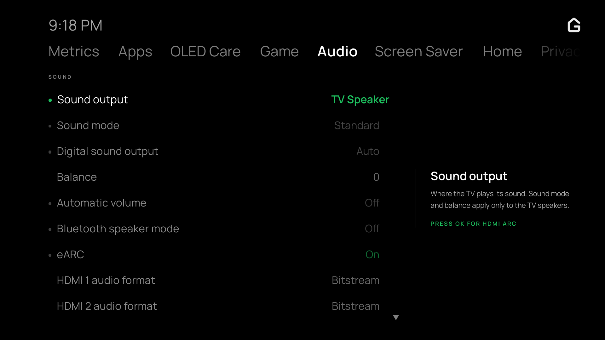

# The TV app

The dashboard can also run directly on the TV's home screen, driven by the remote, for when there is no phone or laptop to hand.

It is drawn on true black for OLED panels in 1080p, with high-contrast text and a layout designed for remote control: Left and Right flip between sections, Up and Down move within rows, Channel Up and Channel Down page through long lists, and OK acts on the selected item.

*The TV app's Metrics view, showing SoC temperature, CPU load, memory, swap, eMMC storage wear, and TV model.*

### Remote navigation

The TV app is operated entirely with the LG remote control:

* **Left / Right**: Switch between dashboard tabs (Metrics, System, Display, Audio, Network, Apps, Settings, OLED Care).
* **Up / Down**, or the Magic Remote's wheel: Move selection row by row, automatically skipping section headings.
* **Channel Up / Channel Down** (or **Page Up / Page Down**): Jump 6 selectable rows at a time to quickly page through long lists, such as the Homebrew Channel catalog, installed apps, or system options.
* **OK / Enter**: Toggle switches, expand options, or confirm app installations and actions.
* **Back**: Return to the previous view from sub-menus (such as app preview details) or exit the app.
* **Magic Remote pointer**: Clicking a row selects it and clicking it again acts on it; clicking a tab opens it.

### Audio capabilities

The **Audio** tab has the same rows as the web dashboard's
[Audio tab](../dashboard/audio.md): LG's sound settings and each input's audio
format, then the TV model, the DTS declaration, the incoming audio and the
negotiated return channel, and the format declarations.

### First-run setup wizard

Opening the TV app on a fresh install starts an on-screen setup wizard to configure the TV in a few quick steps with the remote:

1. **Web dashboard access**: Choose between opening the web dashboard to devices across your home network or keeping it private to this TV only (`127.0.0.1`).
2. **Home Assistant integration**: Connect your TV to Home Assistant via MQTT. The TV displays a QR code to scan with your phone, allowing you to enter MQTT broker details easily without typing credentials on the remote.
3. **Active Standby (Always-on)**: On TVs with Always Ready support (such as LG C2 or G2), choose whether Glasshouse and Home Assistant remain connected with the screen off so the TV can be controlled and turned back on over the network.
4. **Summary**: Review your setup and open the dashboard with a single click.

All choices made during setup can be changed at any time from the TV app's **Settings** tab or the web dashboard.

*The setup wizard welcome screen.*

*Choosing whether the web dashboard is open to devices on the home network or TV-local only.*

*Scanning the phone handoff code to configure Home Assistant without typing on the remote.*

*The final summary screen confirming your settings before opening the dashboard.*

> [!TIP]
> **Testing the setup wizard**: To test or verify the setup flow without modifying TV settings, start the server with the `--emulate-setup` flag, or open the web dashboard in a browser with `?setup=1`.

### Pairing and settings

Its **Settings** tab gives the web dashboard's address, with a QR code to scan on a phone: the TV's DNS name where the home network's DNS has one, with its IPv4 and IPv6 local addresses under it.

Scanning the code automatically pairs the phone with the TV, passing the access token if one is configured, allowing the dashboard to be opened without typing an IP address with the remote.

*The Settings view, presenting the web dashboard's LAN address and phone pairing QR code.*

### Installing apps

The **Apps** tab can install packages directly from the Homebrew Channel catalog: **Install apps** lists catalog entries by title, with updates first. The preview shows the app's background services, root access switches, and free storage space before confirming the install with the remote.

*The Apps view, showing Homebrew Channel catalog browsing and system app hiding.*

### Glasshouse Home

The **Home** section sets up [Glasshouse Home](../dashboard/home.md) from the TV, as the browser dashboard's Home tab does, and is left out on a TV with neither Glasshouse Home nor LG's Home's options. Its rows follow the browser dashboard's [Home customisation](../dashboard/home.md#home-customisation): Open Home at power-on wherever the TV has it, system app hiding, which hides built-in LG apps (such as Always Ready, Alexa, or Camera) from whichever Home screen is in use, and LG's Home's layout while LG's Home is the TV's Home. A TV without Glasshouse Home, such as a B8, has these alone. It has the on/off switch (a second press confirms), a way to open Glasshouse Home while it is on, the order of its rows, then a section for each row in that order: each row's Order (Your order or Last opened), apps and inputs each shown or hidden, and the channels added, each removed with OK, with **Add channels** listing the TV's channels not yet on Home. Then whether wallpapers are uploaded (they are uploaded from the browser dashboard), and **Reset the layout**. Moving tiles within a row is done on Glasshouse Home itself, by holding OK.

### Sleep timer and power

The **System** tab has the sleep timer under **Timers**: each press of OK moves it to the next of 10, 30, 60, 90 and 120 minutes, then off. Its **Power** section, last in the tab, has **Power off** and **Reboot**, the full restart the browser dashboard's Control tab offers. Each takes a second press of OK within five seconds, and warns first while an app is installing. Both are left out when `allowPower` is false in `config.json`, as on the browser dashboard.

### Adding and removing the app

A first install of Glasshouse adds the app to the TV's home screen; updating an existing install leaves the home screen alone.

The app can be added or removed at any time:

* **From the web dashboard**: Go to the **Server** tab and toggle the TV app.
* **From deploy.sh**: Pass `--app` to add it or `--no-app` to omit it during installation.

Removing the app changes nothing else, since the dashboard server continues to run in the background and reaches any browser on the network regardless. Where a TV model will not take the app, the control is hidden and everything else works as before.
