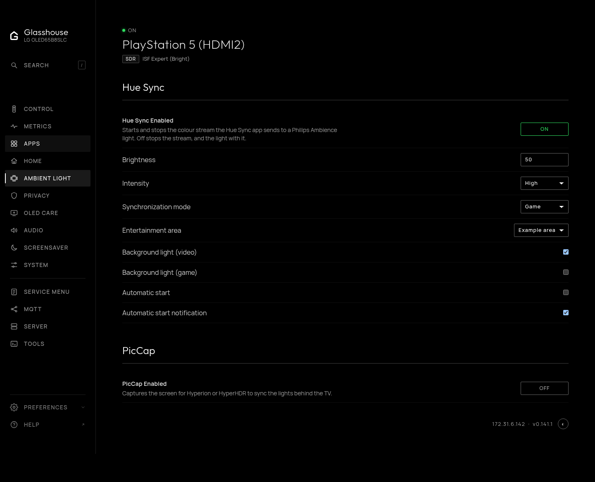
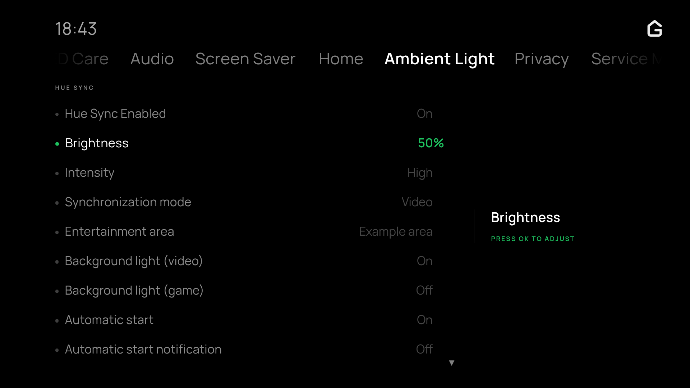

# Ambient Light

The **Ambient Light** page (`/?tab=ambient`) follows **Home** in the sidebar.
The TV app has the same top-level menu. Available integrations have separate
categories, **Hue Sync** first and **PicCap** second. Categories and Control
shortcuts are hidden when an integration is unavailable, as with other optional
Glasshouse controls. If neither is available, the page shows a short message.

* **[Hue Sync Enabled](../huesync.md):** Starts or stops synchronization with Hue
  lights. Brightness, intensity, Video/Game mode, entertainment area, background
  light for each mode, automatic start and its notification are shown directly.
* **[PicCap Enabled](../piccap.md):** Starts or stops the screen capture sent to
  Hyperion or HyperHDR.

The switches are independent, so either or both integrations can run. The
[Control](control.md) page has quick toggles labelled **Hue Sync** and
**PicCap** immediately below Playback, with Hue Sync first.

In the TV app, press OK to toggle a switch or cycle a choice. Brightness uses
OK to begin, arrows to adjust, and OK or Back to finish.

