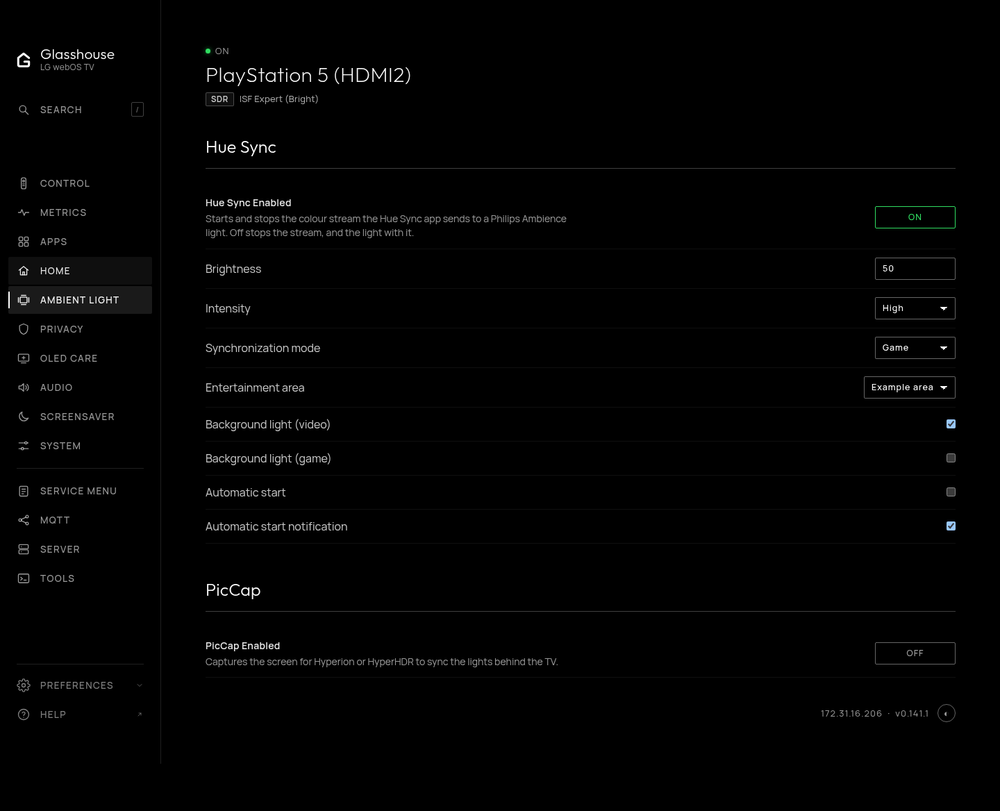
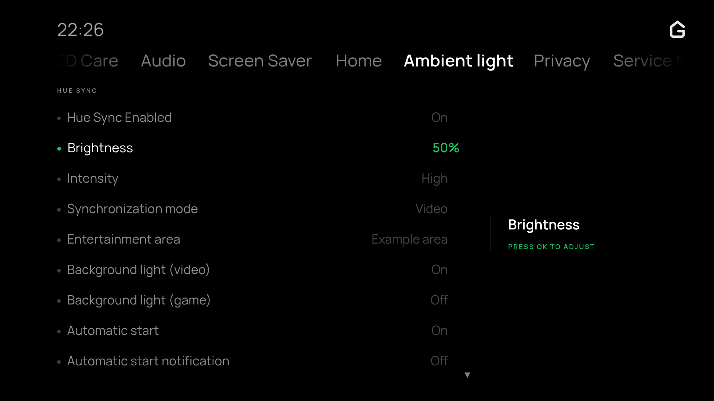

# Ambient Light

The **Ambient Light** tab, `/?tab=ambient`, switches and sets up the lights that follow the TV's picture: [Hue Sync](../huesync.md), for Philips Hue lights, and [PicCap](../piccap.md), which feeds Hyperion or HyperHDR. It shows where at least one of them is installed, with a section for each.

* **Hue Sync:** starts or stops streaming the picture's colours to the chosen entertainment area, and sets its brightness, intensity, Video or Game mode, the background light for each mode, and whether it starts by itself, with or without a notification.
* **PicCap:** starts or stops capturing the screen for Hyperion or HyperHDR.

The two are independent, so either or both can run. The [Control](control.md) tab has a switch for each too, below Playback, and Home Assistant gets one for each as well ([PicCap and Hue Sync](../HOME-ASSISTANT.md#piccap-and-hue-sync)). A remote button can toggle PicCap: set it to **Ambient light** on the [Remote](remote.md#available-actions) tab.

While either one is capturing, the dashboard's [screen glow](index.md#screen-glow) pauses and says so, so the two captures never run at once.

In the TV app, OK switches a setting or steps through its choices. For brightness, OK starts, the arrows adjust, and OK or Back finishes.

