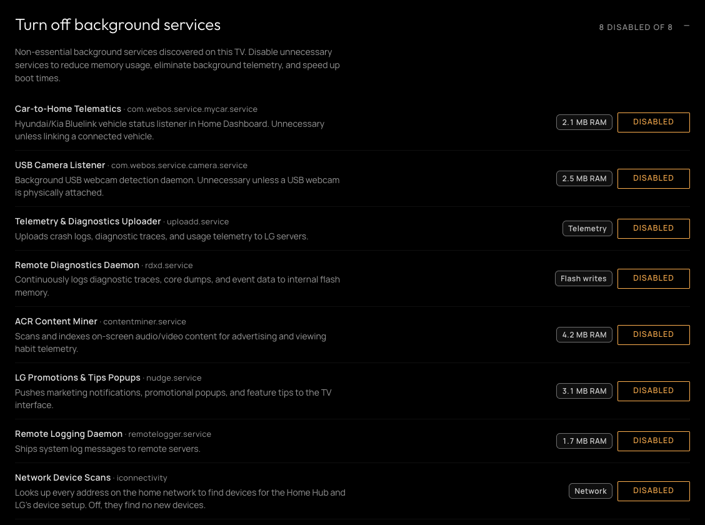

# Apps and home screen launcher

The **Apps** tab, `/?tab=apps`, has three groups: **Apps**, for installing and removing apps and the web pages saved to the Home screen; **Remote**, for what the remote's keys do; and **Background**, for the memory LG's background apps and services take up.

*The three groups, with installed applications, saved web pages, the Home screen layout, apps kept ready in the background and background services open.*

## Apps

### Manage applications

Lists the apps downloaded from the LG store or installed by hand, with their version, vendor, and storage badge showing disk footprint. Launch opens the application on the TV, while Uninstall deletes an app completely and frees its storage. LG's built-in apps can't be removed this way; they can be [hidden](home.md#hide-home-screen-system-apps) instead.

### Install homebrew apps

Lists the Homebrew Channel catalog, with category filters (All, Media, Games, Utilities, Ambilight, Screensavers) and keyword search, and Install, Update or Uninstall for each app, with Launch beside an installed one. The list shows 10 apps at a time, with **Show 10 more** beneath; a search or category looks through the whole catalog. Downloads are checked against the catalog before they are installed, and the dashboard asks first when something needs a decision, such as replacing a copy installed from the LG store.

The outlined **View source** control beside Install, Update or Uninstall opens an app's declared source repository in a new browser tab when its catalog provides a valid absolute HTTPS address. It stays available while installation is disabled, in progress or complete. Apps without a valid source address have no source control.

GitHub release-download and archive addresses open the repository's main page. Other source addresses keep their path, including links to specific source files or directories. A direct `.ipk` download has no source link when its repository cannot be identified this way.

After a [settings backup](server.md#glasshouse) is restored, the apps it listed that this TV lacks and the catalog has are shown above the catalog. **Install all** installs them one after another, each as if picked from the catalog, so it stops for any decision; **Dismiss** forgets the list.

### Other app catalogs

Catalogs other than the Homebrew Channel's, such as the one a developer keeps for a fork of an app. Pasting a catalog's address and choosing **Add catalog** lists its apps here, each with Install, Update or Uninstall (and Launch, once installed) and the catalog it is from, and they are checked for updates with the rest. A GitHub repository's page can be pasted in place of the address, and the dashboard reads the `repo.json` it keeps, as many such catalogs do. Each catalog shows how many apps it offers, or why it could not be read, and **Remove** takes it off the list; apps installed from it stay on the TV. Their apps show 10 at a time, as the Homebrew Channel's do, with a search box once there are more than 10.

These apps are listed apart from the Homebrew Channel's, so an app both list, such as YouTube AdFree and a fork of it, shows in each, and Install or Update installs the one in that list. Where the TV has an LG store app under the same id, as YouTube is for YouTube AdFree and its forks, the catalog's app shows as not installed, and installing it asks before replacing the store's. An app from an added catalog is never given root without asking, as for an install from a URL.

Apps here also show **View source** when their catalog declares a valid HTTPS source address, regardless of where the repository is hosted.

Adding or removing a catalog needs **Install app from a URL or file** turned on, or a token, since whoever runs a catalog chooses what it offers to install. Catalogs listed in `config.json` show here too.

### Install app from a URL or file

Installs an `.ipk` package from outside the catalog. **From URL...** downloads one from an http or https address, with an optional sha256 to check it against, and **Upload .ipk** sends one from the browser. Both show the same preview as a catalog install.

It is off until it is switched on in this section (after a warning) or a token is set, since a package from outside the catalog can run anything on the TV. A request from the TV itself is always allowed.

### Saved web pages

Lists the web pages on the Home screen, each of which opens in the TV's browser. They are on Glasshouse Home's Apps row too. A page saved from the browser takes its whole title as its name, so a long one can be given a shorter name here. Pages can also be added, pointed at a new address, or removed.

## Remote

### Quick Access

Sets what each number key on the remote opens when it is held: an installed app, an HDMI input or Live TV, for keys 1 to 9. The keys are tiles laid out as the remote's number pad, each showing what it opens; choosing one opens the choices under its row, as for Remote keys. Holding 0 shows the list on the TV. A change applies straight away, the same as changing it in the TV's own Quick Access list, which shows it too.

**None** leaves a key opening nothing, including one LG set itself, such as its help on 9. A streaming button set to None is still reported to Home Assistant as a [remote button event](../HOME-ASSISTANT-REMOTE-BUTTONS.md). A key LG set for an app that is not installed, as it does for some regions' channel apps, shows as **App not installed**, with the app's id beneath. A key set to a live TV channel on the TV shows the channel, and can be changed here but not set to another channel. The TV app lists the keys without changing them.

### Remote keys

Configures what individual remote buttons do when pressed. Each key appears as a tile showing its active assignment, grouped under **Streaming buttons**, **Color keys**, and **Other keys**. Selecting a tile opens its available choices beneath the row.

Core keys (**Home**, **Back**, volume, mute, channel, and power) are reserved and cannot be reassigned. The microphone button can be reassigned; setting it to another action overrides both press and hold, replacing LG's voice control until returned to **As LG has it**.

#### Available actions

* **As LG has it:** Keeps the TV's default behavior for that key.
* **Open an app, an HDMI input, or Live TV:** Launches the selected target directly.
* **Input bar:** Opens Glasshouse's [input bar](#input-bar) overlay instead of LG's inputs list.
* **Input switcher:** Opens LG's quick input picker on TVs that support it (such as a C5 on webOS 11).
* **Screen off:** Blanks the display while audio continues playing; pressing any key turns the screen back on.
* **Power off:** Puts the TV into standby on key release. When using TVs side by side, assigning this to a Magic Remote's RF button allows putting one TV into standby without an IR signal affecting the other. (The dedicated Power button is unchanged, and power actions are not offered in Quick Access).
* **Media controls:** Sends **Play**, **Pause**, **Stop**, **Rewind**, **Fast forward**, **Volume up**, **Volume down**, or **Mute** to on-screen media. Volume commands repeat while held and control connected HDMI ARC soundbars.
* **Home & Guide:** Opens Glasshouse Home (or LG's Home if disabled), or opens Glasshouse Home's [IPTV guide](home.md#internet-tv).
* **Home Assistant:** Silences TV handling while keeping the key labelled for Home Assistant automations. When MQTT is enabled, Home Assistant receives [Remote Button](../HOME-ASSISTANT-REMOTE-BUTTONS.md) events for streaming buttons, color keys, Google Assistant, and the microphone regardless of what they are set to on the TV.
* **Nothing:** Disables the key completely on the TV.

#### Remote models and regional buttons

The available keys reflect what the TV's software supports, not necessarily what is present on a specific physical remote. A Magic Remote lacks color, Guide, and Info keys, while a standard IR remote lacks dedicated streaming buttons, but the TV can receive both.

The list names buttons supported by the TV's model generation (e.g. a C5 lists its Disney+ button while a CX does not; 2020 remotes add a Movies button, and recent Magic Remotes add Alexa and Google Assistant buttons).

LG uses identical key definitions across countries. Once the TV reports its country, keys only sold on remotes elsewhere (such as Hulu and Sling TV in the US, BBC iPlayer and Freeview Play in the UK, Globoplay in Brazil, or Shahid in the United Arab Emirates) are grouped under **Buttons on remotes sold elsewhere**. Assigning a key not present on the physical remote does nothing and causes no harm.

#### Interception and persistence

Changes take effect immediately across all screens and persist across reboots, working before the Glasshouse server starts. Setting every key back to **As LG has it** (or running `tvwebctl restore-keys` on the TV) removes Glasshouse's filter from the TV's key handling.

Glasshouse intercepts keys in the compositor filter chain before apps see them. An assigned key overrides an app's internal use of that key (such as **Guide** in YouTube, or color keys in Live TV teletext). See [Remote keys through the compositor's filter chain](../IMPLEMENTATION.md#remote-keys-through-the-compositors-filter-chain).

> [!WARNING]
> **Conflict with LG Input Hook:** If [LG Input Hook](https://repo.webosbrew.org/apps/org.webosbrew.inputhook/) is installed from the Homebrew Channel, it captures streaming buttons before the TV's key handling sees them, preventing Glasshouse from reassigning them. Uninstall LG Input Hook and restart the TV for Glasshouse remote keys to work.

#### webOS 11 behaviour

On webOS 11 (LG's webOS 26), LG manages button assignments natively:

* **Supported keys:** Streaming buttons, Apps, Guide, Home Hub (on MR25 remotes), **AI**, **Alexa**, and the **?** button (configurable separately for press and hold). Color keys, Input, Search, Info, Home, and **123** cannot be reassigned.
* **Action limits:** LG only permits opening apps on webOS 11. Media controls, **Power off**, **Home Assistant**, and **Glasshouse Home's guide** are unavailable. A streaming button set to **Nothing** displays LG's "This function is not supported" notice, and the **?** button cannot be set to **Nothing**.
* **Screen off:** Available on Netflix, Prime Video, and Home Hub buttons. A streaming button displays LG's "This function is not supported" notice, and Glasshouse turns the screen off ~0.5 s after press. LG restores its streaming button assignments when the screen goes off, and Glasshouse reapplies them moments later.
* **AI button:** Reassigning the AI button disables LG's voice assistant entirely (voice search, the AI assistant, and the microphone stop working until restored to **As LG has it**). Glasshouse opens the chosen target ~1 s after press.
* **Alexa button:** Reassigning the Alexa button prevents Alexa from launching and suppresses all on-screen notices for 4 seconds to hide Amazon's "Alexa is loading" prompt. See [webOS 11: LG's own values](../IMPLEMENTATION.md#webos-11-lgs-own-values).

### Input bar

A strip of the HDMI inputs over the picture, in place of LG's list of inputs, opened by a key set to **Input bar** under [Remote keys](#remote-keys), usually **Input**. Each input shows its device's name, its port and an icon for the kind of device it is, from the name: a console, a handheld, a streaming box, a sound bar, a disc player, a computer or a cable box, or an HDMI plug for any other. The one on screen is marked with a dot.

* The first press opens it on the input on screen. Each further press moves to the next input, round to the first, and the TV switches to it a second after the last press, as LG's does.
* **Left** and **Right** move too, **OK** switches at once and **Back** closes it. With the Magic Remote's pointer, hovering an input picks it and clicking switches, without the second's wait.
* Left alone, it closes after 3 seconds on the input already on screen, or after 6 on another one the pointer left it on.
* A device behind a receiver is switched to as Glasshouse Home's tile does, waking it through the receiver.

It shows the inputs [Glasshouse Home](home.md)'s Inputs row shows, in its order, without the hidden ones, and without those with nothing connected where that row leaves them out. Once a key opens it, those are listed under Remote keys as well, each with **Shown** or **Hidden**, beside **Hide inputs with nothing connected**, so they can be chosen with Glasshouse Home switched off. A change made either place is made in both.

Choosing it for a key installs its app, a web app with no tile on the Home screen, `com.tvweb.inputbar`; setting the last key that used it to anything else removes it, as does uninstalling Glasshouse. While a key opens it and the TV is on, Glasshouse keeps the app loaded in the background, hidden and taking no keys, so a press shows it in about 0.4 s on a C1 rather than 0.7 s or more.

It is offered on webOS 4, 6 and 9, where it has been tried (a B8 with 4.4.3, a C1 with 6.5.3 and a C2 with 9.2.2), and on webOS 5, 7, 8 and 10 once switched on under **Server** → **Advanced** → **Experimental features**: see [Experimental features](../experimental.md#input-bar). webOS 11's remote keys are LG's own, and cannot hand the bar the further presses, so it is not offered there.

## Background

### Apps kept ready in the background

LG keeps some apps loaded so they open faster, including ones that are never used, and each takes up memory. Each app is a tile with roughly how much memory it takes once loaded, and whether it is loaded now; choosing one switches it off, or keeps it ready again. A switched-off app's tile is dimmed and marked in orange, the colour the Apps tab uses for a change from LG's own setting.

Switching an app off frees its memory once the app is next closed or the TV restarts, and it then takes a few seconds longer to open. Switching it back on returns it to LG's setting. Home, Live TV, the HDMI inputs and the other parts the TV relies on are not listed, and the section only appears on TVs that keep such a list. On webOS 11.2 the TV keeps none in its settings; the list comes from the preload manager itself, which is told about switched-off apps at each start and switch-on.

### Turn off background services

Stops background services that most TVs don't need, such as the connected-car listener, the USB camera watcher, and LG's diagnostics and telemetry uploaders. Only the services present on the TV are listed. A service switched off stays off across restarts, and is stopped again if something on the TV starts it.

The TV looking up every address on the home network, which a network-wide ad blocker such as Pi-hole shows as hundreds of requests, is switched off in [Devices and connectivity](advanced.md#devices-and-connectivity), as **Network device scans**.

## Network

### DNS app configuration

An app LG runs in a sandbox of its own, such as YouTube, can look names up with DNS servers of its own: 1.1.1.1, say, or a Pi-hole on the home network, while everything else on the TV keeps using the TV's. **Change** takes up to three IPv4 or IPv6 addresses, separated by commas or spaces, and **Use the TV's DNS** puts the app back; an app without its own shows **Using TV's DNS**.

**Change** also takes a single `https://` address for DNS over HTTPS, such as `https://dns.nextdns.io/` followed by a NextDNS profile ID, which also tells NextDNS which profile to use without linking the TV's IP address. Glasshouse then answers the app's lookups on the TV itself and sends each on over HTTPS. The app finds nothing while Glasshouse isn't running, as in the first minute after the TV starts, and when the address doesn't answer, its row says why. TVs on webOS 4 may not manage the HTTPS that most of these servers require.

A change takes effect the next time the app starts, including when LG starts it again in the background. An app is listed once it has been opened, since that is when its sandbox is made. Web apps all run in one shared process, so they can't have servers of their own, and the section only appears on TVs with app sandboxes. An app that picks its own DNS server, or uses DNS over HTTPS by itself, is not affected; YouTube uses the servers set here. DNS can't block YouTube's video ads, which come from the same servers as the videos.

## Notes

* Live TV, Settings, Home, the HDMI inputs, the Homebrew Channel and Glasshouse itself are protected: they can't be hidden or uninstalled.
* Everything on this tab also works from the TV app, except saved web pages and installing from a URL or a file, which are in the browser dashboard only.
* Apps that check they were installed from the LG store may refuse to run when installed another way, and apps built for a newer webOS than the TV runs may not launch.
