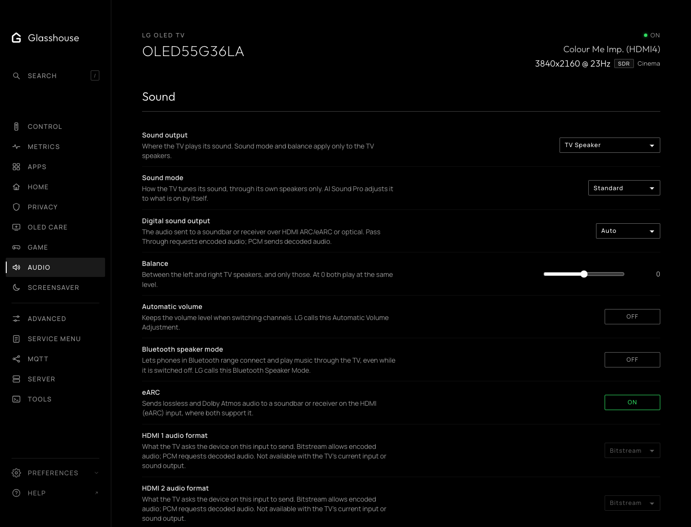
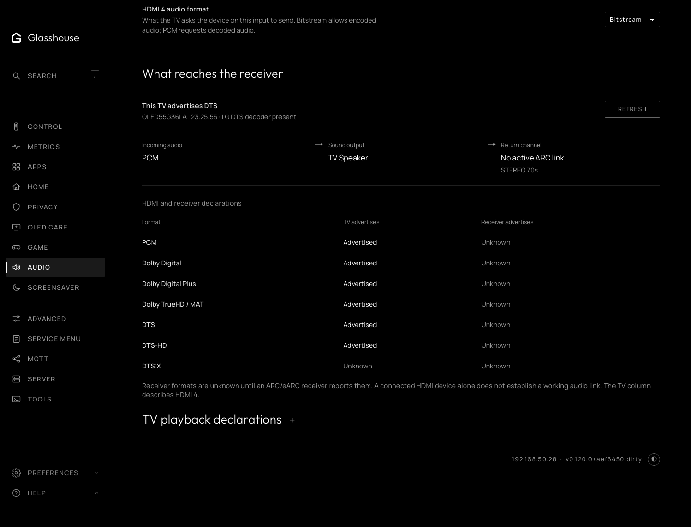

# Audio

The Audio tab gathers the TV's sound settings and what the TV and its receiver
report about audio formats. The TV app has the same tab, with the same rows in
the same order.

## Sound

LG's own sound settings: sound output, sound mode, digital sound output,
balance, automatic volume levelling, eARC and Bluetooth speaker mode, then each
HDMI input's audio format. Sound mode and balance apply to the TV speakers
only. Pass Through and Bitstream request encoded audio; PCM requests decoded
audio. As in LG's menu, only the input on screen can have its audio format
changed.

## Soundbar and receiver

Whether a soundbar or receiver is connected over HDMI ARC or eARC, and which
audio formats the TV and the receiver say they support: useful when Dolby Atmos
or DTS doesn't come through. On the web tab it is folded under Sound; the TV
app lists it below Sound.

The audio coming in, where the TV sends it, and the return channel it has
negotiated with the receiver (ARC, eARC or none). The negotiated link is
separate from the eARC setting.

Below it, each format as the TV advertises it to the current HDMI source, and
as the ARC or eARC receiver advertises it. Unknown stays unknown when the TV
does not report a value. A DTS-HD entry does not establish DTS:X. A listed
format is not proof of working pass-through; the receiver's incoming-signal
display confirms what arrives.

On a C9 with a HAWK2 HDMI switch, the input declaration comes from LG's
native switch readback. The lower HDMI driver buffer and the `TrueHD` family
name do not describe that switch's current source-facing EDID. A failed native
read remains unknown.

A C9 owner with a player that decodes DTS-HD to PCM, such as a Panasonic UB820, may get only stereo PCM where the receiver can take 5.1. elforeign's separate [C9 HAWK2 audio helper](https://github.com/elforeign/c9-hawk2-audio-helper) changes what HDMI 1 tells the player so it sends 5.1. It is experimental, firmware-specific and not part of Glasshouse: read its README, and back up the TV's calibration first.

**HDMI channel information**, where available on HAWK2, shows the source's
Audio InfoFrame channel count and an explicitly reported sample rate. An
unspecified rate stays blank. Metadata can remain during a pause; it does not
identify the codec, establish active playback or confirm the receiver's audio.

**TV playback declarations** lists the formats and channel limits in LG's
media configuration for apps on the TV. They describe playback, not what
reaches a receiver.

A failed reading removes the web tab's controls until a successful refresh.
