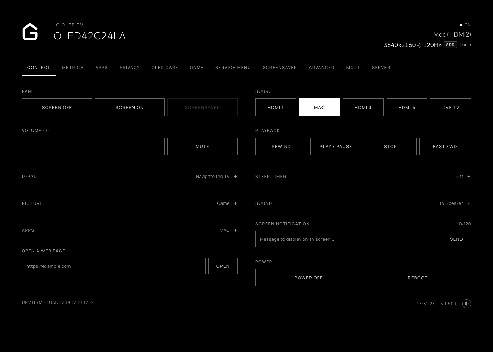

# Control

The **Control** tab, `/?tab=control`, turns the TV into a locally controlled device over the home network, operating directly with webOS without relying on LG's cloud services or mobile applications.

## Navigation and playback

* **D-pad navigation:** Directional arrows (Up, Down, Left, Right), OK/Select, Back, Home and Settings (LG's quick settings) to navigate webOS menus and built-in interfaces.
* **Keyboard box:** types into the text field selected on the TV, such as a search box or a web address, as you type, backspace included, up to 500 characters at a time. **Enter** submits it, as the Enter on LG's on-screen keyboard does, and empties the box. On webOS 6 and later the note under it says whether LG's on-screen keyboard is up; some apps, such as YouTube, draw a keyboard of their own instead.
* **Keyboard:** while the Control tab is open, a computer's keyboard works as the remote: the arrow keys, Enter for OK, Esc or Backspace for Back, H for Home, M for Settings, Space for play or pause and K for mute. Keys typed into a field, or pressed with Ctrl, Alt or Cmd, are left to the page.
* **Media playback:** Dedicated transport controls (Play, Pause, Stop, Rewind, Fast Forward) for active media players.
* **Volume and mute:** Volume slider, precision step buttons (`+` and `-`), and a one-click mute toggle.
* **Source selection:** One-click switching across active TV inputs, including HDMI ports and Live TV, with an active indicator marking the current display source.

## Picture and sound

* **Picture mode presets:** Instant switching between calibrated picture modes (such as Cinema, Filmmaker, ISF Expert, Game Optimizer). The presets offered adapt dynamically to what is currently playing, displaying Dolby Vision presets for Dolby Vision content and HDR presets for HDR signals.
* **OLED light and backlight:** Live slider adjusting the panel luminance level for the active picture mode.
* **Energy saving:** Quick toggles for Auto, Off, Minimum, Medium, Maximum, and Screen off energy-saving states.
* **Sound output routing:** Switch audio output between TV Speaker, HDMI ARC, Optical, Headphone, and Bluetooth.
* **Bluetooth device:** under the outputs, a list of the headphones and speakers already paired with the TV, each with whether it is connected. Choose one, then **Connect** or **Disconnect** it; choosing does not connect. **Refresh** reads the list again. It is read when Sound is opened, never polled, and is the same list as on the [Audio tab](audio.md#bluetooth-audio). It follows the Controls setting, and is not shown on a TV without the service.

## Panel, timers and power

* **Screen blanking:** **Screen off** turns off the OLED or LCD panel immediately while audio and background services continue running. **Screen on** or any remote interaction restores the picture.
* **Screensaver:** Triggers the configured screensaver directly on the TV.
* **Sleep timer:** Sets a timed shutoff (Off, 10, 30, 60, 90, or 120 minutes).
* **Power and reboot:** Switches the TV between standby and on, or performs a full operating system reboot.

## Apps and remote tools

* **App launcher:** Launch installed webOS applications directly from the dashboard grid.
* **Remote tools & utilities:** Collapsible section grouping quick on-screen actions:
  * **Screen notifications:** Send instant on-screen toast notifications (up to 120 characters) to display messages on the TV.
  * **Open a web page:** Enter any HTTP or HTTPS URL to launch it immediately in the TV's native web browser.

*The Control tab: local remote navigation, playback, inputs, picture presets and power.*
