# Home

> [!NOTE]
> **Experimental (webOS 4, 5, 6, 7, 9, 10 & 11):** Glasshouse Home replaces LG's built-in launcher when pressing **Home** or **Back** on the remote, or when the TV turns on. It is available on webOS 4, 5, 6, 7, 9, 10 and 11, and on webOS 3, webOS 8 and webOS 12 and later when `"allowExperimentalHome": true` is set in `config.json`, and works on whichever port the dashboard is on. On webOS 4 (tried on a B8), LG's launcher is an in-compositor ribbon; Glasshouse Home runs as a standalone app (`com.tvweb.home`) launched by the remote key filter, and pressing Back dismisses it. It runs the same way on webOS 3, which has not been tried yet: there, LG's ribbon may show for a moment before Glasshouse Home opens over it, and holding **Home** leaves LG's ribbon open. On webOS 5 and 6 (tried on a CX, two C1s and a B1), switching it on or off, or holding Home for LG's Home, restarts the TV's app manager, which closes the apps that are open; the Home tab says so on those TVs.

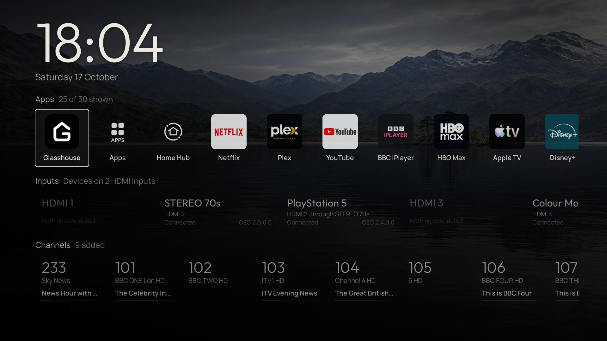

## What is on screen

Glasshouse Home displays a clock and date (following the TV's 12-hour or 24-hour time setting), the last active source or app, and up to five rows (any row with no visible items is automatically hidden). When there are more rows than fit, they scroll to keep the one in focus in view:

<div class="grid cards" markdown>

-   **Apps**

    ---

    Installed applications with native icons, saved web pages, and quick tiles for **Notifications**, **Search**, and **LG Home**. Promotional clutter starts hidden, and apps can be reordered, hidden, or grouped into a **More apps** folder.

-   **Magic Remote & navigation**

    ---

    Hover to focus, click to open, and rest near row edges to glide smoothly across off-screen tiles. The scroll wheel and arrow keys navigate seamlessly, preserving focused tiles and scroll positions when returning from an app.

-   **Inputs & HDMI-CEC devices**

    ---

    Shows the TV's internal tuner and HDMI ports with device-specific icons, plus dedicated tiles for HDMI-CEC devices connected through AV receivers. Disconnected ports appear dimmed or can be hidden automatically. See [Inputs and connected devices](#inputs-and-connected-devices).

-   **Channels**

    ---

    Favourite live broadcast TV channels added from the dashboard or TV app, showing current programme details from the TV guide when available.

-   **Internet TV**

    ---

    The starred channels of your Internet TV lineup, chosen on the dashboard or from the row itself, with logos and what is on now and next. See [Internet TV](#internet-tv).

-   **Recommended**

    ---

    Shows continuing titles and recommendations from installed streaming apps (such as Netflix, Prime Video, Disney+, and YouTube) as a row of cards below Apps. Off by default. See [Recommended row](#recommended-row).

-   **Recent apps (`Back` button)**

    ---

    Pressing **Back** on Glasshouse Home opens a strip of recently used apps with live snapshots. Press **OK** to switch to an app, **Down** to close a single app, or **Up** for **Close all**.

-   **Picture details plate**

    ---

    When **Picture details** is switched on, a top-right badge shows the active picture preset, OLED light / backlight level, and signal format — live HDMI resolution, refresh rate, chroma, bit depth, HDR format, and VRR, or the last video format played in an app.

-   **Live preview**

    ---

    Hovering an input, TV channel, or Internet TV tile displays a live video preview beside the clock or directly within the tile, along with current signal and programme details. Silent unless **Preview sound** is on. Off by default. See [Live preview](#live-preview).

-   **Weather badge**

    ---

    Displays current temperature, condition icon, and location level with the clock, sourced from Home Assistant or Open-Meteo. See [Weather badge](#weather-badge).

-   **Badges & labels**

    ---

    Customizable status badges across rows: **Last watched** (top banner and active input highlight), **App count** (e.g. "4 of 18 shown"), **CEC addresses** on input tiles, and **Channel logos** for Internet TV. See [Badges and labels](#badges-and-labels).

-   **Rows along the bottom**

    ---

    Positions rows along the bottom of the screen (similar to LG's built-in launcher) instead of centered, scrolling subsequent rows into view as you navigate down. Off by default. See [Layout options](#layout-options).

-   **Alternative View**

    ---

    A compact layout featuring rounded translucent tiles, a smaller clock on the right, and status indicators aligned horizontally. Can be combined with **Rows along the bottom** for a minimalist home screen. See [Layout options](#layout-options).

-   **Animations**

    ---

    Independent switches for motion and transitions: smooth row scrolling, wallpaper drift, cross-fades between times of day, sliding panels, and smooth fade transitions when opening apps or inputs. See [Animations](#animations).

-   **Colours & themes**

    ---

    Seven built-in colour presets (starting with **Pure white**), plus custom **Text** and **Accent** colour pickers. The accent colour highlights focused tiles and active sources.

</div>

## Inputs and connected devices

The **Inputs** row displays the TV's tuner and video sources:

* **Live TV tuner:** A **TV** tile comes first on TVs with channels tuned, showing the last active channel; selecting it opens Live TV. It can be hidden like any other input.
* **HDMI ports and CEC devices:** Each HDMI port is listed, alongside separate tiles for connected HDMI-CEC devices discovered through an AV receiver or soundbar (for example, *"HDMI 2, through STEREO 70s"*).
* **Device icons:** Each input or CEC tile automatically selects an icon matching the device's name:
    * A controller for an Xbox or PlayStation, or a handheld for a Nintendo Switch.
    * A streaming box for an Apple TV, Roku, Chromecast, or Fire TV.
    * A soundbar, disc player, computer, or cable-box icon for those devices.
    * An HDMI plug for generic sources.
* **CEC wake and receiver switching:** Selecting a CEC tile wakes the device and switches intermediary AV receivers to that source. Inactive ports appear dimmed.
* **Hiding inputs:** Inputs can be hidden individually from the dashboard or in arrange mode.
* **Hide inputs with nothing connected:** This switch in the Inputs row's settings on the dashboard and TV app completely omits ports with nothing plugged in instead of dimming them, marked **Left out**. They show dimmed while arranging, and return as soon as a cable or device is plugged in. An input is left out if it is hidden or, with that switch on, has nothing connected.

## Recommended row

The **Recommended** row surfaces content cards provided by installed streaming apps:

* **Content cards:** Displays titles that apps put on LG's Home, such as Netflix's *Continue watching*, Prime Video picks, Disney+, HBO Max, and YouTube, with each app's artwork, title, and category. Pressing **OK** opens the app directly at that title.
* **App-specific filtering:** When an app is focused in the Apps row (via remote keys or pointer), the Recommended row filters to show only cards from that service (*From Netflix*), accessible by pressing **Down**. When focusing a tile with no recommendations (such as an input or LG Home), cards from all apps are shown in the Apps row's order. Hidden apps show no recommendations.
* **Row positioning:** The row appears under Apps by default and can be reordered like other rows, though individual cards within it are ordered by the respective streaming apps.
* **Privacy:** Artwork is loaded directly from each app's own servers, as on LG's Home; no extra telemetry is sent.
* **Availability:** Switched off by default in the Recommended row settings on the dashboard or TV app. Supported on webOS 10 and webOS 4.10; on TVs where the system reports no app recommendations (such as a C2 on webOS 9.2), the row remains hidden and the switch indicates none are available.

## Search

> [!WARNING]
> **Sends queries to LG's search service:** Enabling **Search** sends typed search queries to LG's cloud search service (`com.webos.service.nlpmanager` / `*.nextlgsdp.com` — the same backend used by LG's built-in Search app) and nowhere else. It is **off by default** so nothing leaves the TV unless explicitly switched on.

When switched on under **Home** on the web dashboard or in the TV app's Home section, **Search** adds a mark in the left margin beside the rows: **Left** from the first tile of any row reaches it, and **Right** goes back. **OK** opens a search panel over the left of Glasshouse Home for films and series, typed on the TV's keyboard. While the keyboard is up the titles are single lines, with the icons of the apps that have them; once it closes each shows its poster, year, running time and apps. Editing the query clears the previous titles immediately. Up and down move between titles, left and right between apps, and OK opens the app at that title. A series opens at its start where the app allows: Prime Video and HBO Max at its first season, Disney+ and BBC iPlayer playing its first episode, Netflix at the series; Apple TV opens its latest episode. Titles only on apps the TV does not have are counted, not listed, and trailers, teasers and sneak peeks are never shown or opened. Back closes the keyboard, then the panel. Coming back from an app opened there within 30 minutes, without the TV having been switched off, finds the panel as it was left. Switched off, the mark goes and nothing typed leaves the TV.

LG's search needs the TV online and LG's search server (`gb.nextlgsdp.com` on a TV in the UK) reachable. Where the ad blocker blocks that server, on **Everything** or through an uploaded hosts list, the mark is hidden on Glasshouse Home and the **Search** switch is greyed on both dashboards, with a note saying what blocks it. The switch keeps its setting, and search comes back when the blocker is set to **Ads & telemetry** or off.

## Internet TV

Internet TV places channels from your IPTV provider into a dedicated row on Glasshouse Home, positioned below Channels. Glasshouse does not bundle playlists or channels; you provide your own **M3U playlist link** or **Xtream Codes login** in the **Internet TV** section of the **Home** tab, along with an optional XMLTV guide link (Xtream logins include their own guide automatically).

* **Background sync:** The playlist is parsed locally on the TV upon entry and refreshed automatically every night; the TV guide (XMLTV) is updated every six hours.
* **Account status:** Each configured playlist displays its live channel count, last sync timestamp, subscription expiry date, and maximum simultaneous streams allowed.
* **Playlist actions:**
    * **Refresh:** Re-reads the playlist and guide immediately.
    * **Edit:** Updates credentials or URLs (leaving the password blank preserves the existing password).
    * **Remove:** Deletes the playlist, cached guide, and associated channels from the TV.
* **Failure handling:** If a playlist is temporarily unreachable, the previous channel list is retained. If login authentication is refused, automatic retries pause until edited or refreshed manually, preventing account lockouts from repeated failed attempts.

### Choosing channels

IPTV subscriptions often contain tens of thousands of streams. Glasshouse organizes them into two tiers:

* **The Lineup (up to 2,000 channels):** The active channel collection stored on the TV, numbered like a traditional broadcaster guide.
* **Home's row (up to 60 starred channels):** The favourite channels chosen with a star to appear directly on the Glasshouse Home screen.

Clicking **Manage channels** in the Internet TV section of the dashboard opens a dedicated three-column channel manager:

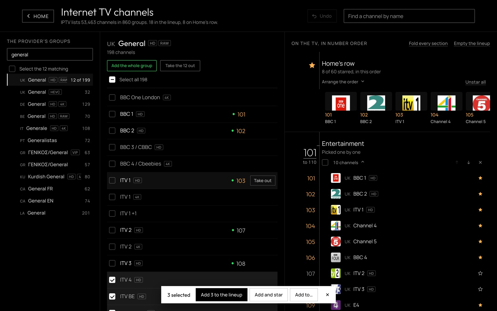

#### Channel name cleanup

Names from providers are automatically normalized for readability on the TV:

* Country and tier prefixes (such as `"VIP: "` or `"UK| "`) are displayed as small prefix labels.
* Resolution and codec tags (such as `ᴴᴰ`, `ᴿᴬᵂ`, or `HEVC`) appear as small quality badges.
* ALL-CAPS names are converted to Title Case.
* Original provider names remain intact when hovering over a channel.

#### The three-column channel manager

* **On the left (Groups):**
    * Lists the provider's channel categories grouped by country or tier, showing total channel count and how many are currently in your lineup.
    * **Filter groups:** Quickly filters the list by category name.
    * **Hidden groups:** Unwanted categories (foreign languages, movies, adult) can be moved to the end and excluded from searches.
* **In the middle (Group channels & search):**
    * Displays channels for the currently selected group, or search results from **Find a channel by name** across the whole playlist (**Only in** restricts search to the active group).
    * Channels already in your lineup display their assigned channel number.
    * **Add** / **Take out:** Instantly adds or removes individual channels.
    * **Add the whole group:** Creates a dynamic lineup section that follows the provider: newly added provider channels join automatically, and dropped channels are removed. Drag channels to reorder them (new channels append to the end).
    * **Take out group:** Removes all channels belonging to the group from the lineup at once.
* **On the right (Lineup & Home row):**
    * **Home's row:** Starred channels displayed at the top in row order. Click a channel to locate it in the lineup, use **Arrange the order** to reorder via drag-and-drop or arrow buttons, or click **Unstar all** to clear the row.
    * **Lineup sections:** Numbered channel blocks. A section starts immediately after the preceding section or at a custom number (e.g. `101`, `401`, like satellite/cable guides).
    * **Customization:** Click a section name to rename it, use arrow buttons to move sections up or down, or click the cross icon to remove a section.
    * **Starring & renaming:** Star a channel to toggle it on Home's row; click the pencil icon (or double-click the name) to rename a channel (clearing the name restores the provider's title).
    * **Empty the lineup:** Clears all channels and sections from the TV.

#### Batch editing and keyboard shortcuts

Multiple channels and groups can be selected across searches and filters:

* **Selecting items:** Click a channel or group checkbox, Shift-click to select a range, or click the master checkbox at the top of a column to select all items.
* **Bottom action bar:**
    * **Groups:** Add selected groups, remove all their channels from the lineup, or hide/show them.
    * **Channels:** Add selected channels to the lineup, add and star them, or choose **Add to…** to create a new section or assign them to an existing section.
    * **Lineup:** Star/unstar selected channels, **Move to…** another section, or remove them (pressing Delete also removes selected channels).
* **Undo:** The **Undo** button at the top reverts up to 20 recent changes (history resets when the TV restarts).
* **Keyboard navigation:** Press Escape to clear the current selection, or press it again to exit the channel manager.

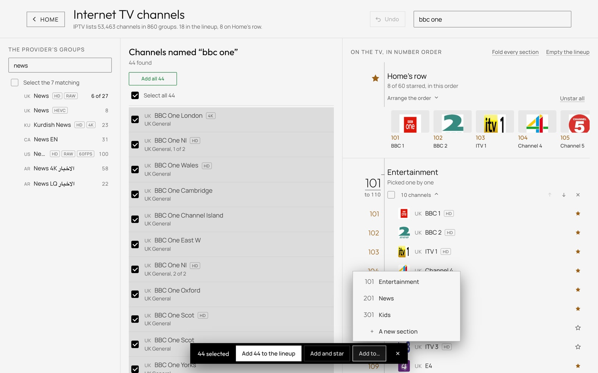

#### Mobile, TV app, and TV screen management

* **On mobile phones:** The three columns are presented as swipeable tabs: **Groups**, **Channels**, and **Lineup**.

    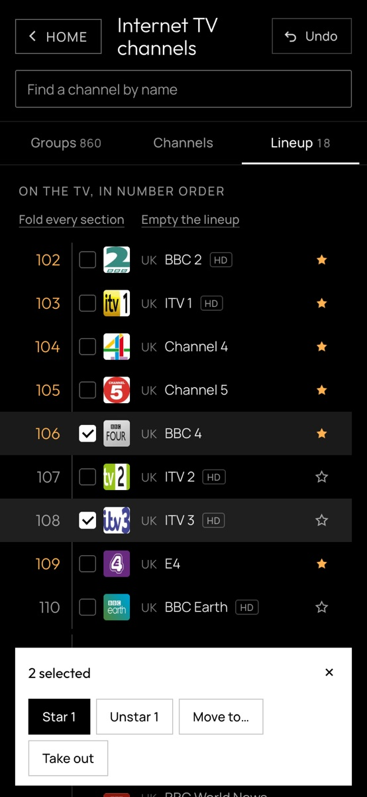

* **In the TV app:** The **Internet TV** section provides remote-friendly lineup editing: view and reorder Home's row, browse provider groups, star/unstar channels with **OK**, and use **Numbers start at** to advance section numbering by hundreds. (Renaming channels requires the web dashboard).

    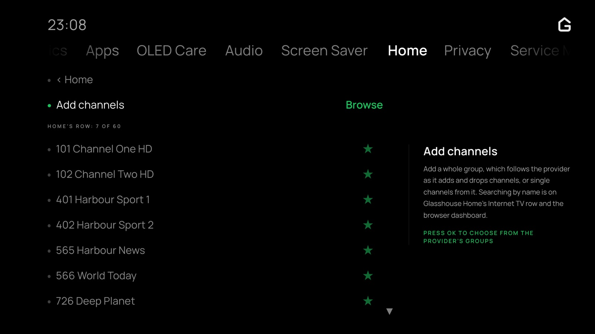

* **Directly on the TV screen (Add channels tile):**
    * While arranging rows (hold **OK**), or when the lineup is empty, an **Add channels** tile appears on the row.
    * Selecting it opens a search panel to browse playlists, groups, and channels directly from the couch.
    * **DRM and unsupported streams:** Channels requiring custom player headers or DRM encryption are marked and cannot be added. If an unflagged DRM stream fails to play (such as RTÉ streams in public playlists), Glasshouse identifies the restriction, displays an explanatory notice, and marks the channel as protected from then on.

### Full-screen player and controls

When opening a channel from the Internet TV row or live preview, playback opens full screen:

* **Remote navigation:**
    * **OK:** Opens the channel list one section at a time. Use **Left** / **Right** to switch sections, **OK** to tune a channel, and **Back** to close the list.
    * **Up / Down / CH+ / CH−:** Steps through channels across the entire lineup.
    * **Number keys:** Directly jumps to a channel by its lineup number.
    * **Info:** Displays the programme banner showing what is on now and next (also appears automatically for 5 seconds on each channel change).
    * **Yellow button:** Switches between **HLS** and **MPEG-TS** stream formats for provider accounts. The TV remembers the selected stream format for each channel.
    * **Back or Home:** Returns to Glasshouse Home. If [Live preview](#live-preview) is enabled, the channel continues playing in the preview, silently unless **Preview sound** is on.
* **Preview in the tile:** With **Preview in the tile** enabled under Live preview settings, channels play directly inside their Home tile. Pressing **OK** smoothly expands the video to full screen, and pressing **Back** returns it to the tile without opening a new stream.

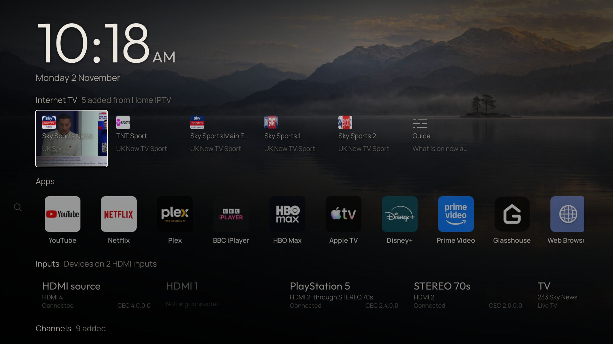

### Electronic Programme Guide (EPG)

Whenever the lineup contains channels, a **Guide** tile remains accessible on the Internet TV row (even if no channels are currently starred):

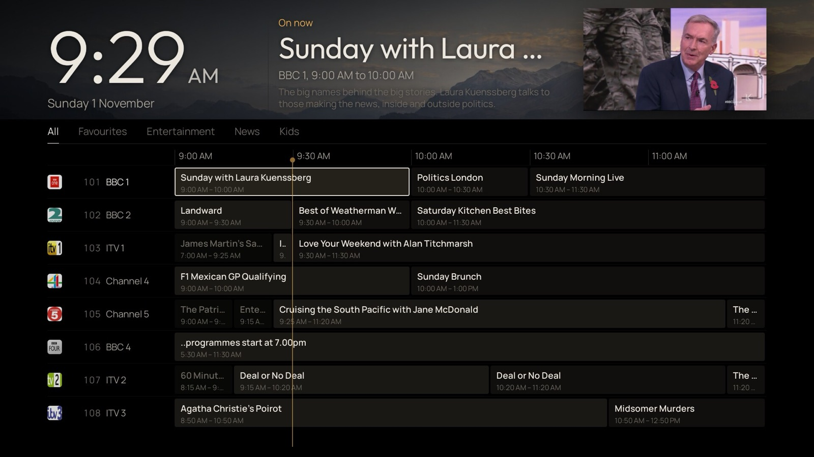

* **EPG grid view:** Selecting **Guide** (or pressing **Info** while on the Internet TV row) displays a 2.5-hour programme timeline starting 30 minutes before the current time, marked with an amber vertical line at the current time.
* **Navigation:**
    * **Up / Down:** Moves through channels at the current time slot.
    * **Left / Right:** Scrolls horizontally through time (from 2 hours in the past up to 24 hours ahead).
    * **Channel Up / Channel Down:** Pages through channels a full screen at a time.
    * **Top section tabs:** Moving **Up** from the first channel highlights section and favourites tabs; use **Left** and **Right** to switch sections.
    * **Programme details:** The top banner displays the title, start/end times, and synopsis of the focused programme, accompanied by a live preview of the channel.
    * **Tune / Scheduled:** Pressing **OK** on an active programme tunes to the channel; pressing **OK** on an upcoming programme shows its scheduled start time.
* **Sync schedule:** Guide data is parsed from the playlist's XMLTV URL or Xtream account. The full guide updates every 6 hours, while starred channels on Home's row refresh every 30 minutes. Channels lacking EPG data indicate none is available.
* **Remote Guide button mapping:** LG remotes route the physical **Guide** button to LG's broadcast tuner guide by default. In the **Internet TV** section on the Home tab, the **The remote's Guide button** setting can be switched to **Glasshouse Home's guide**, opening the Glasshouse IPTV guide from anywhere on the TV (apps, HDMI inputs, or Home). If Glasshouse Home is disabled or has no playlist, the button automatically reverts to LG's tuner guide. *(Note: Physical Guide button remapping is not available on webOS 11).*

### Stream handling and reliability

* **Single-stream enforcement:** Many IPTV subscriptions permit only one or two simultaneous streams across an entire household. Glasshouse ensures the active stream is cleanly closed before opening the next. If all account streams are currently occupied by other devices, pressing **OK** retries the connection.
* **Auto-reconnection:** If a live stream drops unexpectedly, Glasshouse automatically attempts to reconnect at the live broadcast edge for up to one minute before stopping.
* **Background efficiency:** Automatic playlist and guide refreshes pause while a channel is playing.
* **Screen saver protection:** Screen savers stay suppressed while watching full screen.
* **Pause live Internet TV:** With the switch of that name on in the **Internet TV** section of the Home tab (off by default) and a USB stick in the TV, **Pause** on the remote pauses a channel played full screen, and **Play** or Pause again goes on from the same picture. The stick must be formatted FAT32 or exFAT, with at least 512 MB free. Only MPEG-TS channels can pause (**Yellow** switches a provider's channel to MPEG-TS); previews on the row and HLS channels are never recorded.
    * **Recording:** While a channel plays full screen, the TV records it to the stick, up to 2 GB (about half an hour of an HD channel), and deletes the recording when the channel stops, changes or the TV goes to standby. The stick is written for as long as a channel plays, about 3 GB an hour, which wears a cheap stick sooner.
    * **Left / Right:** Go 30 seconds back or forward in what was recorded, back as far as the stick holds and forward as far as live, with a moment's reconnect at each jump. The channel list is on **OK** for such a channel.
    * **Back:** Behind live, asks "Back to live?": **OK** goes to the live point and Back again stays. At the live point Back closes the player as ever. A remote's **Stop** asks the same, and changing channel from behind live asks "Change channel?" the same way, as the recording goes with the channel.
    * **Band:** Shows how long the pause can last and how far behind live the channel is. A pause that reaches the start of what the stick holds plays on by itself.
* **Security & privacy:** Playlist URLs and Xtream login credentials remain stored strictly on the TV (`/var/lib/tvweb`). They are never displayed on the dashboard again, never transmitted to Home Assistant, and never written to debug logs. See [Security](../SECURITY.md#internet-tv).

## Background

The **Background** section chooses what is behind Glasshouse Home, and shows only the settings for that choice:

* **None**, the default: a pure `#000` OLED black, which leaves the TV's [screen saver](screen-savers.md) untouched.
* **Pictures**: a picture for each part of the day, or your own pictures in a random order.
* **Animated**: light that moves slowly behind the rows.

The TV app's **Background** row moves through the three with OK, followed by the rows for the one chosen.

### Pictures

A picture for each of four times of day: **Morning** (06:00 to 11:00), **Afternoon** (11:00 to 17:00), **Evening** (17:00 to 21:00) and **Night** (21:00 to 06:00), or a collection of your own shown in turn. There are four to choose from:

* **Landscape**, a loch at four times of day, and **Abstract**, four flowing abstract pictures. A set is downloaded to the TV when it is chosen, about 820 KB, from [glasshouse-wallpapers](https://github.com/rorygallagher2024/glasshouse-wallpapers), so it adds nothing to the Glasshouse download. Only the chosen set is kept on the TV.
* **Your own**: pictures uploaded from the browser, one for each time of day. They are kept while a set or another background is chosen, and come back with **Your own**. Uploading a picture chooses **Your own**.
* **Your own, shuffled**: up to 50 pictures uploaded from the browser, shown one at a time in a random order. Each comes round once before any comes again, and never the same one twice running. They are kept while something else is chosen, and adding one chooses **Your own, shuffled**.

The web dashboard shows the day as a strip from midnight to midnight, each time of day filled with its picture across its hours and a marker at the time now, and below it each time of day as a small Glasshouse Home: its picture behind the clock in the chosen text colour, so how readable the clock will be shows before it is on the TV. The time of day showing now is marked **Now**.

With **Your own** chosen:

* Choosing a time of day, on the strip or its preview, or dropping an image on it, sets its picture. JPEG, PNG and WebP images up to 25 MB are taken; the browser scales each to fit 1920 × 1080 as a JPEG before saving it to `/var/lib/tvweb/home-wallpaper-uploads` on the TV.
* **Replace** and **Remove** under a time of day change or remove its picture alone; one without a picture is black.
* **Remove all** takes every picture away.

With **Your own, shuffled** chosen, the times of day give way to the collection:

* **A new picture every** sets how long each stays: 1, 5, 10 (the default), 15 or 30 minutes, or an hour. The next comes with the usual cross-fade. A picture stays while Home is out of sight, and the next waits for Home to be back on screen, so one is never changed unseen.
* **Add pictures**, or images dropped on it, takes several at once, uploaded one after another; under it, how many there are of the 50. Each is prepared as for the times of day and saved to `/var/lib/tvweb/home-wallpaper-shuffle` on the TV under a name made there.
* **Remove** under a picture takes it alone, and **Remove all** the whole collection.
* Each picture shows through the black as much as the time of day's own would, more in the day and less at night.

The TV app's **Pictures** row moves through the sets and your own with OK. With **Your own, shuffled**, **A new picture every** follows and moves through the intervals; the pictures are added on the web dashboard.

### Animated

Seven moving backgrounds, each drawn in place of the pictures:

* **Light waves**: soft bands of light with a bright thread along their edges, as on a games console's home screen.
* **Particles**: soft lights rising and twinkling.
* **Aquarium**: a tank seen through its side, with light from the surface, fish at every depth, waving weed and rising bubbles.
* **Aurora**: curtains of light hanging from the top, their lower edges swaying.
* **Glow**: a few large, soft pools of colour drifting and blending where they meet.
* **Constellations**: points of light drifting slowly, joined by fine lines while they are near one another.
* **Ripples**: a still surface where now and then a drop falls and spreads in thin rings.

An animated background keeps the TV busy while Glasshouse Home is on screen, and moving around Home can be less smooth, more so on older TVs, where it moves a little less often to make up for it. It stops as soon as Home is covered by an app, an input or the screen saver, and with reduced motion asked for it is a still picture.

Its colours: **Time of day**, the default, follows the four times of day, and the aquarium dims in the evening and at night; five presets, **Night blue**, **Sunset**, **Emerald**, **Ember** and **Silver**; or **Your own**, a background and a light colour picked on the web dashboard. In the aquarium they are the water and the light through it. The TV app's **Animation** and **Background colours** rows move through the choices with OK.

### Darkening

**Darkening** sets how much the background is darkened behind the clock and the rows, which keeps them easy to read on a bright picture. It is 100% by default; the web dashboard's slider goes down in steps of 5% to **Off**, which shows the picture as it is, and the TV app's **Darkening** row steps through 100%, 75%, 50%, 25% and Off with OK. Behind an animated background it is lighter, as these are dark already. With **None** chosen it is not shown.

=== "Darkening 100% (default)"

    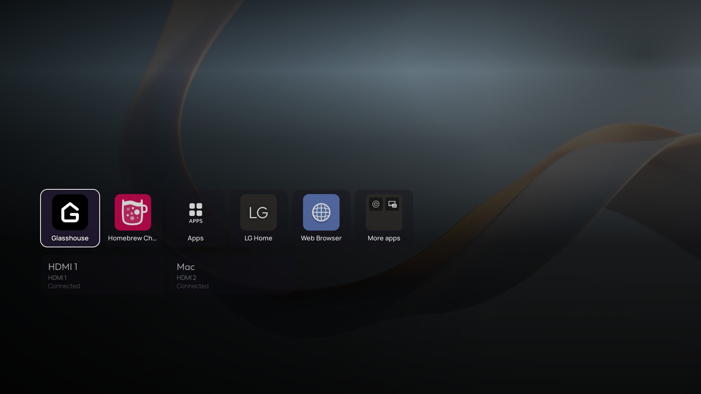

=== "Darkening off"

    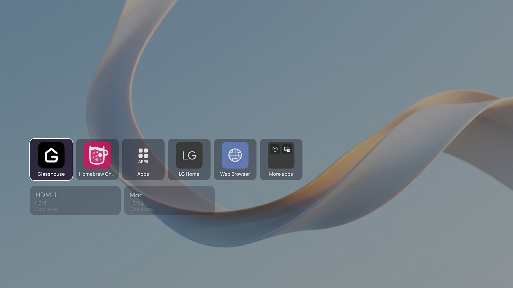

=== "Afternoon wallpaper"

    

=== "Evening wallpaper"

    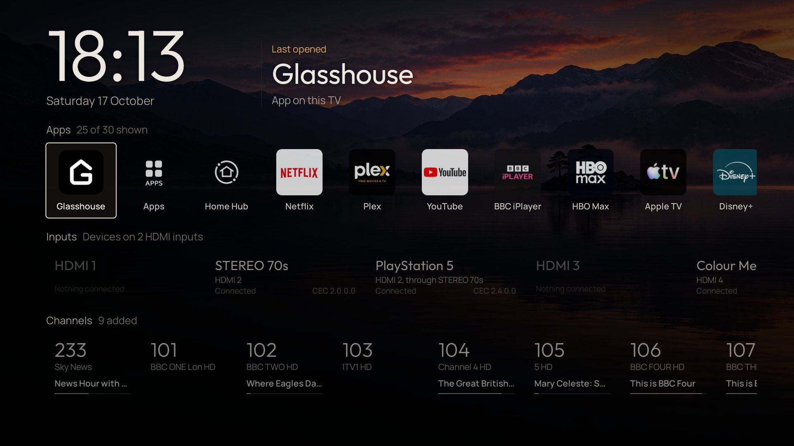

=== "Pure black (default)"

    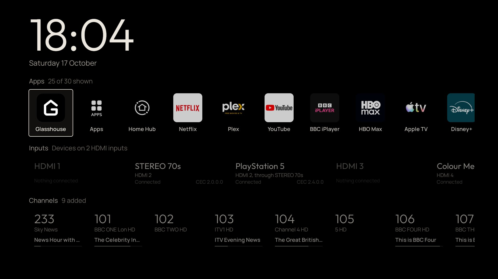

=== "Upload controls"

    

## Switching it on and off

Under **Choose your launcher** on the web dashboard's **Home** tab, choose **Glasshouse Home** (and confirm on the second press), or switch it on in the TV app's **Home** section. The same choice offers **LG Home**, [Glasshouse Minimal](#glasshouse-minimal) and [Custom](#custom-launcher). Glasshouse Home is mounted over LG's launcher without modifying the root filesystem (on webOS 4 it runs as a standalone app, `com.tvweb.home`, with the remote's Home key intercepted by the compositor filter). Choosing **LG Home** (or running `tvwebctl restore-glasshouse-home` over SSH) restores LG's launcher within a few seconds. On webOS 5 and 6 each switch restarts LG's app manager (sam), so the app in front comes back a moment later and a switch takes a few seconds longer.

* **Reaching LG's Home without turning Glasshouse Home off:**
  * Select the **LG Home** tile at the end of the Apps row, unless it has been hidden.
  * Hold the remote's **Home** button for 1 second (a short press on LG's Home returns to Glasshouse Home).
  * Stop the Glasshouse server: if Glasshouse Home stops answering or the server is stopped/uninstalled, LG's Home automatically takes its place back.
  * Glasshouse Home not opening: if a short press of **Home** brings nothing from Glasshouse Home, LG's Home opens instead. Where the TV's web app manager, which runs Glasshouse Home, has stopped, this is decided after five seconds, and the web app manager is started again first and Glasshouse Home given one more try. Where it is running, Glasshouse Home may only be slow to load, as on the first press after a reboot, so it is given 20 seconds. An app opened from Glasshouse Home is given 30 seconds to show its window before Glasshouse Home counts as not answering, as some, such as Nuvio, show LG's loading screen for several seconds first. A press of **Home** that only ends the screen saver opens nothing, as on LG's own Home, and is not taken for one that should open Glasshouse Home.
* **Cold boot & standby:** [Open Home at power-on](#open-home-at-power-on) controls whether the TV opens the Home screen when switched on or stays on the last input (LG's Home Auto Launch). With Quick Start+ (Active Standby) on, Glasshouse Home opens immediately on wake (and on TVs like the C4 on webOS 10.3.1 that start on their last input anyway, Glasshouse Home is opened over it when Open Home at power-on is on). On a cold boot (Quick Start+ off), Glasshouse Home takes over about 25–40 seconds after power-on; pressing Home during startup keeps the TV on the current input with a brief notice until ready.
* **Hide LG's Home while the TV starts (webOS 9 optional setting):** Replaces LG's Home layout with a blank screen during the first seconds of a cold boot so LG's launcher never flashes on screen.

> [!WARNING]
> **If `Hide LG's Home while the TV starts` is enabled** and Glasshouse is removed manually without choosing **LG Home** or running `tvwebctl restore-glasshouse-home` (for example, if a firmware update removes root), LG's Home will remain blank until its layout cache is cleared over SSH:
> ```sh
> rm -rf /mnt/lg/cmn_data/manifest /tmp/checkpoint/*com.webos.app.home* /mnt/lg/cmn_data/checkpoint/*com.webos.app.home* && reboot
> ```

## Glasshouse Minimal

**Glasshouse Minimal**, beside **Glasshouse Home** under **Choose your launcher**, is a second home screen that comes with Glasshouse, made to be as plain as it can: the TV's apps and inputs as two lists of names on black, and the time, in the type of the Glasshouse TV app. **Left** and **Right** choose between Apps and Inputs, **Up** and **Down** move through them, and **OK** opens; **Home** comes back to the first app, and the last entry under Apps opens LG's Home. With Glasshouse Home on, choosing **Glasshouse Minimal** puts it in Glasshouse Home's place within a few seconds; from LG's Home it takes a second press. Choosing **Glasshouse Home** goes back. It works as a custom launcher does, below: the Home button, Back and waking open it, and **Rows and tiles** decides which apps and inputs it lists and in what order, with those in More apps after the rest. Every few minutes the whole screen moves a few pixels, so that the names do not stay in one place on an OLED panel.

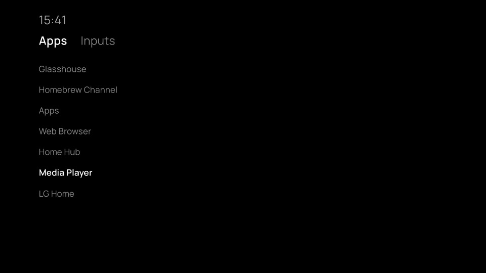

## Custom launcher

A home screen of your own can take Glasshouse Home's place: a launcher you have written or downloaded, or a web page such as a Home Assistant dashboard. Everything above still applies to it. The Home and Back buttons open it, it opens when the TV wakes on Home, holding **Home** opens LG's Home, and if it stops working, LG's Home takes its place by itself.

Under **Choose your launcher** on the web dashboard's **Home** tab, choose **Custom**. Its settings open below it, to set one up, either:

* **Upload a launcher:** a web app as an `.ipk` package, a `.zip` of its folder, or a single `.html` file, up to 50 MB. Native apps can't be used. As with installing an app from a file, this needs **Install app from a URL or file** switched on on the [Apps tab](apps.md#install-app-from-a-url-or-file), or a token.
* **Or open a web page:** an address starting with `http://` or `https://`, shown full screen. Some sites refuse to be shown inside another page; Home Assistant does unless it is told to allow it ([Writing a launcher](../development/WRITING-LAUNCHERS.md#a-web-page) has the setting).

You have one at a time: uploading another, or giving a web address, replaces it, and **Remove** deletes it. With Glasshouse Home already on, it takes Glasshouse Home's place as soon as it is set up. Once one is set up, **Custom** makes it the TV's Home, as the other choices do; from LG's Home it takes a second press. Its settings show only while **Custom** is chosen. Choosing **Glasshouse Home** goes back and keeps the launcher for later. The TV app's **Home** section has a switch for it.

While Glasshouse Minimal or a custom launcher is the TV's Home, **Rows and tiles** stays on this tab with the Apps and Inputs rows: which apps and inputs it shows, and their order, including **Hide inputs with nothing connected**. Glasshouse Minimal follows them, as the example in the docs does; a launcher of your own follows them where it was written to. Glasshouse Home's other settings (its other rows, background, colours and the rest of this page) have no effect, and come back as they were with Glasshouse Home.

> [!WARNING]
> A launcher can do anything on the TV that Glasshouse can, so only use one you trust.

[Writing a launcher](../development/WRITING-LAUNCHERS.md) covers making one: what Glasshouse adds to its page, and the calls for listing and opening the TV's apps and inputs.

## Arranging

Rows and tiles can be arranged from the **web dashboard**, the **TV app**, or **directly on Glasshouse Home**:

* **On the TV screen:** Hold **OK** on any tile to enter arrange mode. Use the D-pad (**Left/Right** to move a tile, **Up/Down** to reorder rows), **Back** to hide/show a tile (the **LG Home** tile included) or remove a channel, and the bottom bar for **Reset** and **Done**.
* **Hiding a whole row:** In the web dashboard, each row under **Rows and tiles** has a **Shown** / **Hidden** switch beside **Row up** and **Row down**. A hidden row is left off Glasshouse Home whatever its tiles, and shows dimmed while arranging so it can still be moved. **Reset the layout** shows every row again.
* **More apps:** Apps that should not take up the Apps row can go into a folder instead of being hidden. While arranging, focus an app and choose **Into or out of More apps** in the bottom bar (or press the green button). The Apps row then ends with a **More apps** tile showing the first four icons; **OK** opens every app in it as a grid, and **Back** or **Home** closes the grid. The LG Home tile can go into the folder too. Hiding an app takes it out of the folder, and **Reset** empties the folder. In the web dashboard's Home tab, each app in the Apps row has a choice of **Shown**, **In More apps** or **Hidden**.
* **Row ordering (`Your order` vs `Last opened`):** Each row can be set to stay in a fixed custom order (**Your order**) or automatically move the most recently used app, input, or channel to the front (**Last opened**, keeping **LG Home** pinned at the end).
* **Adding and removing channels:** Apps and inputs are discovered automatically from the TV and toggled between shown and hidden (inputs with nothing plugged in can also be left out with the Inputs row's **Hide inputs with nothing connected** switch); live TV channels are added by name or number under **Add channels** and removed when no longer needed.

In the TV app's Home section each row has one entry, in the rows' order, with
what it holds beside it: **7 of 9 shown**, **10 on Home**. While an entry is
chosen, the panel beside the list names the row's first tiles. **OK** opens
the row's own list: its tiles, its order, and the settings that change only
that row, such as **App count** and **Search** for Apps and **CEC addresses**
for Inputs. **Back** returns to the entry. **Animations** and **Row order and
reset** are lists of their own too.
The Apps preview shows **More apps** in place of the apps inside it; those
apps are labelled **In More apps** in its list. Hidden app, input and channel
rows are labelled **Hidden**.

=== "Arranging on the TV (hold OK)"

    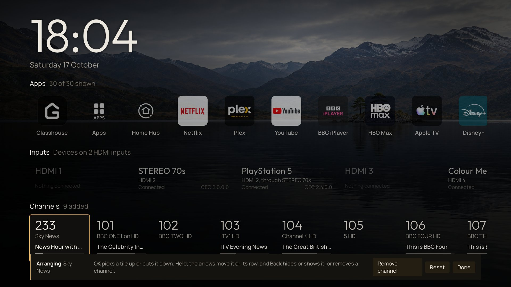

=== "Web dashboard"

    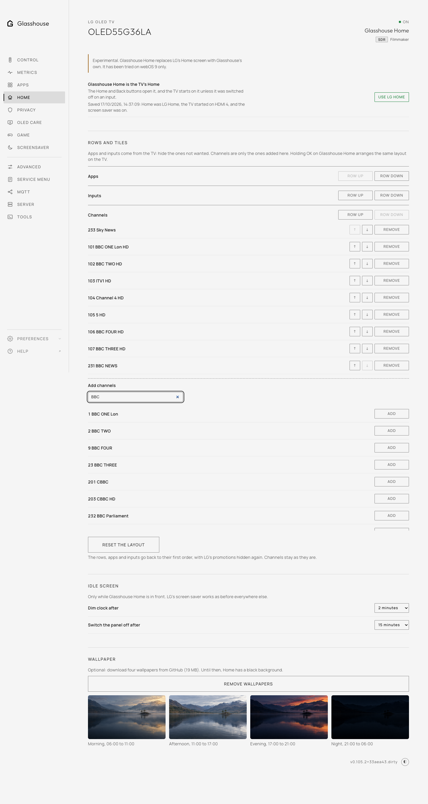

=== "TV app"

    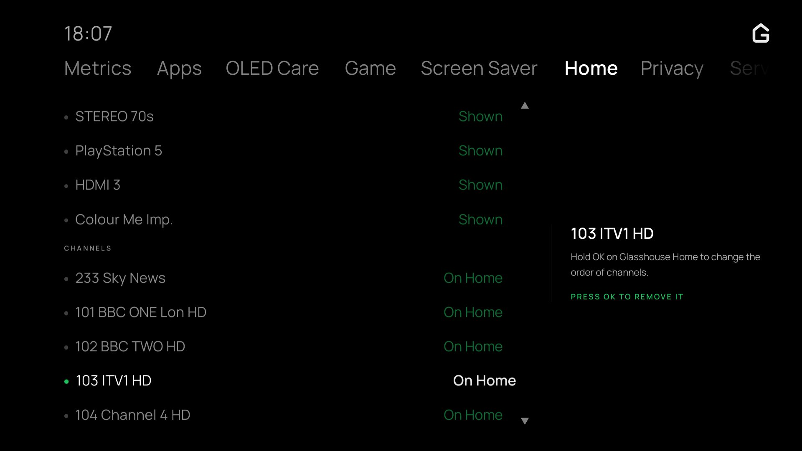

## Home customisation

The Home tab's **Home customisation** section holds what applies to whichever Home is the TV's, grouped under headings:

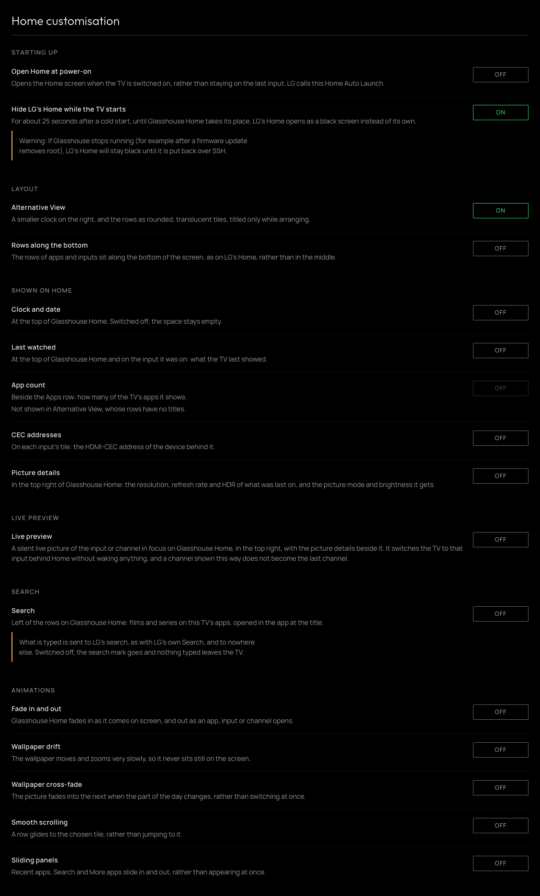

* While Glasshouse Home is on:
    * **Starting up:** Open Home at power-on, Hide LG's Home while the TV starts.
    * **Layout:** Alternative View, Rows along the bottom.
    * **Shown on Home:** Clock and date, Last watched, App count, CEC addresses, Channel logos, Weather, Picture details.
    * **Live preview:** Live preview, with Preview sound, Keep the preview on and Preview in the tile once it is on.
    * **Search.**
    * **Animations:** Fade in and out, Wallpaper drift, Wallpaper cross-fade, Smooth scrolling, Sliding panels.
* While LG's Home is: **Open Home at power-on**, **Home screen layout** and **Hide home screen system apps**.

Each appears where the TV has it. A TV Glasshouse Home is not offered on, such as a webOS 8 TV, still has the Home tab for these; there it holds Open Home at power-on and whichever of LG's Home options the TV has. The TV app's Home section has the same rows.

### Open Home at power-on

Opens the Home screen when the TV is switched on, rather than staying on the last input. LG calls this Home Auto Launch (`general.homeAutoLaunch`). While Glasshouse Home is on, the Home it opens is Glasshouse Home (see [Switching it on and off](#switching-it-on-and-off)).

### Layout options

The **Layout** section configures the on-screen placement of rows and status elements:

* **Clock and date:** Displayed by default in the upper left; if switched off, its space remains reserved so rows do not jump.
* **Rows along the bottom:** Places the rows along the bottom of the screen (as on LG's launcher) rather than in the middle. The row in focus sits at the bottom and subsequent rows wait below the screen: moving down scrolls the rows up by one. Off by default.

    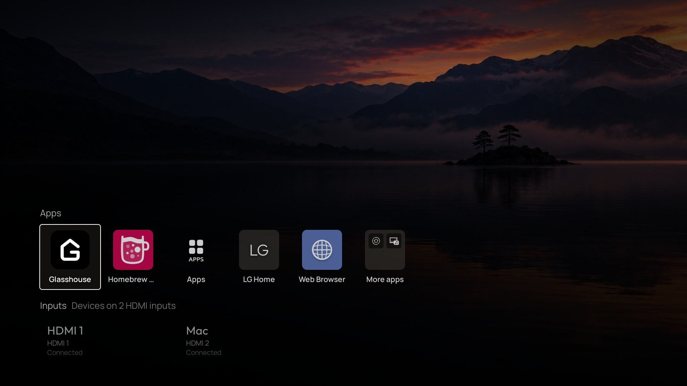

* **Alternative View:** A compact layout with a smaller clock on the right, status badges to its left, and rounded, translucent tiles. Row titles show only while arranging, so **App count** is greyed out. Off by default, and works with **Rows along the bottom** and the other switches:

    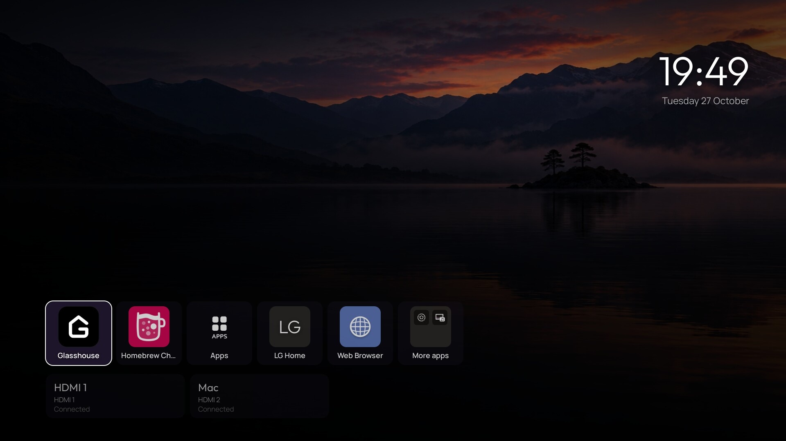

    Disabling the clock, Last watched, and CEC addresses over the Abstract wallpaper creates a minimal interface:

    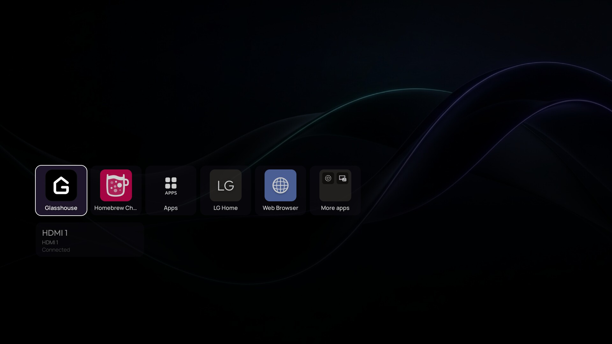

### Badges and labels

Individual toggles in the **Shown on Home** section control informative badges across the interface:

* **Last watched:** Displays the most recently active source in the top strip and highlights its tile. Behind an AV receiver, Last watched names the specific active downstream device (e.g. the console rather than the receiver) whenever recorded by the TV; if unrecorded, all connected devices on the port are named. The top strip stays empty until the saved layout loads. Switching it off leaves the clock in place.
* **App count:** Displays the count of visible vs total apps (e.g. *"4 of 18 shown"*) next to the Apps row header. (Hidden in Alternative View).
* **CEC addresses:** Displays physical HDMI-CEC port addresses (such as `1.0.0.0` or `2.1.0.0`) on each input tile.
* **Channel logos:** Displays graphical channel logos on Internet TV tiles; when disabled, channels display plain text names instead.
* **Picture details:** Displays the active picture preset, OLED light / backlight level, and signal format in the top-right corner.
* **Magic Remote pointer:** On by default. Switched off, the remote's pointer is hidden on Glasshouse Home and moving the remote no longer moves the focus, so only the arrow keys move around Home; OK opens the tile in focus. The wheel still scrolls the rows. Apps, inputs and LG's menus keep the pointer.

### Weather badge

The weather badge displays the current temperature and an icon level with the clock, with the place and condition on the date line below. The **Weather** setting on the dashboard chooses where it comes from:

* **From Home Assistant (default):** Displays whatever was last written to the `text.lg_tv_weather` entity, a JSON string such as `{"condition":"partlycloudy","temp":14.2,"city":"Paris"}` ([entities](../HOME-ASSISTANT-ENTITIES.md)). The `city` field is optional, and the temperature is shown in the unit sent. An automation keeps this current ([example automation](../HOME-ASSISTANT.md#6-the-weather-on-glasshouse-home)).
* **From the internet:** Weather from [Open-Meteo](https://open-meteo.com/) for a location searched by name on the dashboard. The TV queries Open-Meteo every 30 minutes while the screen is on (sending only coordinates, never polling while the TV is off). Temperatures are in °C, or °F for US locations. *Weather data by Open-Meteo.com* appears in the bottom corner while shown.
* **Off:** Disables the badge completely.

The badge appears once data is received, is kept when the TV restarts, and is hidden once 3 hours pass without an update (or when an empty value is sent from Home Assistant).

### Live preview

When enabled, resting on an input or a TV channel for a moment shows it live in the top right, with its name and programme beside it. Off by default.

* **Picture details plate:** With [Picture details](#badges-and-labels) also enabled, the plate moves beside the preview window, level with its foot, and describes what it shows: incoming HDMI resolution, refresh rate, HDR, chroma, picture preset, and backlight/OLED light levels. Changing Picture details updates the plate during a preview without restarting video playback.
* **AV receiver handling:** Devices connected behind an AV receiver share its HDMI input, so each shows what that input shows. Moving to another input takes the TV's HDMI receiver off the active input without sending CEC commands.
* **Tuner channels:** Previewing a channel does not make it the TV's last-watched channel, except on webOS 4, whose browser plays channels only the way that does. An input with no incoming signal or a channel off-air displays a status notice; on webOS 4, which reports no signal for a channel, a channel that plays stays up.
* **Screen saver:** The preview pauses while the screen saver runs over Home, and resumes when dismissed. Pressing **OK** releases the preview while the input or channel opens full screen.
* **Additional options (webOS 5+):**
    * **Preview sound (off by default):** Plays the sound of the input or channel in the preview. Off, the preview is silent. Switching it from a dashboard changes a preview already playing. Opening a channel full screen always has sound.
    * **Preview in the tile:** Renders the preview inside the hovered tile itself, under the tile's name, rather than beside the clock.
    * **Keep the preview on:** Runs the preview whenever Glasshouse Home is on screen, showing the last-watched HDMI input or TV channel until another is focused.
    *(These options are not offered on webOS 4, where background video playback in tiles is unsupported and preview sound was not tried.)*

### Animations

Each kind of motion has its own switch:

* **Fade in and out (off by default):** Fades Glasshouse Home out before an app, input, channel, or recent app opens, and back in when returning. **Notifications** and **Search** open over Home without fading.
* **Wallpaper drift (on by default):** Slow movement of the wallpaper to protect against image retention on OLED panels.
* **Wallpaper cross-fade (on by default):** Cross-fades smoothly from one part of the day's background to the next.
* **Smooth scrolling (on by default):** Rows glide smoothly to the focused tile rather than jumping abruptly.
* **Sliding panels (on by default):** Slides Recent apps, Search, and More apps smoothly in and out.

### Hide home screen system apps


Hides built-in LG apps that can't be uninstalled, such as Gallery, Music, Sports, Alexa and the User Guide, from the Home screen ribbon. Each app is a tile, dimmed and marked **Hidden** while hidden; choosing one hides or shows it. The apps themselves stay on the TV, and switching the feature off brings every one back. The Web Browser is not offered: hidden, it no longer opens, and saved web pages and links from other apps open in it. A TV that had it hidden shows it again.

On webOS 7, 9, 10, and 11, hidden apps come back hidden at each cold boot without restarting the app manager. On webOS 3 to 6 the app manager is restarted to read them, when a tile is hidden and at each cold boot, which can blank the screen for a moment before the active input returns, and the section says so.

It is for LG's Home, and is not offered while Glasshouse Home is on, which hides apps itself from [Arranging](#arranging) or the Apps row. Switching Glasshouse Home on switches it off, and the apps it was hiding stay hidden in Glasshouse Home, apart from any in More apps. Switching back to LG's Home, they show there again until it is switched on again.

It is experimental, and off until it is turned on under **Server** → **Advanced** → **Experimental features**; see [Experimental features](../experimental.md) for why. It is not offered on a Homebrew Channel install.

### Home screen layout


Switches parts of LG's Home screen off, for a Home screen with only the apps and inputs on it:

* **Banner**: the large picture at the top, with LG's adverts or, with them off, its own message and a Go to Apps button. The profile, notifications, settings and search buttons beside it go with it; Settings and search stay on the remote's own buttons.
* **Quick Cards**: the coloured buttons for LG's offers, Sports, Gaming, Music and others.
* **App tiles**: the row of apps and inputs.
* **Recent Input and Device Functions**: the last input used, and cards for editing the app list, the TV guide, the user guide and Home Hub.

At least one part stays. A change takes a few seconds, while the Home screen starts again, and lasts through restarts and power cuts. It is shown while LG's Home is the TV's Home, and left out while Glasshouse Home is on; the layout set here is kept, and is what LG's Home shows when opened from Glasshouse Home or once Glasshouse Home is switched off. The rows further down, such as Live TV and LG Channels, come from LG's servers and stay.

**Inputs on Home** shows each HDMI input as a tile, dimmed while it is not on Home; choosing one adds or removes the Home screen's tile for it, named as the TV names the input. The input tiles go before the apps, in HDMI order; adding one moves any input tiles moved elsewhere back to the front, and starts the Home screen again to show it. It is LG's own tile for the input, so it can be moved or removed on the TV like any other.

On webOS 9, highlighting an input tile shows its HDMI port and the CEC device
names, including devices behind a receiver, or the TV's own name for the input
where no device gives one. Long names scroll in LG's title area. Titles are
read again when the Home screen opens and shortly after the TV switches on,
never while it is in standby. Only input tiles added by Glasshouse are updated;
a failed discovery keeps the last good title.

**Put back LG's Home screen** shows every part again and takes off the input tiles added here; ones added on the TV stay. The TV app has the same switches.

It is offered on webOS 9 (LG's webOS 24), where it has been tried on a C2, and as an [experimental feature](../experimental.md#home-screen-layout-on-webos-10) on webOS 10 (LG's webOS 25), where it has been tried on a C2 with webOS 10.3.1. webOS 3 and 4 have a much plainer Home screen, so they do not have it. A webOS 8 TV may have the same home app as webOS 9, and webOS 11 a layout of its own; neither is offered it until one has been tried.

On webOS 10 the section has a switch at the top, with its warning, and nothing in it changes until that is on. The parts that can be switched off there are the **Side buttons** (profile, notifications, settings and search), the **Quick Cards**, the **Recommended shelf** and the **Banner text**, the line inviting a new experience with webOS and its **Go to Apps** button. The banner stays, and **Banner picture** chooses what it shows: LG's picture, plain black, or your own. Your own is uploaded from the browser and cropped for each shape the banner can take, so it fills the banner whichever parts are shown; the banner grows into the space hidden rows leave, and with the side buttons hidden it reaches the screen's edges and top. It stops above the apps row, which LG draws on black.

### Hiding apps from Recents

**Recent apps**, under the rows on the Home tab, lists the apps with a **Shown** or **Hidden** switch each. A hidden app never appears in Glasshouse Home's Recent apps panel (Back on Home), and Glasshouse no longer serves its last screen, including one saved before it was hidden. Its tile stays on the Apps row; hiding a tile is the Apps row's own choice. This doesn't stop webOS taking its snapshots or change LG's own Recents.

The list is kept as `excludedRecents` in `/var/lib/tvweb/home.json`, a list of app IDs, and `POST /api/home/layout` takes it too, for example `{"excludedRecents":["private.app.id"]}`.
