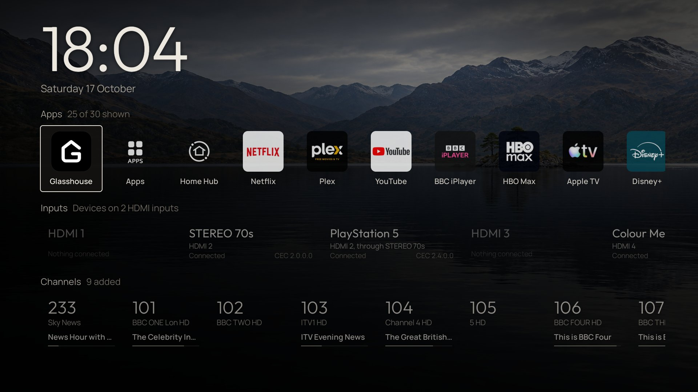
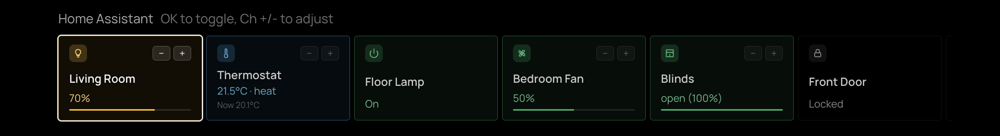
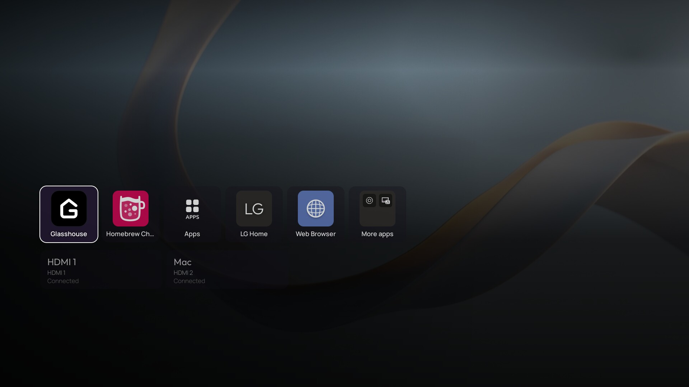
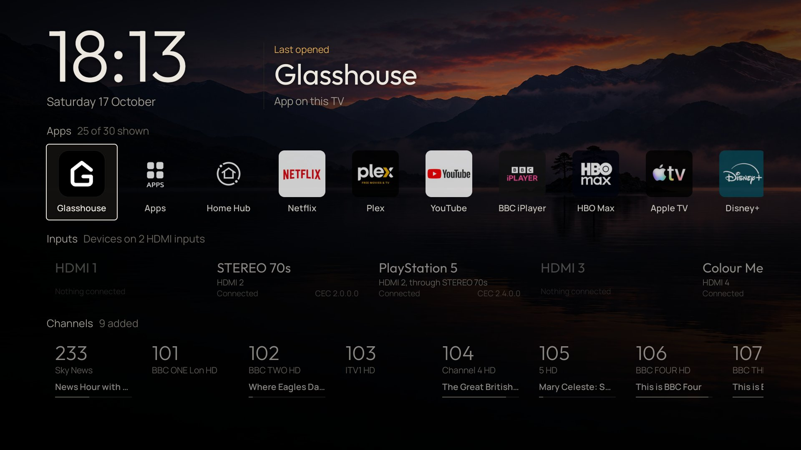
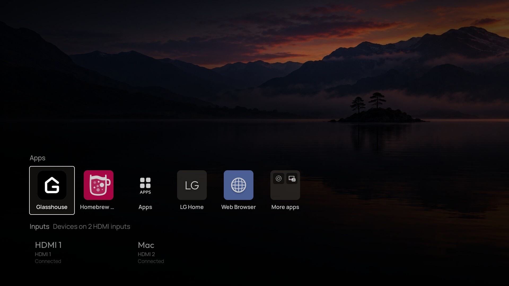
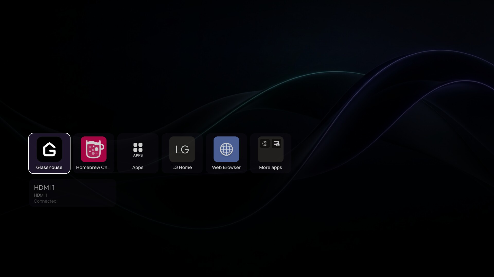

# Home

The **Home** tab chooses what opens when you press **Home** on the remote, described under [Launchers](launchers.md), and sets up **Glasshouse Home**, the home screen this page is about: an ad-free replacement for LG's, with your own background, rows of apps, inputs and channels, [Internet TV](internet-tv.md) and Home Assistant.



## What is on screen

**Glasshouse Home** displays a clock and date (following the TV's 12-hour or 24-hour time setting), the last active source or app, and its rows (any row with no visible items is automatically hidden). When there are more rows than fit, they scroll to keep the focused row in view:

<div class="grid cards" markdown>

-   **Apps**

    ---

    Installed applications with native icons, saved web pages, and quick tiles for **Notifications**, **Search**, **AirPlay** and **LG Home**. Promotional clutter starts hidden, and apps can be reordered, hidden, or grouped into a **More apps** folder.

-   **Magic Remote & navigation**

    ---

    Hover to focus, click to open, and rest near row edges to glide across off-screen tiles. Scroll wheel and arrow keys preserve focused tiles and scroll positions when returning from an app. **Up** and **Down** move to the tile directly above or below.

-   **Inputs & connected devices**

    ---

    Displays the TV tuner, HDMI ports with device icons, AV and Component inputs where the TV has them, HDMI-CEC devices behind receivers, and discovered Media Servers, USB storage, AirPlay, Screen Share, and All Inputs tiles. Configured on the [Inputs tab](inputs.md#your-inputs). See [Inputs and connected devices](#inputs-and-connected-devices).

-   **Channels**

    ---

    Favourite live broadcast TV channels added from the dashboard or TV app, showing current programme details from the TV guide when available.

-   **Internet TV**

    ---

    The starred channels of your Internet TV lineup, chosen on the dashboard or from the row itself, with logos and what is on now and next. See [Internet TV](#internet-tv).

-   **Recommended**

    ---

    Shows continuing titles and recommendations from installed streaming apps (such as Netflix, Prime Video, Disney+, and YouTube) as a row of cards below Apps. Off by default. See [Recommended row](#recommended-row).

-   **Home Assistant**

    ---

    Control your home from Home: a row of your Home Assistant lights, switches, thermostats, fans, blinds, locks and scenes, with sensors shown as readings. **OK** toggles, and the step buttons, or **Ch +** and **Ch -**, dim or adjust. Off by default. See [Home Assistant row](#home-assistant-row).

-   **Recent apps (`Back` button)**

    ---

    Pressing **Back** on Glasshouse Home opens a strip of recently used apps with live snapshots. Press **OK** to switch to an app, **Down** to close a single app, or **Up** for **Close all**. The key that ends the screen saver over Home only wakes the screen, so **Back** there leaves the strip closed and **OK** opens nothing.

-   **Picture details plate**

    ---

    When **Picture details** is switched on, a top-right badge shows the active picture preset, OLED light / backlight level, and signal format — live HDMI resolution, refresh rate, chroma, bit depth, HDR format, and VRR, or the last video format played in an app.

-   **Live preview**

    ---

    Hovering an input, TV channel, or Internet TV tile displays a live video preview beside the clock or directly within the tile, along with current signal and programme details. Silent unless **Preview sound** is on. Off by default. See [Live preview](#live-preview).

-   **Weather badge**

    ---

    Displays current temperature, condition icon, and location level with the clock, sourced from Home Assistant or Open-Meteo. See [Weather badge](#weather-badge).

-   **Home Assistant: board**

    ---

    A short list beside the clock that Home Assistant sends, such as today's matches from a sports integration, a few lines at a time. See [Home Assistant: board](#home-assistant-board).

-   **Home Assistant: values at a glance**

    ---

    Up to four short lines from Home Assistant beside the clock: the next bin collection, a parcel on its way, a share price. Each reads an entity picked on the dashboard, or an automation sends them. See [Home Assistant: values at a glance](#home-assistant-values-at-a-glance).

-   **Badges & labels**

    ---

    Customizable status badges across rows: **Last watched** (top banner and active input highlight), **App count** (e.g. "4 of 18 shown"), **App labels** (show or hide app names beneath icons), **CEC addresses** on input tiles, and **Channel logos** for Internet TV. See [Badges and labels](#badges-and-labels).

-   **Rows along the bottom**

    ---

    Positions rows along the bottom of the screen (similar to LG's built-in launcher) instead of centered, scrolling subsequent rows into view as you navigate down. Off by default. See [Layout options](#layout-options).

-   **Alternative View**

    ---

    A compact layout featuring rounded translucent tiles, a smaller clock on the right, and status indicators aligned horizontally. Can be combined with **Rows along the bottom** for a minimalist home screen. See [Layout options](#layout-options).

-   **Animations**

    ---

    Independent switches for motion and transitions: smooth row scrolling, wallpaper drift, cross-fades between times of day, sliding panels, and smooth fade transitions when opening apps or inputs. See [Animations](#animations).

-   **Colours & themes**

    ---

    Seven built-in colour presets (starting with **Pure white**), plus custom **Text**, **Accent** and **Tile highlight** colour pickers. The accent colour frames focused tiles and marks active sources; **Tile highlight** sets the fill behind focused tiles (and, in **Alternative View**, a shaded fill behind unfocused tiles) in place of the built-in charcoal fill, and can also be stepped through presets on the TV app.

</div>

## Inputs and connected devices

The **Inputs** row displays the TV's tuner, HDMI ports, and connected media/casting sources:

* **Live TV tuner:** A **TV** tile comes first on TVs with channels tuned, showing the last active channel; selecting it opens Live TV.
* **HDMI ports and CEC devices:** Each HDMI port is listed, alongside separate tiles for connected HDMI-CEC devices discovered through an AV receiver or soundbar (for example, *"HDMI 2, through STEREO 70s"*). Selecting a CEC tile wakes the device and switches intermediary receivers to that source.
* **Media servers, USB, AirPlay & Screen Share:** Attached USB storage, AirPlay, Screen Share, LG's All Inputs / Home Hub, and (when **Show media servers** is switched on under [Inputs](inputs.md#your-inputs)) discovered DLNA media servers are offered alongside your HDMI inputs. Screen Share opens Home Hub's guide to sharing a phone's screen, and is offered only where Home Hub has that guide: LG's Screen Share app itself opens only while a phone is connected. Where AirPlay is also on the Apps row, Glasshouse Bar shows it there only, so hiding it there hides it from the Bar.
* **Device icons:** Each tile automatically picks an icon matching the source or device name (console, handheld, streaming box, soundbar, disc player, PC, cable box, media server, USB, AirPlay, Screen Share, or HDMI plug).
* **Customising inputs:** Renaming, showing/hiding, reordering, and **Hide inputs with nothing connected** live on the [Inputs tab](inputs.md#your-inputs) so they can be arranged whether a Glasshouse launcher or the [Glasshouse Input bar](inputs.md#glasshouse-input-bar) is in use. Inputs can also be reordered and hidden directly in arrange mode on Glasshouse Home. An input keeps its name, place and hiding when the TV starts or stops listing the device on it, as many consoles and boxes drop off that list when switched off; where a port has two devices, such as a console behind a receiver, each keeps its own.

## Recommended row

The **Recommended** row surfaces content cards provided by installed streaming apps:

* **Content cards:** Displays titles that apps put on LG's Home, such as Netflix's *Continue watching*, Prime Video picks, Disney+, HBO Max, and YouTube, with each app's artwork, title, and category. Pressing **OK** opens the app directly at that title.
* **App-specific filtering:** When an app is focused in the Apps row (via remote keys or pointer), the Recommended row filters to show only cards from that service (*From Netflix*), accessible by pressing **Down**. When focusing a tile with no recommendations (such as an input or LG Home), cards from all apps are shown in the Apps row's order. Hidden apps show no recommendations.
* **Row positioning:** The row appears under Apps by default and can be reordered like other rows, though individual cards within it are ordered by the respective streaming apps.
* **Privacy:** Artwork is loaded directly from each app's own servers, as on LG's Home; no extra telemetry is sent.
* **Availability:** Switched off by default in the Recommended row settings on the dashboard or TV app. Supported on webOS 10 and webOS 4.10; on TVs where the system reports no app recommendations (such as a C2 on webOS 9.2), the row remains hidden and the switch indicates none are available.

## Home Assistant row

When the **Home Assistant API** is enabled and at least one entity is configured in the [Home Assistant control bar](../HOME-ASSISTANT.md#home-assistant-control-bar) on the **HA & MQTT** tab, a **Home Assistant** row toggle appears under **Rows and tiles** on the web dashboard and under **Rows** on the TV app (off by default).

* **Shared entity list:** Displays and controls the same entities configured for the control bar (`habar.json`), without maintaining a separate list.
* **Sensors:** a temperature, humidity, power or other sensor shows its reading, with an icon for what it measures, and is not toggled.
* **Inline control:** **OK** or clicking a tile toggles a switch, light, climate device, cover, or lock, or runs a scene, script, or button; clickable step buttons on focused adjustable tiles or **Ch +** / **Ch -** on the remote adjust brightness, fan percentage, cover state, or target temperature while leaving **Up** and **Down** for row navigation. Where **Ch +** and **Ch -** are set to **Brightness up** and **Brightness down** on the [Remote](remote.md) tab, they step the tile in focus instead while one that steps has focus, and set the TV's brightness everywhere else.



## Search

> [!WARNING]
> **Sends queries to LG's search service:** Enabling **Search** sends typed search queries to LG's cloud search service (`com.webos.service.nlpmanager` / `*.nextlgsdp.com` — the same backend used by LG's built-in Search app) and nowhere else. It is **off by default** so nothing leaves the TV unless explicitly switched on.

When switched on under **Home** on the web dashboard or in the TV app's Home section, **Search** adds a mark in the left margin beside the rows: **Left** from the first tile of any row reaches it, and **Right** goes back. **OK** opens a search panel over the left of Glasshouse Home for films and series, typed on the TV's keyboard. While the keyboard is up the titles are single lines, with the icons of the apps that have them; once it closes each shows its poster, year, running time and apps. Editing the query clears the previous titles immediately. Up and down move between titles, left and right between apps, and OK opens the app at that title. A series opens at its start where the app allows: Prime Video and HBO Max at its first season, Disney+ and BBC iPlayer playing its first episode, Netflix at the series; Apple TV opens its latest episode. Titles only on apps the TV does not have are counted, not listed, and trailers, teasers and sneak peeks are never shown or opened. Back closes the keyboard, then the panel. Coming back from an app opened there within 30 minutes, without the TV having been switched off, finds the panel as it was left. Switched off, the mark goes and nothing typed leaves the TV.

LG's search needs the TV online and LG's search server (`gb.nextlgsdp.com` on a TV in the UK) reachable. Where the ad blocker blocks that server, on **Everything** or through an uploaded hosts list, the mark is hidden on Glasshouse Home and the **Search** switch is greyed on both dashboards, with a note saying what blocks it. The switch keeps its setting, and search comes back when the blocker is set to **Ads & telemetry** or off.

## Background

The **Background** section chooses what is behind Glasshouse Home, and shows only the settings for that choice:

* **None**, the default: a pure `#000` OLED black, which leaves the TV's [screen saver](screen-savers.md) untouched.
* **Pictures**: a picture for each part of the day, or your own pictures in a random order.
* **Animated**: light that moves slowly behind the rows.

The TV app's **Background** row moves through the three with OK, followed by the rows for the one chosen.

### Pictures

A picture for each of four times of day: **Morning** (06:00 to 11:00), **Afternoon** (11:00 to 17:00), **Evening** (17:00 to 21:00) and **Night** (21:00 to 06:00), or a collection of your own shown in turn. There are four to choose from:

* **Landscape**, a loch at four times of day, and **Abstract**, four flowing abstract pictures. A set is downloaded to the TV when it is chosen, about 820 KB, from [glasshouse-wallpapers](https://github.com/rorygallagher2024/glasshouse-wallpapers), so it adds nothing to the Glasshouse download. Only the chosen set is kept on the TV.
* **Your own**: pictures uploaded from the browser, one for each time of day. They are kept while a set or another background is chosen, and come back with **Your own**. Uploading a picture chooses **Your own**.
* **Your own, shuffled**: up to 50 pictures uploaded from the browser, shown one at a time in a random order. Each comes round once before any comes again, and never the same one twice running. They are kept while something else is chosen, and adding one chooses **Your own, shuffled**.

The web dashboard shows the day as a strip from midnight to midnight, each time of day filled with its picture across its hours and a marker at the time now, and below it each time of day as a small Glasshouse Home: its picture behind the clock in the chosen text colour, so how readable the clock will be shows before it is on the TV. The time of day showing now is marked **Now**.

With **Your own** chosen:

* Choosing a time of day, on the strip or its preview, or dropping an image on it, sets its picture. JPEG, PNG and WebP images up to 25 MB are taken; the browser scales each to fit 1920 × 1080 as a JPEG before saving it to `/var/lib/tvweb/home-wallpaper-uploads` on the TV.
* **Replace** and **Remove** under a time of day change or remove its picture alone; one without a picture is black.
* **Remove all** takes every picture away.

With **Your own, shuffled** chosen, the times of day give way to the collection:

* **A new picture every** sets how long each stays: 1, 5, 10 (the default), 15 or 30 minutes, or an hour. The next comes with the usual cross-fade. A picture stays while Home is out of sight, and the next waits for Home to be back on screen, so one is never changed unseen.
* **Add pictures**, or images dropped on it, takes several at once, uploaded one after another; under it, how many there are of the 50. Each is prepared as for the times of day and saved to `/var/lib/tvweb/home-wallpaper-shuffle` on the TV under a name made there.
* **Remove** under a picture takes it alone, and **Remove all** the whole collection.
* Each picture shows through the black as much as the time of day's own would, more in the day and less at night.

The TV app's **Pictures** row moves through the sets and your own with OK. With **Your own, shuffled**, **A new picture every** follows and moves through the intervals; the pictures are added on the web dashboard.

### Animated

Seven moving backgrounds, each drawn in place of the pictures:

* **Light waves**: soft bands of light with a bright thread along their edges, as on a games console's home screen.
* **Particles**: soft lights rising and twinkling.
* **Aquarium**: a tank seen through its side, with light from the surface, fish at every depth, waving weed and rising bubbles.
* **Aurora**: curtains of light hanging from the top, their lower edges swaying.
* **Glow**: a few large, soft pools of colour drifting and blending where they meet.
* **Constellations**: points of light drifting slowly, joined by fine lines while they are near one another.
* **Ripples**: a still surface where now and then a drop falls and spreads in thin rings.

An animated background keeps the TV busy while Glasshouse Home is on screen, and moving around Home can be less smooth, more so on older TVs, where it moves a little less often to make up for it. It stops as soon as Home is covered by an app, an input or the screen saver, and comes back, like the wallpaper, within a second of the screen saver ending. With reduced motion asked for it is a still picture.

Its colours: **Time of day**, the default, follows the four times of day, and the aquarium dims in the evening and at night; five presets, **Night blue**, **Sunset**, **Emerald**, **Ember** and **Silver**; or **Your own**, a background and a light colour picked on the web dashboard. In the aquarium they are the water and the light through it. The TV app's **Animation** and **Background colours** rows move through the choices with OK.

### Video

Plays videos behind Glasshouse Home, and in the **Video** screen saver. Enter links in the box, one per line, and press **Save videos**: [Which video links work](#which-video-links-work) says what to enter. Up to 50 videos play, muted, streamed by the TV as they play and never copied to it. Links are read again only when **Save videos** is pressed; the other settings below save as they are changed. **Random order** plays every video once, in a new order each time round, before any plays again; otherwise they play in order and repeat. Home's existing darkening setting applies over the video.

**Captions** show each scene's name, and what is in view as it plays, where a [playlist](#which-video-links-work) gives them; a plain video link has none. They can be switched off, placed in any corner, made one of four sizes and set in Outfit or Manrope. They show on Glasshouse Home in its text colour (see Colours) and on the Video screen saver, whose clock, date and weather are set on the [Screen savers](screen-savers.md) tab.

While an Internet TV channel, a TV channel or an input plays in a tile or full screen, the video wallpaper stops and gives the TV's video decoder to it, and starts again when it ends.

When the TV's screen saver is due, the video fades out and stops, so the screen saver can come on: LG's screen saver never starts over a playing video, which would leave Home's clock and tiles on screen for as long as the TV stays on. Where the TV keeps its screen saver time in LG's settings, as webOS 10 does, the video plays until that time and Home then starts the screen saver itself, since the TV's own timer does not run while a video plays. Elsewhere the video stops after two minutes without a key or the pointer, and on a B8 (webOS 4.4) and a C2 (webOS 9.2) the screen saver followed about two minutes later. Any key, the pointer, or coming back to Home plays the video again. With **Keep the preview on**, the preview still plays on a focused input or channel tile, but is not kept over the video elsewhere, as both cannot have the decoder.

#### Which video links work

Two kinds of link go in the box, and both can be mixed:

* **A link to a video file**, such as `https://example.com/videos/beach.mp4`. It has to be the file itself, not a page with a video on it: a YouTube, Vimeo or Google Drive page does not work. The TV fetches it, so it has to be reachable from the TV, on the internet or on your own network. On your network that can be a NAS or any computer that serves files over HTTP, or Home Assistant, which serves a file in its `www` folder at `http://<home-assistant>:8123/local/<file>`. MP4 or MOV files in H.264 play on every webOS TV, and most also play HEVC (H.265). 1080p is the safe choice: 4K needs a network and TV that keep up.
* **A link to a playlist**: a JSON file in the format Apple TV uses to list its aerial screen savers, which Aerial (macOS) and Aerial Views (Android TV) read too. Each video in it adds one to the list, with its scene's name as a caption, and, where it has them, captions that change at set points in the video. A playlist like this one adds a single video:

    ```json
    {"assets": [
      {"accessibilityLabel": "Greenland",
       "url-1080-H264": "https://example.com/videos/greenland.mov",
       "pointsOfInterest": {"0": "Over the ice", "20": "Past the ridge"}}
    ]}
    ```

    `accessibilityLabel` (or `title`) is the scene's name, and `pointsOfInterest` the captions, each at the second it starts. For the video, the first of `url-1080-H264`, `url-1080-SDR`, `url-1080-HDR`, `url-4K-SDR`, `url-4K-HDR` and `url` is played. The list is `assets` or `entries`; other fields are ignored.

    The playlists Apple publishes are a poor choice: in November 2026, almost every video in the two at `sylvan.apple.com` had been removed. A playlist you write or keep yourself, with links that work, is the reliable way.

Links with a user name or password in them are refused, and so is anything other than `http` and `https`. When a video does not play, the next one is tried.

### Darkening

**Darkening** sets how much the background is darkened behind the clock and the rows, which keeps them easy to read on a bright picture. It is 100% by default; the web dashboard's slider goes down in steps of 5% to **Off**, which shows the picture as it is, and the TV app's **Darkening** row steps through 100%, 75%, 50%, 25% and Off with OK. Behind an animated background it is lighter, as these are dark already. With **None** chosen it is not shown.

=== "Darkening 100% (default)"

    

=== "Darkening off"

    

=== "Afternoon wallpaper"

    

=== "Evening wallpaper"

    

=== "Pure black (default)"

    

=== "Upload controls"

    

## Arranging

Rows and tiles can be arranged from the **web dashboard**, the **TV app**, or **directly on Glasshouse Home**:

* **On the TV screen:** Hold **OK** on any tile to enter arrange mode. Press **OK** to pick a tile up and use the D-pad (**Left/Right** to move a tile, **Up/Down** to reorder rows), or put it down and press **Up** from the top row or **Down** from the bottom row to reach the bottom bar (**Up/Down** returns to the row). Press **Red** (or **Back** while held) to hide/show a tile or remove a channel, **Green** to move an app into or out of **More apps**, and **Yellow** or the bar's **Reset** and **Done** buttons to reset or finish.
* **Hiding a whole row:** In the web dashboard, each row under **Rows and tiles** has a **Shown** / **Hidden** switch beside **Row up** and **Row down**. A hidden row is left off Glasshouse Home whatever its tiles, and shows dimmed while arranging so it can still be moved. **Reset the layout** shows every row again.
* **More apps:** Apps that should not take up the Apps row can go into a folder instead of being hidden. While arranging, focus an app and choose **Into or out of More apps** in the bottom bar (or press the green button). The Apps row then ends with a **More apps** tile showing the first four icons; **OK** opens every app in it as a grid, and **Back** or **Home** closes the grid. The LG Home tile can go into the folder too. Hiding an app takes it out of the folder, and **Reset** empties the folder. In the web dashboard's Home tab, each app in the Apps row has a choice of **Shown**, **In More apps** or **Hidden**.
* **Row ordering (`Your order` vs `Last opened`):** Each row can be set to stay in a fixed custom order (**Your order**) or automatically move the most recently used app, input, or channel to the front (**Last opened**, keeping **LG Home** pinned at the end).
* **Apps, Channels, Recommended & Internet TV:** Apps can be renamed inline, toggled between **Shown**, **In More apps**, and **Hidden**, or reordered on the **Home** tab; inputs are configured on the [Inputs tab](inputs.md#your-inputs); and live TV channels are added by name or number under **Add channels** and removed when no longer needed.

In the TV app's Home section each row has one entry, in the rows' order, with
what it holds beside it: **7 of 9 shown**, **10 on Home**. While an entry is
chosen, the panel beside the list names the row's first tiles. **OK** opens
the row's own list: its tiles, its order, and the settings that change only
that row, such as **App count** and **Search** for Apps and **CEC addresses**
for Inputs. **Back** returns to the entry. **Animations** and **Row order and
reset** are lists of their own too.
The Apps preview shows **More apps** in place of the apps inside it; those
apps are labelled **In More apps** in its list. Hidden app, input and channel
rows are labelled **Hidden**.

=== "Arranging on the TV (hold OK)"

    

=== "Web dashboard"

    

=== "TV app"

    

## Home customisation

The Home tab's **Home customisation** section holds what applies to whichever Home is the TV's, grouped under headings. While Glasshouse Home is active, a bar underneath switches between **Rows & tiles**, **Appearance & wallpaper**, **Behavior & startup** and **Internet TV**:


* While Glasshouse Home is on:
    * **Starting up:** Open Home at power-on, Reopen Home after a wake, Hide LG's Home while the TV starts.
    * **Layout:** Alternative View, Rows along the bottom.
    * **Shown on Home:** Clock and date, Last watched, App count, App labels, Apps as cards, Card transparency, Pulse on the app in focus, Sound when moving with the buttons, Sound when moving with the pointer, Weather, Remote battery, Picture details, CEC addresses.
    * **Live preview:** Live preview, with Preview sound, Keep the preview on, Preview in the tile and Preview size once it is on.
    * **Search.**
    * **Animations:** Fade in and out, Wallpaper drift, Wallpaper cross-fade, Smooth scrolling, Sliding panels.
* While LG's Home is: **Open Home at power-on**, **Home screen layout** and **Hide home screen system apps**.

Each appears where the TV has it. A TV Glasshouse Home is not offered on, such as a webOS 8 TV, still has the Home tab for these; there it holds Open Home at power-on and whichever of LG's Home options the TV has. The TV app's Home section has the same rows.

### Rows & tiles

Which rows show, their order and their tiles are set with [Arranging](#arranging), on the TV or the dashboard.

#### Layout options

The **Layout** section configures the on-screen placement of rows and status elements:

* **Clock and date:** Displayed by default in the upper left; if switched off, its space remains reserved so rows do not jump.
* **Rows along the bottom:** Places the rows along the bottom of the screen (as on LG's launcher) rather than in the middle. The row in focus sits at the bottom and subsequent rows wait below the screen: moving down scrolls the rows up by one. Off by default.

    

* **Alternative View:** A compact layout with a smaller clock on the right, status badges to its left, and rounded, translucent tiles. Row titles show only while arranging, so **App count** is greyed out. Off by default, and works with **Rows along the bottom** and the other switches:

    

    Disabling the clock, Last watched, and CEC addresses over the Abstract wallpaper creates a minimal interface:

    

#### Card icons

With **Apps as cards** on, each card can show a wide logo of your own. Glasshouse comes with none: you add the ones you want.

* **Adding one:** under **Rows and tiles** → **Apps**, each app shows its card in place of its icon; clicking it opens a dialog with the card as Home draws it, the sizes below, **Upload** (or **Replace**) and **Remove**. A PNG, JPEG, WebP or SVG image, picked or dropped on the card, is drawn whole on a clear 640 × 360 PNG, the card's shape, before it is sent, and saved under the app's title as below, or the name chosen for it, replacing one of that name. **Remove** deletes the one the app shows. Home updates within a few seconds. The icons can take up to 64 MB together; a pack of a thousand takes about 16.
* **Where:** PNG files in `/var/lib/tvweb/home-icons` on the TV. They can also be copied there over SSH (for example `scp youtube.png root@<tv>:/var/lib/tvweb/home-icons/`), and Home shows those the next time it opens.
* **Size:** 16:9, at most 1280 × 720 and 1 MB. 640 × 360 suits the card; another shape is scaled to fit inside it without cropping.
* **Look:** the card is black, so a light or full-colour logo on a transparent background works best. A logo with its own background fills the card.
* **Name:** lower case letters, digits and underscores only, at most 80 characters, then `.png`. Other files in the folder are ignored.

Each app takes the file named for its title, as renamed on the dashboard or its own: spaces and punctuation become underscores, `&` becomes `and` and `+` becomes `plus`, so "YouTube Music" takes `youtube_music.png` and "Disney+" takes `disney_plus.png`. Failing that, it takes one named for a part of its app id that is also a word of its title ("MBC Shahid", `net.mbc.shahid-lgapp`, takes `shahid.png`), then for the title's first word of four letters or more ("Spotify - Music and Podcasts" takes `spotify.png`). In an app's card icon dialog, **Or use an icon already on the TV** picks any of the files by name instead, and **Match by name** goes back to matching by title.

### Appearance & wallpaper

Colours and the [background](#background) are set here too.

#### Animations

Each kind of motion has its own switch:

* **Fade in and out (off by default):** Fades Glasshouse Home out before an app, input, channel, or recent app opens, and back in when returning. **Notifications** and **Search** open over Home without fading. Switching the TV off and on does not fade: Home is back as it was left.
* **Wallpaper drift (on by default):** The picture shifts sideways by one display pixel every 3.75 seconds without zooming, to reduce image retention on OLED panels.
* **Wallpaper cross-fade (on by default):** Cross-fades smoothly from one part of the day's background to the next.
* **Smooth scrolling (on by default):** Rows glide smoothly to the focused tile rather than jumping abruptly.
* **Sliding panels (on by default):** Slides Recent apps, Search, and More apps smoothly in and out.

### Behavior & startup

#### Open Home at power-on

Opens the Home screen when the TV is switched on, rather than staying on the last input. LG calls this Home Auto Launch (`general.homeAutoLaunch`). While Glasshouse Home is on, the Home it opens is Glasshouse Home (see [Switching it on and off](launchers.md#switching-it-on-and-off)).

While Glasshouse Home is on with this set, a TV switched on with Wake-on-LAN, from Home Assistant say, opens Home as the remote's power button does. LG's software otherwise starts the last input under it, and a console or set-top box on that input can wake with the TV over HDMI-CEC. This applies from the TV's next start.

#### Badges and labels

Individual toggles in the **Shown on Home** section control informative badges across the interface:

* **Last watched:** Displays the most recently active source in the top strip and highlights its tile. Behind an AV receiver, Last watched names the specific active downstream device (e.g. the console rather than the receiver) whenever recorded by the TV; if unrecorded, all connected devices on the port are named. The top strip stays empty until the saved layout loads. Switching it off leaves the clock in place.
* **App count:** Displays the count of visible vs total apps (e.g. *"4 of 18 shown"*) next to the Apps row header. (Hidden in Alternative View).
* **App labels:** Shows or hides app names beneath app icons on Glasshouse Home and Glasshouse Bar. Switched off, only the icons appear. Individual apps can also be renamed inline under **Rows and tiles** → **Apps** on the web dashboard, applying across Glasshouse Home, Glasshouse Minimal, and Glasshouse Bar (clearing a custom name restores the TV's own title).
* **Apps as cards:** Off by default. Switched on, apps show as wide dark cards rather than square icons, with a logo of your own on each where you add one (see [Card icons](#card-icons)); the name shows under the card in focus. An app with no card icon shows its own icon on the card.
* **Card transparency:** With apps as cards, how see-through the cards not in focus are, from Solid to 90% (20% by default). The card in focus is always solid.
* **Pulse on the app in focus:** Off by default. The ring around the app in focus breathes, with a soft glow around it, as a card or a square tile. Both the ring and the glow take the accent of Home's colours. The frame of the channel in focus in the TV guide and in the player's channel list breathes too.
* **Sound when moving with the buttons:** Off by default. A sound plays through the TV each time an arrow key moves focus to another tile, and each time OK or Back is pressed (once, however long it is held), or Left or Right opens or closes the channel list while playing, in Home's rows, the TV guide and the channel list while playing: **Click** or **Rollover**, from Kenney's UI Audio (CC0), at half their recorded volume, or **Your own**. The play button beside the choice plays it in the browser. With **Your own** chosen, **Upload a sound** takes an OGG, WAV or MP3 file of up to 512 KB, played as it is, and **Remove** deletes it; Home uses a new one within a few seconds. It is kept on the TV as `/var/lib/tvweb/home-sounds/nav.ogg` (or `nav.wav`, `nav.mp3`), so it can also be copied there over SSH.
* **Sound when moving with the pointer:** The same choices for focus moved by the Magic Remote's pointer or wheel, and for a click. It is unavailable while Magic Remote pointer is off, and not shown with no Magic Remote paired. Until Home's settings are first saved after updating, it takes the buttons' sound; **Your own** is the file uploaded above.
* **Picture details:** Displays the active picture preset, OLED light / backlight level, and signal format in the top-right corner.
* **CEC addresses:** Displays physical HDMI-CEC port addresses (such as `1.0.0.0` or `2.1.0.0`) on each input tile.
* **Magic Remote pointer:** On by default. Switched off, the remote's pointer is hidden on Glasshouse Home and moving the remote no longer moves the focus, so only the arrow keys move around Home; OK opens the tile in focus. The wheel still scrolls the rows. Apps, inputs and LG's menus keep the pointer.

#### Weather badge

The weather badge displays the current temperature and an icon level with the clock, with the place and condition on the date line below. The **Weather** setting on the dashboard chooses where it comes from:

* **From Home Assistant (default):** Displays whatever was last written to the `text.lg_tv_weather` entity, a JSON string such as `{"condition":"partlycloudy","temp":14.2,"city":"Paris"}` ([entities](../HOME-ASSISTANT-ENTITIES.md)). The `city` field is optional, and the temperature is shown in the unit sent. An automation keeps this current ([example automation](../HOME-ASSISTANT.md#6-the-weather-on-glasshouse-home)).
* **From the internet:** Weather from [Open-Meteo](https://open-meteo.com/) for a location searched by name on the dashboard. The TV queries Open-Meteo every 30 minutes while the screen is on (sending only coordinates, never polling while the TV is off). Temperatures are in °C, or °F for US locations. *Weather data by Open-Meteo.com* appears in the bottom corner while shown.
* **Off:** Disables the badge completely.

The badge appears once data is received, is kept when the TV restarts, and is hidden once 3 hours pass without an update (or when an empty value is sent from Home Assistant).

#### Home Assistant: values at a glance

Up to four lines of your own after the weather, or before the clock in the Alternative View, each an icon, a name and a value: *Bin 1 · collected on Wednesday*, *PostNord · arrives tomorrow*, *Viscaria · 14.58 SEK*. For Home Assistant users. The setting chooses where they come from, and offers only what is set up: **Entities you pick** needs the [Home Assistant API](../HOME-ASSISTANT.md#reading-home-assistant-entities) on the HA & MQTT tab, and **Sent by an automation** needs MQTT. With neither, the setting is not shown.

* **Entities you pick (default):** each line reads a Home Assistant entity, every 30 seconds while Home is on screen. **Add a line** uses the Home Assistant entity picker (search by name, entity ID or unit, filter by entity type such as `Sensors` or `Weather`, and load more results on scroll), up to four, and says what it added, or why it could not. Each line can be moved or removed, and **Customise** gives it, all optional:
  * **Name:** shown in place of the entity's own name.
  * **Attribute:** one of its attributes in place of its state, such as `next_date` for a bin collection whose state is text.
  * **Text before:** a few words put in front of the value, such as *collected* or *arrives*, so a date reads *collected tomorrow*.

  Under each line, **Shows as** gives how it reads beside the clock.

  A date shows as today, tomorrow, a weekday within the week, or a day and month after that, in the page's language. A number shows with its own decimals, two at most, and its unit. Anything else shows as Home Assistant has it. The icon is the entity's own, or one for what it measures.

  Some examples, with entity names as the integrations usually make them:

  | Entity | Attribute | Name | Text before | Shows |
  |---|---|---|---|---|
  | `sensor.bin_collection` (a bin's next collection) | `next_date` | Bin 1 | collected | *Bin 1 · collected on Wednesday* |
  | `sensor.postnord_delivery_12345` (PostNord) | `next_delivery` | PostNord | arrives | *PostNord · arrives tomorrow* |
  | `sensor.yahoofinance_visc_st` (Yahoo Finance) | | Viscaria | | *Viscaria · 14.58 SEK* |
  | `sensor.outdoor_temperature` | | Outside | | *Outside · 3.4 °C* |

  To find an attribute, open the entity in Home Assistant's **Developer tools → States**: its attributes are listed beside its state. An attribute shows without the entity's unit, which belongs to its state.
* **Sent by an automation:** whatever was last written to the `text.lg_tv_home_info` entity, a JSON list such as `[{"icon":"trash-can","label":"Bin 1","value":"in 4 days"}]` ([entities](../HOME-ASSISTANT-ENTITIES.md)), kept across a restart until the next one. An empty value or `[]` takes them away ([example automation](../HOME-ASSISTANT.md#7-your-own-lines-on-glasshouse-home)).
* **Off.**

Icons are [Material Design Icons](https://pictogrammers.com/library/mdi/) names, with or without `mdi:`. Glasshouse Home draws its own outline for names starting with trash, delete, recycle, mail, email, post, chart, trending, finance, cash, car, flash, lightning, power, battery, calendar, thermometer, home, package and truck, and a dot for any other.

#### Home Assistant: board

Beside the lines, a board of up to twenty lines that Home Assistant sends, shown four at a time, turning to the next four every 8 seconds, with a page count by its title. It keeps one width as the pages turn, that of its longest line, and a line too long for it slides to show its end and back. For Home Assistant users, and offered only with MQTT set up, as Home Assistant sends the board over it. The setting chooses whether it shows:

* **Sent by an automation:** whatever was last written to the `text.lg_tv_home_board` entity, `{"title":"Football today","minutes":10,"lines":[{"label":"Arsenal 2–1 Chelsea","value":"67'"}]}`. It is not kept across a restart, and with `minutes` it goes that long after the last push. An empty value takes it away at once. Glasshouse fetches nothing for it: the matches, or anything else, come from an integration of the owner's choice, such as a sports one, through an automation that writes the entity. [Home Assistant](../HOME-ASSISTANT.md#9-a-board-on-glasshouse-home) has an example.

  **Shown** puts the board **Beside the lines** (default) or **Running along the bottom**: there its lines open every run of the strip the news uses, with the next headlines after them, so a changed line comes round within a run. The strip shows even with the news off.
* **Off (default).**

#### News strip

Along the bottom, below the rows: the headlines of up to three news feeds, each after its source, on one line, eight headlines a run and the next eight the run after. The **News strip** setting turns it on. **Add a feed** takes a feed's address (RSS 2.0, RSS 1.0 or Atom, such as `https://www.svt.se/rss.xml`), up to three, and each feed's card then says whether it was read and how many headlines it gave, or why not: it could not be read, it is not a feed, or it is over 2 MB, which stops its download there. Feeds can be moved or removed, and **Customise** gives one a name to show in place of its own. The feeds take turns, up to fifteen headlines from each. Each feed is read every 10 minutes at most while the strip is on screen, and new headlines join at the end of a run, so none is cut off. The [News screen saver](screen-savers.md#news) reads the same feeds. **Headlines** shows them **One at a time** (default), each for a few seconds and fading to the next, or **Running** right to left. **Speed** is **Slow** (default) or **Normal**: 8 or 6 seconds a headline, or 60 or 100 pixels a second. Both apply to the board's matches when they are in the strip, and to the News screen saver. Running is less smooth on TVs whose browser cannot draw every frame, such as a C6.

#### Remote battery

The Magic Remote's battery, as a remote outline and a percentage after the date, in orange once it is down to 20%. It is the level the remote last reported, the same one the dashboard's Remote section shows. A remote that reports only High, Medium or Low (such as an MR19) shows that word instead, in orange at Low. The **Remote battery** setting chooses when it appears:

* **When low (default):** only once the battery is down to 20%, or at Low.
* **Always:** at any level, once the remote has reported one.
* **Off:** never.

The setting is not offered with no remote paired, or once the remote's battery has turned out not to be readable.

#### Live preview

When enabled, resting on an input or a TV channel for a moment shows it live in the top right, with its name and programme beside it. Off by default.

* **Picture details plate:** With [Picture details](#badges-and-labels) also enabled, the plate moves beside the preview window, level with its foot, and describes what it shows: incoming HDMI resolution, refresh rate, HDR, chroma, picture preset, and backlight/OLED light levels. Changing Picture details updates the plate during a preview without restarting video playback.
* **AV receiver handling:** Devices connected behind an AV receiver share its HDMI input, so each shows what that input shows. Moving to another input takes the TV's HDMI receiver off the active input without sending CEC commands.
* **Tuner channels:** Previewing a channel does not make it the TV's last-watched channel, except on webOS 4, whose browser plays channels only the way that does. An input with no incoming signal or a channel off-air displays a status notice; on webOS 4, which reports no signal for a channel, a channel that plays stays up.
* **Screen saver:** The preview pauses while the screen saver runs over Home, and resumes when dismissed. Pressing **OK** releases the preview while the input or channel opens full screen.
* **Preview size:** Small (356×200, the default), Medium (512×288) or Large (640×360) on the 1920×1080 view, in both the standard and Alternative views. Medium and Large keep the small preview's top right corner and grow down and left. Under them go the name of what they show, on the left, in place of Last watched, and the picture details, on the right; the rows start lower to make room. Not offered with Preview in the tile, where the tile sets the size. On the TV app, **OK** steps through the sizes.
* **Additional options (webOS 5+):**
    * **Preview sound (off by default):** Plays the sound of the input or channel in the preview. Off, the preview is silent. Switching it from a dashboard changes a preview already playing. Opening a channel full screen always has sound.
    * **Preview in the tile:** Renders the preview inside the hovered tile itself, under the tile's name, rather than beside the clock.
    * **Keep the preview on:** Runs the preview whenever Glasshouse Home is on screen, showing the last-watched HDMI input or TV channel until another is focused. Not with a [video background](#video), which it would keep from playing.
    *(These options are not offered on webOS 4, where background video playback in tiles is unsupported and preview sound was not tried.)*

#### Hiding apps from Recents

**Recent apps**, under the rows on the Home tab, lists the apps with a **Shown** or **Hidden** switch each. A hidden app never appears in Glasshouse Home's Recent apps panel (Back on Home), and Glasshouse no longer serves its last screen, including one saved before it was hidden. Its tile stays on the Apps row; hiding a tile is the Apps row's own choice. This doesn't stop webOS taking its snapshots or change LG's own Recents.

The list is kept as `excludedRecents` in `/var/lib/tvweb/home.json`, a list of app IDs, and `POST /api/home/layout` takes it too, for example `{"excludedRecents":["private.app.id"]}`.
### LG's Home

For LG's own Home screen, whichever launcher is chosen.

#### Hide home screen system apps


Hides built-in LG apps that can't be uninstalled, such as Gallery, Music, Sports, Alexa and the User Guide, from the Home screen ribbon. Each app is a tile, dimmed and marked **Hidden** while hidden; choosing one hides or shows it. The apps themselves stay on the TV, and switching the feature off brings every one back. The Web Browser is not offered: hidden, it no longer opens, and saved web pages and links from other apps open in it. A TV that had it hidden shows it again.

On webOS 7, 9, 10, and 11, hidden apps come back hidden at each cold boot without restarting the app manager. On webOS 3 to 6 the app manager is restarted to read them, when a tile is hidden and at each cold boot, which can blank the screen for a moment before the active input returns, and the section says so.

It is for LG's Home, and is not offered while Glasshouse Home is on, which hides apps itself from [Arranging](#arranging) or the Apps row. Switching Glasshouse Home on switches it off, and the apps it was hiding stay hidden in Glasshouse Home, apart from any in More apps. Switching back to LG's Home, they show there again until it is switched on again.

It is experimental, and off until it is turned on under **Server** → **Advanced** → **Experimental features**; see [Experimental features](../experimental.md) for why. It is not offered on a Homebrew Channel install.

#### Home screen layout


Switches parts of LG's Home screen off, for a Home screen with only the apps and inputs on it:

* **Banner**: the large picture at the top, with LG's adverts or, with them off, its own message and a Go to Apps button. The profile, notifications, settings and search buttons beside it go with it; Settings and search stay on the remote's own buttons.
* **Quick Cards**: the coloured buttons for LG's offers, Sports, Gaming, Music and others.
* **App tiles**: the row of apps and inputs.
* **Recent Input and Device Functions**: the last input used, and cards for editing the app list, the TV guide, the user guide and Home Hub.

At least one part stays. A change takes a few seconds, while the Home screen starts again, and lasts through restarts and power cuts. It is shown while LG's Home is the TV's Home, and left out while Glasshouse Home is on; the layout set here is kept, and is what LG's Home shows when opened from Glasshouse Home or once Glasshouse Home is switched off. The rows further down, such as Live TV and LG Channels, come from LG's servers and stay.

**Inputs on Home** shows each HDMI input as a tile, dimmed while it is not on Home; choosing one adds or removes the Home screen's tile for it, named as the TV names the input. The input tiles go before the apps, in HDMI order; adding one moves any input tiles moved elsewhere back to the front, and starts the Home screen again to show it. It is LG's own tile for the input, so it can be moved or removed on the TV like any other.

On webOS 9, highlighting an input tile shows its HDMI port and the CEC device
names, including devices behind a receiver, or the TV's own name for the input
where no device gives one. Long names scroll in LG's title area. Titles are
read again when the Home screen opens and shortly after the TV switches on,
never while it is in standby. Only input tiles added by Glasshouse are updated;
a failed discovery keeps the last good title.

**Put back LG's Home screen** shows every part again and takes off the input tiles added here; ones added on the TV stay. The TV app has the same switches.

It is offered on webOS 9 (LG's webOS 24), where it has been tried on a C2, and as an [experimental feature](../experimental.md#home-screen-layout-on-webos-10) on webOS 10 (LG's webOS 25), where it has been tried on a C2 with webOS 10.3.1. webOS 3 and 4 have a much plainer Home screen, so they do not have it. A webOS 8 TV may have the same home app as webOS 9, and webOS 11 a layout of its own; neither is offered it until one has been tried.

On webOS 10 the section has a switch at the top, with its warning, and nothing in it changes until that is on. The parts that can be switched off there are the **Side buttons** (profile, notifications, settings and search), the **Quick Cards**, the **Recommended shelf** and the **Banner text**, the line inviting a new experience with webOS and its **Go to Apps** button. The banner stays, and **Banner picture** chooses what it shows: LG's picture, plain black, or your own. Your own is uploaded from the browser and cropped for each shape the banner can take, so it fills the banner whichever parts are shown; the banner grows into the space hidden rows leave, and with the side buttons hidden it reaches the screen's edges and top. It stops above the apps row, which LG draws on black.

### Internet TV

The Internet TV sub-tab chooses the playlists and channels: see [Internet TV](internet-tv.md).

