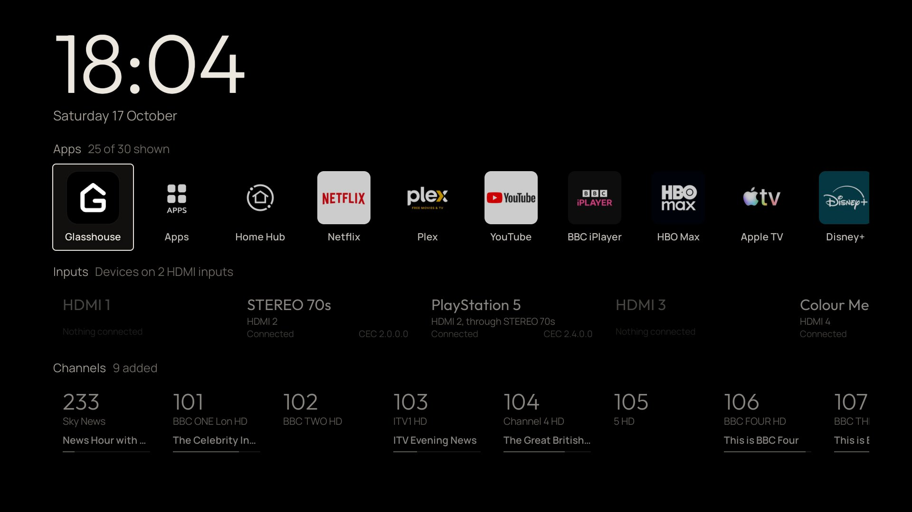
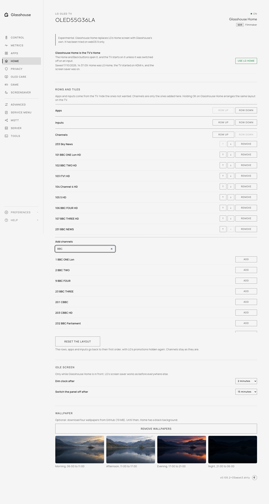
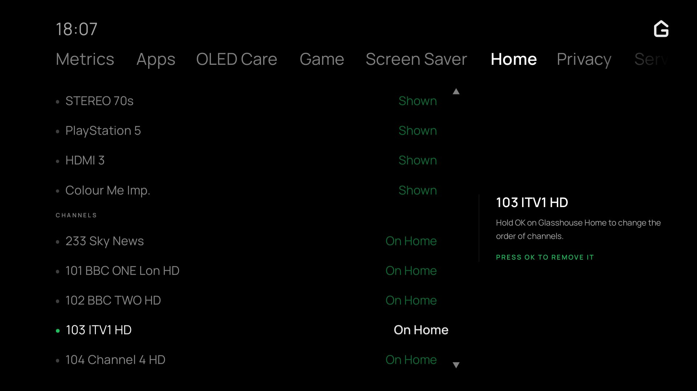
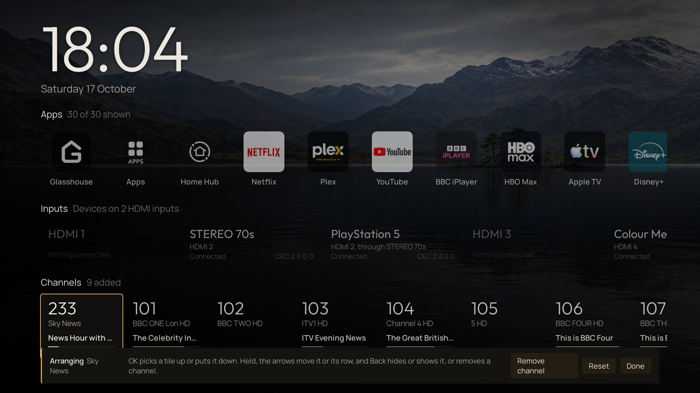

# Home

**Experimental.** Glasshouse Home is a home screen of Glasshouse's own, shown in place of LG's when the remote's Home or Back button is pressed and when the TV switches on. The Home tab switches it on and off and arranges it. It has been tried on webOS 9 and 10, and works on whichever port the dashboard is on. On webOS 11 it is offered once `"allowExperimentalHome": true` is set in `config.json`. Elsewhere neither dashboard shows it, unless it is still switched on or LG's Home has not yet been fully restored.


The screen has a clock and date, what was last on (an app, an input and the devices on it, or a channel and its programme), and three rows:

* **Apps**: every app on LG's Home, with each app's own icon. LG's own promotions (LG Channels, Sports, Always Ready, Alexa, Camera) start hidden. An app hidden under [Hide home screen system apps](apps.md) is hidden here too; hiding an app on this tab hides it on Glasshouse Home only. With [History](advanced.md) on, new apps are placed by how much each is used; otherwise they follow LG's order. **Notifications** and **Search** open LG's notification list and search, which LG's Home reaches from its sidebar. The last tile, **LG Home**, opens LG's Home screen and cannot be hidden.
* **Inputs**: every HDMI input. An input with devices on it has a tile for each device the TV knows over HDMI-CEC, saying which device it is behind ("HDMI 2, through STEREO 70s"); an input with nothing connected is greyed out. Choosing a tile switches the TV to that input. Nothing is sent to the devices themselves.
* **Channels**: the channels added here, in the order they are listed, with the programme on now where the TV's guide has it. Choosing one tunes it.

A row with nothing to show, such as Inputs with every input hidden or Channels with none added, is left out, and the rows that remain sit centred below the clock.

**Back** on Glasshouse Home opens **Recent apps**, as it opens LG's on LG's Home: the apps the TV lists as recent, newest first, each with a snapshot of how it was left (its splash screen, for an app left before the TV last restarted). OK opens one. Down from a card reaches its **Close**, and up from the cards reaches **Close all**; closing an app takes it off the list and stops it. Apps the TV keeps running in the background without a card, such as YouTube when it is kept ready, are not listed. Back again closes the panel. On a TV that gives no list, Back moves to the first tile instead.

OK acts once when released. Back also cancels a panel still loading. A close
that cannot be confirmed shows an error and keeps the cards for retry.

With **Picture details** switched on, on the tab or in the TV app's Home section, a plate in the top right describes the picture of what was last on. It is off by default. For an HDMI input it gives the signal the device is sending (resolution, refresh rate, chroma and bit depth, HDR10, HLG or Dolby Vision, and VRR and low latency when on), read while Glasshouse Home is on screen, and in large type the picture mode the TV gives that signal. Under it is the OLED light (Backlight on an LCD) of that mode. LG keeps a mode for each input and dynamic range, so HDMI 2 and HDMI 4 can differ, and an input switching from SDR to HDR10 shows its HDR mode. An input with nothing sending says only that. For an app, the plate gives the last video it played, noted while it played, as Last video (a Dolby Vision film on Netflix shows Dolby Vision and its mode). A channel's signal is not read, so it shows only the mode it gets in SDR, which nearly all broadcasts are, and its OLED light. An app that has played nothing since the server started shows no plate.

App video tracking runs while Glasshouse Home and **Picture details** are on and the TV is out of standby, including before Home's first visit after a server restart. Switching either off, or the TV going into standby, stops it; videos already noted are kept. Returning to Home applies **Picture details** as soon as its layout arrives; a delayed picture reply cannot bring the plate back or replace a different source's details.

The background is black. The browser dashboard can add an image for each time of day (morning 06:00, afternoon 11:00, evening 17:00, night 21:00): choose a **Time of day**, select a JPEG, PNG or WebP file up to 25 MB, then press **Upload image**. The browser fits it within 1920 × 1080 pixels, the size Glasshouse Home is drawn at, and prepares a JPEG before sending it to the TV. Images fill the screen, may be cropped, and drift slowly. **Remove uploaded images** puts black back. None are included with Glasshouse.

Uploads are stored in `/var/lib/tvweb/home-wallpaper-uploads`, outside the update and rollback payload. A failed or interrupted upload leaves the previous image intact. The directory is removed when Glasshouse is uninstalled; the layout backup does not include image files.





**Colours** sets the text and the accent of Glasshouse Home. The quieter text is a darker shade of the text colour. Once colours are chosen, the accent frames the focused tile and marks what was last on and the tiles being arranged; the default frames the focused tile in the text colour. The tab shows six presets, each as a small preview of the clock, a row name and the accent, with **Text** and **Accent** pickers for any other colour and **Use the default colours** to go back. The TV app's Home section steps through the same presets with OK, and shows Custom for colours picked in the browser. Glasshouse Home changes colour within a few seconds, without being reopened.

The TV's screen saver, LG's or one chosen on the [Screensaver](screen-savers.md) tab, is left as it is set.

## Switching it on and off

**Use Glasshouse Home** asks for a second press, then puts Glasshouse Home in LG's Home's place: the TV then opens it wherever it would open LG's Home, with the Home button, with Back out of the last app, and when it wakes on Home. LG's Home is not altered: Glasshouse Home is laid over it while switched on. With Quick Start+ off, so that every switch-on starts the TV from cold, the one TV setting changed is LG's **Home Auto Launch**, switched off so that the TV does not show LG's Home as it starts; it is left as it is while Quick Start+ is on, which is followed whenever the TV is switched on or off, and **Use LG Home** puts it back as it was. **Use LG Home** takes it away again, and LG's Home is back after about three seconds. The TV app's own **Home** section offers the same, driven by the remote.

While a switch is in progress, further changes are refused with a retry message. A switch-off that is cut short is shown as **Retry restoring LG Home** on both dashboards, and is finished when the server next starts.

Three ways lead back to LG's Home without switching anything off:

* the **LG Home** tile;
* holding the remote's **Home** button for a second or more; a short press on LG's Home then brings Glasshouse Home back;
* Glasshouse Home not answering: if the view stops sending its heartbeat for ten seconds, LG's Home opens instead.

LG's Home opens about two seconds after any of them, and Glasshouse Home takes its place again as soon as something else is opened.

After the TV starts from cold, Glasshouse Home takes LG's Home's place about 27 seconds in (a G3), 37 seconds on a G5. Home pressed in that time leaves the TV on what it is showing, with a message that Glasshouse Home is starting; once Glasshouse Home is in place, Home opens it as usual. Home is held like this for at most 90 seconds after the TV starts, so a TV where Glasshouse no longer runs still reaches LG's Home. Anything else that opens LG's Home in that time, such as Back out of an app, shows LG's Home until Glasshouse Home replaces it.

With Quick Start+ off, until Glasshouse Home is in place the TV shows its last input, as LG's Home Auto Launch is off. Where it was on, Glasshouse Home opens once in place, after a power-on with the remote or the TV's own button, as LG's Home would have; it is not opened after a restart from the menu, where LG's would not be either, or where another input or app has been chosen since the TV started. Switched back on within a few seconds, before the TV has powered off, it opens a second or so after the last input. With Quick Start+ on, switching on from standby is not a cold start: Glasshouse Home is still in place, and the TV opens it at once.

**Hide LG's Home while the TV starts**, on webOS 9 only and off unless chosen, gives LG's Home an empty layout while Glasshouse Home has its place, so that anything opening it in those first seconds shows a black screen instead. It asks for a second press to switch on, and takes effect at once. The layout is kept on the TV, not in Glasshouse: if Glasshouse stops running without switching Glasshouse Home off, for example after a firmware update removes root or `/var/lib/tvweb` is deleted, LG's Home stays black at every start. Over SSH, `tvwebctl restore-glasshouse-home` puts LG's Home back while Glasshouse is installed. Where it is not:

```sh
rm -rf /mnt/lg/cmn_data/manifest /tmp/checkpoint/*com.webos.app.home* /mnt/lg/cmn_data/checkpoint/*com.webos.app.home* && reboot
```

LG's Home then starts on its default layout, without one set with [Home screen layout](apps.md#home-screen-layout). A TV that already had the empty layout from an earlier build keeps the option on.

The Glasshouse server answers about ten seconds later; Glasshouse Home opened in between shows the Glasshouse mark on black, and fades into the home screen once the server answers. After 30 seconds without an answer it says so under the mark. It does the same whenever the server is not running, as during an update. Should the server stop, or fail three times in ten minutes, LG's Home is given its place back until the server is running again.

Over SSH, `tvwebctl restore-glasshouse-home` does what **Use LG Home** does. Uninstalling Glasshouse from the Homebrew Channel switches Glasshouse Home off before deleting the server; a failed switch-off keeps the server for another attempt.

Earlier builds installed a separate Glasshouse Home app and changed the TV's Home and start-up settings to it. The first start of a newer server puts back any of those settings that still name that app, gives the Home button back to LG's filters, and removes the app.





## Arranging

Apps and inputs come from the TV, so they are shown or hidden rather than added. Channels are the other way round: none is on Home until it is added, and one no longer wanted is removed. The Channels row on this tab lists those added, each with **Remove**, and below them **Add channels** finds the rest of the TV's channels by name or number. The TV app's Home section does the same with OK. A change made on either dashboard shows on Glasshouse Home within a few seconds, while it is on screen.

Each row has an **Order**: **Your order**, as arranged, or **Last opened**, with the tile opened last first. Last opened counts an app, input or channel however it was opened, from Glasshouse Home or not: an input switched to from the remote counts for every device on it, and the channel Live TV was left on counts as opened. Tiles not yet opened follow in the row's own order, and **LG Home** stays last. What was opened is recorded only for a row set to Last opened, only while Glasshouse Home is on, and forgotten when the row goes back to Your order. On this tab, a Last opened row's tiles cannot be moved; the TV app's Home section has the same choice at the top of each row's section.

Rows and tiles can be moved here, or on the TV by holding **OK** on Glasshouse Home. Both change the same layout. On the TV, OK picks a tile up or puts it down; while it is held, left and right move it, up and down move its row, and **Back** hides or shows it, or removes a channel. Left of a row's first tile, while arranging, is its Order, which OK switches; picking up a tile in a Last opened row puts the row in its own order, starting from the order shown. **Hide or show** (**Remove channel** on a channel), **Reset** and **Done** are in the bar at the bottom. Hidden tiles show, dimmed, while arranging. A row left out for having nothing to show appears while arranging as an outlined strip with its note, and moves like any other row. **Reset the layout** puts the rows, apps and inputs back in their first order, every row in Your order, with LG's promotions hidden again, and leaves the channels as they are.

The browser dashboard locks editing until each save and refresh finishes. A failed move keeps the accepted order. On the TV, changing Order saves any moves already made and waits for the refreshed tiles before accepting another edit; clicking Order also puts down a held tile. The view confirms a save or reset only after the server accepts it, and reports a failure otherwise.

If the first catalogue fails, input waits for usable tiles, the view asks the server for LG Home and retries while visible. It sends its first heartbeat immediately after rendering. A catalogue reply arriving during arranging cannot replace the edits. Reset leaves the Apps row following its default order. A server update waits until arranging and saving finish before reloading the view.


