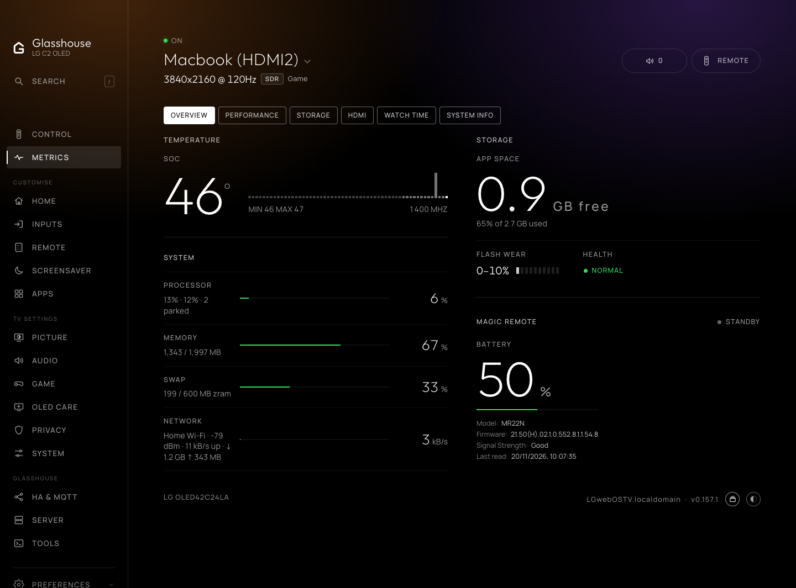
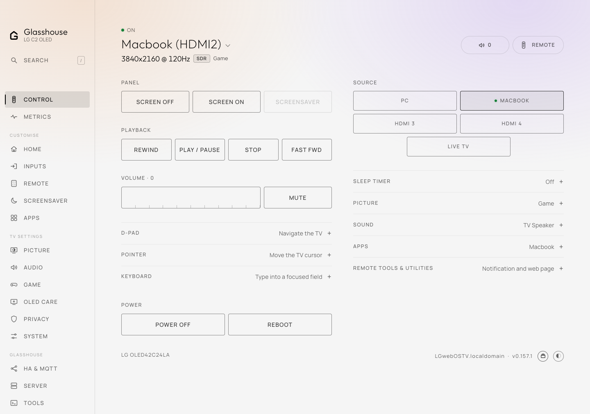

# The dashboard

The dashboard is a web page served by the TV itself. Open `http://<tv-address>:8080/` in any browser on the same network; it needs no internet access.

## Getting around

On a wide screen the tabs are listed down the left, under the TV's name. On a phone, or wherever **Preferences** hides the sidebar, they open from the menu button at the top of the page; in the Android app that button is in the app's bottom bar.

The top of every tab shows what the TV is doing: its state (On, Screen off, Screen saver or Standby), what is on screen in large type, and the picture's resolution, dynamic range and picture mode. Opposite them, **Remote** brings up [the remote](control.md#the-remote-on-its-own) over the tab, with any sleep timer under it.

**Search**, at the top of the sidebar (or `/`, or `Ctrl`/`Cmd` + `K`), finds sections, settings, controls and installed apps. The star beside a result pins it to the sidebar.

**Preferences**, in the sidebar, sets the theme (dark or light, also `/?theme=light`), whether the sidebar shows, the [screen glow](#screen-glow) and the language. The footer names the TV and the Glasshouse version.

## Languages

The dashboard and the TV app come in English, Arabic, Finnish, French, German (partly), Hungarian, Italian, Polish, Portuguese, Brazilian Portuguese, Russian, Spanish, Swedish and Vietnamese, all translated by the community. It follows the browser's language until one is chosen under **Preferences**. [Translating the dashboards](../STRINGS.md) explains how to add or improve one.

The web dashboard serves its fonts locally, including Onest for Cyrillic headings in tabs and settings dialogs; see the [Apps headings](../screenshots/ru-apps-headings.png) and [Picture frame dialog](../screenshots/ru-picture-frame.png) in Russian.

## The tabs

Each tab has a link of its own, such as `/?tab=remote`. A tab whose feature the TV does not have is left out: OLED Care on an LCD, Ambient Light without PicCap or Hue Sync.

-   **[Control](control.md)**

    ---

    The remote, with a D-pad, touchpad, motion and keyboard, plus inputs, volume, playback, picture presets and screen off.

-   **[Metrics](metrics.md)**

    ---

    Live temperatures, processor, memory and network, with Performance history, Storage, HDMI, Watch time and System info.

### Customise

-   **[Home](home.md)**

    ---

    Glasshouse Home, an ad-free home screen in place of LG's, or another launcher: Glasshouse Minimal, Glasshouse Bar or your own. Also Internet TV and Home Assistant on Home.

-   **[Inputs](inputs.md)**

    ---

    Which inputs are offered and what they are called, the input bar, and the No Signal screen.

-   **[Remote](remote.md)**

    ---

    What the remote's buttons do, and what holding a number key opens (Quick Access).

-   **[Screen savers](screen-savers.md)**

    ---

    Twenty-one screen savers in place of LG's, from a picture frame and a clock to Home Assistant readings, and community ones to install.

-   **[Apps](apps.md)**

    ---

    Install and remove apps, saved web pages, apps kept in memory, background services, and DNS for single apps.

### TV settings

-   **[Picture](picture.md)**

    ---

    LG's picture settings for what is on screen.

-   **[Audio](audio.md)**

    ---

    Sound settings, LG Wi-Fi soundbars, Bluetooth audio, and the formats the TV and its receiver report.

-   **[Game](game.md)**

    ---

    Live frame rate, VRR and the Game Optimizer.

-   **[OLED Care](oled-care.md)**

    ---

    Panel wear and the burn-in protections, service-menu ones included.

-   **[Ambient Light](ambient-light.md)**

    ---

    PicCap and Hue Sync, switched and set up in one place.

-   **[Privacy](privacy.md)**

    ---

    Screen recognition, ad tracking, data agreements and the ad blocker.

-   **[System](advanced.md)**

    ---

    Power and standby, screen time limits, TV updates, HDMI, front lights and the [service menu](service-menu.md).

### Glasshouse

-   **[HA & MQTT](../HOME-ASSISTANT.md)**

    ---

    The bridge to Home Assistant or another MQTT client, the Home Assistant API and the control bar.

-   **[Server](server.md)**

    ---

    Updates, backups, the TV's name, access and Glasshouse's own settings.

-   **[Tools](tools.md)**

    ---

    The TV's system log, Glasshouse's own log and the kernel's, in one list.

The [Glasshouse apps](../apps/tv-app.md) put the same dashboard on the TV itself, on Android, and on macOS, iPhone and iPad.

## Screen glow

The dashboard can take its light from the TV. The top of the page, the sidebar included, glows with the colours on the TV's screen, the left half's colour on the left and the right half's on the right, and fades as the picture changes, as a room takes its light from the TV. It is off until switched on in this browser under **Preferences** in the sidebar, or with the glow button beside the light and dark switch at the foot of the page. Searching for "glow" finds both.

While the glow is on and the page shows, the TV captures a 64 by 36 pixel copy of its screen every 3 seconds, works out its colours and deletes the copy, so only the colours leave the TV. The glow pauses while the screen is off, while the source says a game is playing, and while PicCap or Hue Sync is capturing the screen, which **Preferences** and the glow button then say, and protected video, such as Netflix's, gives none. **Screen glow** on the [Server](server.md) tab switches it off for every browser. A TV whose software has no screen capture service doesn't offer the glow at all: its switches are hidden, and the Server tab says why.

## In both themes

=== "Dark theme"

    

=== "Light theme"

    

*Metrics and Control tabs, shown in dark and light themes, with the [screen glow](#screen-glow) taking its colours from the TV.*
