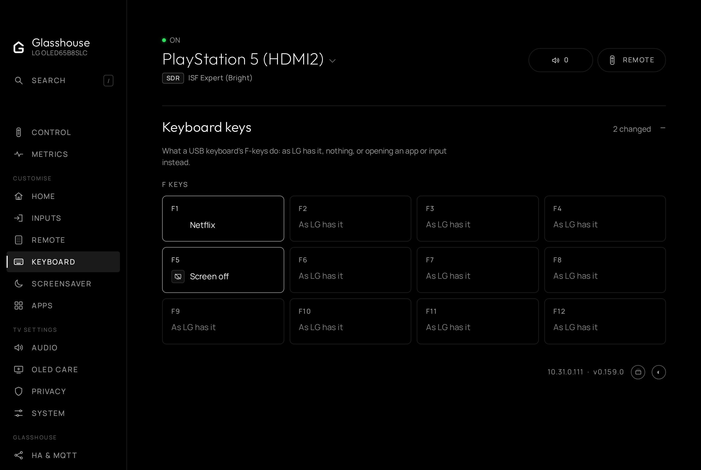

# Keyboard

Sets what a USB keyboard's F-keys do. Each key is a tile showing what it does, and selecting one opens its choices beneath the row, the same as a remote key.

**F1** to **F12** are the Fn+F1 to Fn+F12 keys. **As LG has it** leaves a key to the TV, so Fn+F5 still opens quick settings. Set to an app, an input, nothing or an action, the key does that instead, including on F2, F4, F5, F7 and F10 to F12, which LG otherwise uses for the inputs panel, Home, quick settings, LG Channels, mute and the volume.

Ctrl combinations are not offered. The TV acts on them before Glasshouse sees them, so there is no F-key to set.

The tab appears only where Glasshouse can take these keys: webOS 4 to 10. The bare top row, without Fn, sends browser and media keys rather than F1 to F12, so it is not set here.
