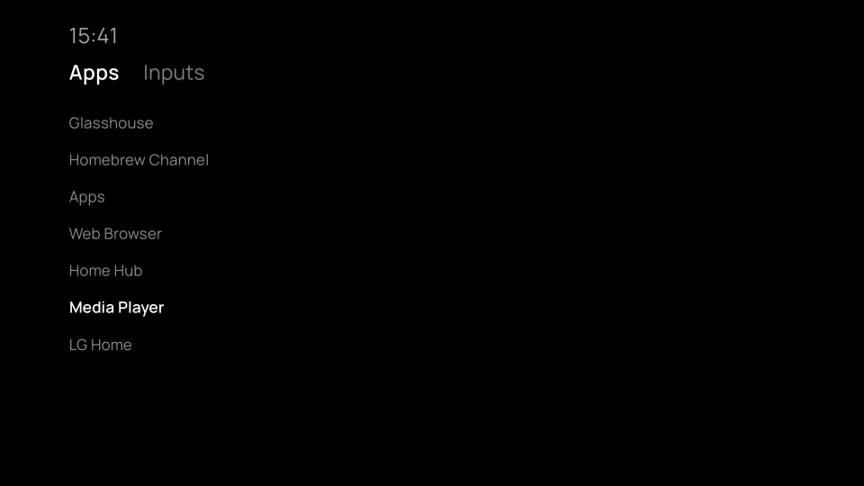
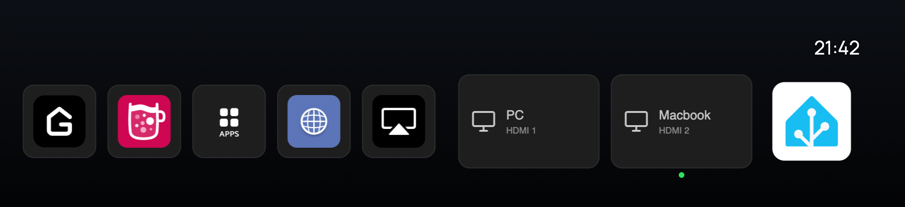

# Launchers

The **Home** tab chooses what opens when you press **Home** (or **Back** at the top level) on the remote: LG's Home, [Glasshouse Home](home.md), or one of the other launchers on this page.

## Choose your launcher

Preview cards at the top of the **Home** tab switch between five launcher options on a single click:

| Launcher | How it works | Availability |
| :--- | :--- | :--- |
| **LG Home** | Restores LG's built-in Home screen (`com.webos.app.home`) and hands the Home key back to it. | Every TV |
| **[Glasshouse Home](home.md#what-is-on-screen)** | Full-screen replacement with live preview, wallpapers, clock, weather, and customisable rows for Apps, Recommended, Inputs, Channels, and Internet TV. | Every webOS version; [untried versions](../tested-tvs.md#launchers-and-overlays-by-webos-version) show a warning |
| **[Glasshouse Minimal](#glasshouse-minimal)** | Distraction-free two-column text list of your apps and inputs plus a pixel-shifting clock on pure black. | Same as Glasshouse Home |
| **[Glasshouse Bar](#glasshouse-bar)** | An overlay row along the bottom of the screen over whatever is playing, keeping LG's Home in place underneath. | webOS 4–10, and 11 on a TV Glasshouse lists |
| **[Custom](#custom-launcher)** | Replaces LG's Home with an uploaded `.ipk`/`.zip`/`.html` app or a full-screen web URL (such as Home Assistant). | Same as Glasshouse Home |

> [!NOTE]
> On webOS 2 and 3, which have no remote key filters, Glasshouse Home reads the Home press from the remote itself and opens straight after, so LG's ribbon shows for about a second first, each time Home is pressed, even with Glasshouse Home already open (a 60UJ6519, webOS 3.9.3). Taking the press before LG's ribbon sees it would need a native program on the TV; see [why](../tested-tvs.md#why-some-versions-are-not-offered).
>
> On webOS 4 (tried on a B8), LG's launcher is an in-compositor ribbon and Glasshouse Home runs as a standalone app (`com.tvweb.home`) launched by the remote key filter, so **Back** dismisses it. On webOS 5 and 6 (tried on a CX, C1 and B1), running standalone avoids app-manager restarts that break DRM/audio on takeover mounts, though switching the launcher itself or holding Home for LG's Home restarts the app manager and closes open apps. On webOS 7, 9, 10 and 11, Glasshouse Home is bind-mounted over LG's Home without modifying the root filesystem.

## Switching it on and off

Under **Choose your launcher** on the web dashboard's **Home** tab, preview cards offer **LG Home**, **Glasshouse Home**, [Glasshouse Minimal](#glasshouse-minimal), [Glasshouse Bar](#glasshouse-bar) and [Custom](#custom-launcher); click one to switch, or switch it on in the TV app's **Home** section. Glasshouse Home is mounted over LG's launcher without modifying the root filesystem (on webOS 3 to 6 it runs as a standalone app, `com.tvweb.home`, beside LG's, with the remote's Home key pointed at it by the compositor filter, as taking LG's launcher's place there restarts LG's app manager, which stopped protected video and HDMI audio on webOS 5 and 6). On webOS 5 and 6, where closing an app opens LG's full-screen Home, Glasshouse Home opens as the app closes, so LG's Home does not open at all, unless LG's Home was asked for, from the **LG Home** tile or a held **Home**. **Back** on Glasshouse Home there opens the recent apps strip, as on webOS 7 and later, since closing it would open LG's Home. Choosing **LG Home** (or running `tvwebctl restore-glasshouse-home` over SSH) restores LG's launcher within a few seconds.

* **webOS versions:** Glasshouse Home, Glasshouse Minimal and Custom are offered on every webOS version, and Glasshouse Bar on webOS 4 to 10, and on webOS 11 on a TV whose key handler Glasshouse knows how to change (an OLED48C31LA on firmware 44.00.92 so far) ([why not elsewhere](../tested-tvs.md#why-some-versions-are-not-offered)). Where no one has yet reported one working on the TV's version, a note under the cards says so, with links to report a problem or that it works. Choosing **LG Home** puts everything back. See [Launchers and overlays by webOS version](../tested-tvs.md#launchers-and-overlays-by-webos-version). On webOS 5 and 6 the app manager has no way to read an appinfo.json again without a restart, so each switch restarts it and the app in front comes back a moment later.
* **Reaching LG's Home without turning Glasshouse Home off:**
  * Select the **LG Home** tile at the end of the Apps row, unless it has been hidden.
  * Hold the remote's **Home** button for 1 second (a short press on LG's Home returns to Glasshouse Home).
  * Stop the Glasshouse server: if Glasshouse Home stops answering or the server is stopped/uninstalled, LG's Home automatically takes its place back.
  * Glasshouse Home not opening: if a short press of **Home** brings nothing from Glasshouse Home, LG's Home opens instead. Where the TV's web app manager, which runs Glasshouse Home, has stopped, this is decided after five seconds, and the web app manager is started again first and Glasshouse Home given one more try. Where it is running, Glasshouse Home may only be slow to load, as on the first press after a reboot, so it is given 20 seconds. An app opened from Glasshouse Home is given 30 seconds to show its window before Glasshouse Home counts as not answering, as some, such as Nuvio, show LG's loading screen for several seconds first. A press of **Home** that only ends the screen saver opens nothing, as on LG's own Home, and is not taken for one that should open Glasshouse Home.
* **Cold boot & standby:** [Open Home at power-on](home.md#open-home-at-power-on) controls whether the TV opens the Home screen when switched on or stays on the last input (LG's Home Auto Launch). With Quick Start+ (Active Standby) on, Glasshouse Home opens immediately on wake (and on TVs like the C4 on webOS 10.3.1 that start on their last input anyway, Glasshouse Home is opened over it when Open Home at power-on is on). On a cold boot (Quick Start+ off), Glasshouse Home takes over about 25–40 seconds after power-on; pressing Home during startup keeps the TV on the current input with a brief notice until ready.
* **Reopen Home after a wake (webOS 11):** On by default. A few seconds after the TV wakes, Glasshouse Home is closed and opened again, which brought back the remote on a C5 where it stopped answering after a wake. It shows as Home going away and coming back. Switched off, Home is left as it is: use that on a TV whose remote answers after a wake without it.
* **Hide LG's Home while the TV starts (webOS 9 optional setting):** Replaces LG's Home layout with a blank screen during the first seconds of a cold boot so LG's launcher never flashes on screen.

> [!WARNING]
> **If `Hide LG's Home while the TV starts` is enabled** and Glasshouse is removed manually without choosing **LG Home** or running `tvwebctl restore-glasshouse-home` (for example, if a firmware update removes root), LG's Home will remain blank until its layout cache is cleared over SSH:
> ```sh
> rm -rf /mnt/lg/cmn_data/manifest /tmp/checkpoint/*com.webos.app.home* /mnt/lg/cmn_data/checkpoint/*com.webos.app.home* && reboot
> ```

## Glasshouse Minimal

**Glasshouse Minimal**, beside **Glasshouse Home** under **Choose your launcher**, is a second home screen that comes with Glasshouse, made to be as plain as it can: the TV's apps and inputs as two lists of names on black, and the time, in the type of the Glasshouse TV app. **Left** and **Right** choose between Apps and Inputs, **Up** and **Down** move through them, and **OK** opens; **Home** comes back to the first app, and the last entry under Apps opens LG's Home. Choosing **Glasshouse Minimal** puts it in place within a few seconds, and choosing **Glasshouse Home** goes back. It works as a custom launcher does, below: the Home button, Back and waking open it, and **Rows and tiles** decides which apps and inputs it lists and in what order, with those in More apps after the rest. Every few minutes the whole screen moves a few pixels, so that the names do not stay in one place on an OLED panel.



## Glasshouse Bar

**Glasshouse Bar**, under **Choose your launcher**, is a launcher that leaves the picture on screen. The remote's **Home** button brings up a row along the bottom, over whatever is playing: the apps of Glasshouse Home's Apps row, in the order and with the hiding set on this tab (apps in **More apps** and saved web pages are left out), the **LG Home** tile where that row has it, and the inputs and Live TV as the Inputs row has them, the input on screen marked. **Left** and **Right** move along it, **OK** opens, and **Back** or **Home** closes it. With the Magic Remote, pointing at a tile picks it and clicking opens it.

LG's Home keeps its place, so the TV shows LG's Home when an app closes. The TV starts in LG's Home. Pressing **Home** there covers LG's Home with black and shows the bar on it, as webOS 5 leaves it, and over an app or an input the bar shows over the picture. Choosing Glasshouse Bar switches Glasshouse Home off. It is an overlay window opened by the remote's Home key, as the [input bar](inputs.md#glasshouse-input-bar) is, so it is offered on webOS 4 to 10, and webOS 3 does not offer it. On webOS 11 LG's Home key cannot be pointed at an app, so Glasshouse changes a few bytes of LG's `libsystemUI.so` in a copy mounted over it, where it knows the TV's build, and the Home key then opens the bar. Choosing the bar, or another launcher after it, restarts the TV's screen once, which takes about 35 s, and the change is made again each time the TV starts. A TV whose build is not known is not offered the bar.

Its app, `com.tvweb.homebar`, has no tile of its own. It is kept loaded in the background while chosen, so a press shows it at once. Choosing any other launcher gives the Home button back and removes the app.

**On a remote key, beside Glasshouse Home.** The Bar can also be opened by another key while Glasshouse Home or LG's Home keeps the Home button: choose **Glasshouse Bar** for a key on the [Remote tab](remote.md#available-actions), such as an app button or a colour key. A press brings it up over whatever is playing, and a second press closes it. Pressed over Glasshouse Home itself, the key does nothing. Beside Glasshouse Home the **LG Home** tile is left out of the row, as **Home** opens Glasshouse Home and holding it opens LG's Home. The app is kept loaded while a key opens it, and removed once no key does and the Bar is not the launcher.

The Home button on the web dashboard's remote opens it too. A phone remote app that opens LG's Home directly, rather than pressing Home, opens LG's Home, as Glasshouse Bar leaves it in place. With the Magic Remote, a notch of the scroll wheel moves the row a tile, and resting the pointer near either end of the row steps it along, as on Glasshouse Home. **Smooth scrolling**, under Animations on the Home tab, applies to the Bar too: off, the row jumps rather than glides.

When the **Home Assistant API** has at least one control bar entity, **Home Assistant bar tile**, under **Glasshouse Bar** on the Home tab and in the TV app, adds a **Home Assistant** tile at the end of Glasshouse Bar that opens the [Home Assistant control bar](../HOME-ASSISTANT.md#home-assistant-control-bar).



## Custom launcher

A home screen of your own can take Glasshouse Home's place: a launcher you have written or downloaded, or a web page such as a Home Assistant dashboard. Everything above still applies to it. The Home and Back buttons open it, it opens when the TV wakes on Home, holding **Home** opens LG's Home, and if it stops working, LG's Home takes its place by itself.

Under **Choose your launcher** on the web dashboard's **Home** tab, choose **Custom**. Its settings open below it, to set one up, either:

* **Community launchers:** Install third-party launchers from [rorygallagher2024/glasshouse-catalog](https://github.com/rorygallagher2024/glasshouse-catalog) (or test one from an `https://` GitHub repository or `.zip` link when **Install app from a URL or file** is enabled). Each listing names its author, licence, version, and source repository. The first is Glasshouse's own **Example launcher**, a simple home screen of the TV's apps and inputs as tiles with a clock, to use as it is or as a starting point. See [Writing a launcher](../development/WRITING-LAUNCHERS.md) to build and submit one.
* **Upload a launcher:** a web app as an `.ipk` package, a `.zip` of its folder, or a single `.html` file, up to 50 MB. Native apps can't be used. As with installing an app from a file, this needs **Install app from a URL or file** switched on on the [Apps tab](apps.md#install-app-from-a-url-or-file), or a token.
* **Or open a web page:** an address starting with `http://` or `https://`, shown full screen. Some sites refuse to be shown inside another page; Home Assistant does unless it is told to allow it ([Writing a launcher](../development/WRITING-LAUNCHERS.md#a-web-page) has the setting).

You have one at a time: uploading another, or giving a web address, replaces it, and **Remove** deletes it. With Glasshouse Home already on, it takes Glasshouse Home's place as soon as it is set up. Once one is set up, clicking **Custom** makes it the TV's Home. Its settings show only while **Custom** is chosen. Choosing **Glasshouse Home** goes back and keeps the launcher for later. The TV app's **Home** section has a switch for it.

While Glasshouse Minimal, Glasshouse Bar, or a custom launcher is active, **Rows and tiles** remains on this tab for the Apps row (which apps are shown and in what order); inputs and **Hide inputs with nothing connected** are configured on the [Inputs tab](inputs.md#your-inputs). Glasshouse Minimal and Glasshouse Bar follow both; a custom launcher follows them where it was written to. Glasshouse Home's other settings (Recommended, channels, background, colours, and visual options) have no effect and return when you switch back to Glasshouse Home.

> [!WARNING]
> A launcher can do anything on the TV that Glasshouse can, so only use one you trust.

[Writing a launcher](../development/WRITING-LAUNCHERS.md) covers making one: what Glasshouse adds to its page, and the calls for listing and opening the TV's apps and inputs.

