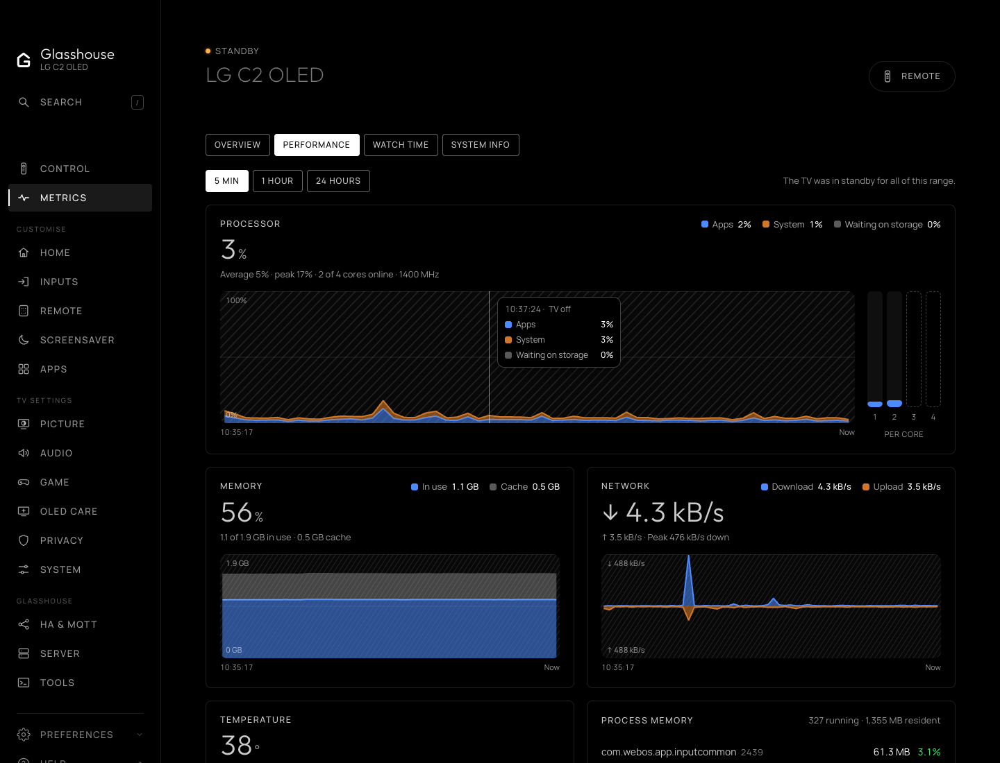
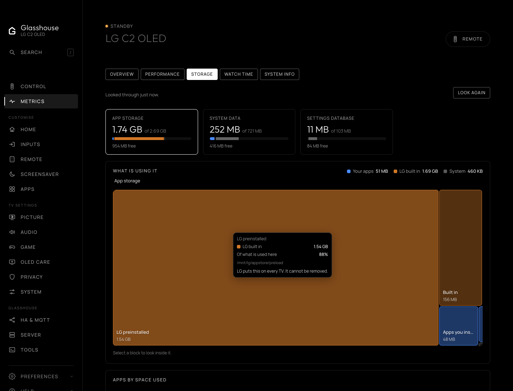
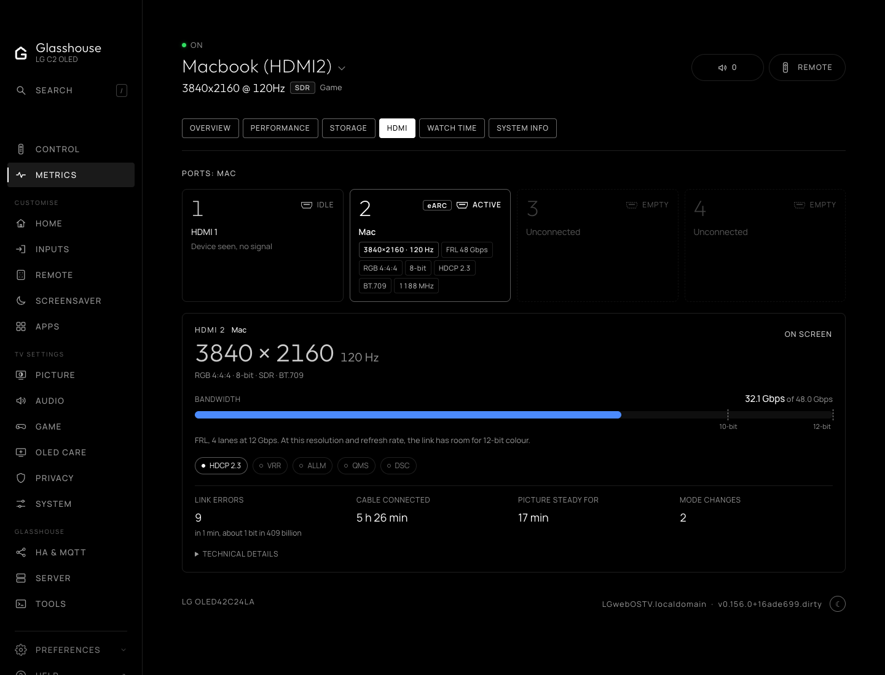
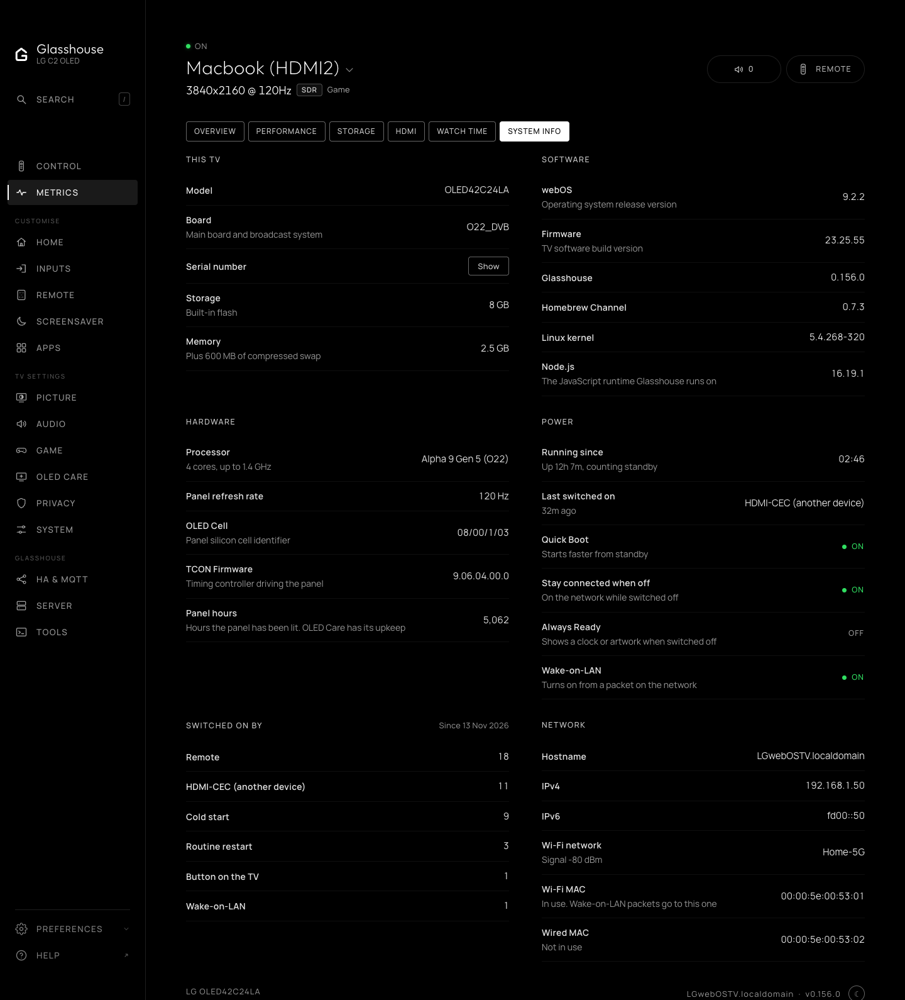
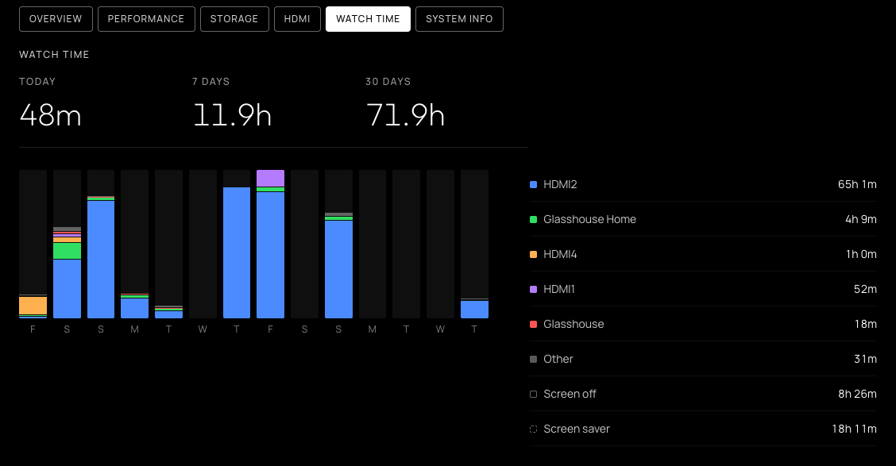

# Telemetry and diagnostics

The **Metrics** tab (`/?tab=metrics`) exposes live hardware and software telemetry from the TV, most of which is absent from LG's own settings menus. Its views are split into **Overview** (live telemetry), **[Performance](#performance)** (the processor, memory, network and temperature over time, with the process lists), **[Storage](#storage)** (what fills the TV's storage, and which apps take the most), **[HDMI](#hdmi)** (each input's link in detail), **Watch time** (when enabled), and **[System info](#system-info)** (what the TV is, what it runs, how it has been switched on, and its network addresses).

*System, processor, memory, swap and network readouts on the Metrics tab.*

-   **System & processor**

    ---

    SoC temperature, overall and per-core CPU load, GPU clock, memory, and swap. The [Performance](#performance) view charts them over time, beside a breakdown of resident memory (with RAM percentage) and the top CPU processes with their PIDs, both colour-coded by usage level.

-   **Network & storage**

    ---

    Wi-Fi signal strength (RSSI), live network throughput, eMMC flash wear (JEDEC health), and free app-partition storage.

-   **HDMI port bay**

    ---

    On the [HDMI](#hdmi) view: visual port status showing whether a device is on each port (or, where the TV can tell, only a cable with nothing on its other end), eARC port, connected device name, resolution and refresh rate, link speed (FRL 48 Gbps or TMDS), chroma, color depth, HDCP version, and gaming flags (VRR, ALLM, QMS).

-   **Active picture & sound**

    ---

    Source HDR format (SDR, HDR10, HLG, Dolby Vision, or player-led low-latency Dolby Vision), picture preset, OLED light level, raw HDMI signal (`3840x2160 @ 120Hz`), audio output routing, and the active app or friendly input name (`Apple TV (HDMI2)`).

-   **Magic Remote**

    ---

    Battery level and when it was last read (from LG's remote service where it reports a percentage or step, and over Bluetooth on webOS 9 and 10), live Bluetooth status (`Connected` / `Standby`), signal strength, remote model, and firmware version, retained across server restarts.

-   **Hardware & firmware**

    ---

    webOS and firmware versions, SoC architecture, OLED cell ID, and TCON firmware where the platform exposes them.

## Performance

The **Performance** view (`/?tab=metrics&open=performance`) charts the TV over the last **5 minutes**, **hour** or **24 hours**:

* **Processor:** time spent in apps and in the system, stacked, with time waiting on storage above them in grey. Beside the chart, a bar for each core shows its load now. webOS parks cores it does not need, and a parked core shows as an empty outline rather than a bar at zero.
* **Memory:** memory in use by programs, with the cache the system can give back above it.
* **Network:** download above the middle line and upload below it, on the same scale.
* **Temperature:** the SoC temperature, where the TV has a sensor.
* **What was on screen:** each change of app or input is marked along the processor chart and drawn as a faint line down every chart, so a spike can be matched to what caused it. Time with the TV or its screen off is shaded. The app in front is known while Glasshouse follows it: with Watch time, Glasshouse Home or Home Assistant on, or while a dashboard is open.
* **Readings:** point at any chart to read the values and the app in front at that moment.

Glasshouse takes a reading every 5 seconds from the start of the server, whether or not a dashboard is open, so the charts are already filled when you open them. The last hour is kept at 5 seconds and the last day at one reading a minute (the average of that minute). Each reading only reads a few system files and asks the TV nothing. The history is kept in memory, never written to the TV's storage, so it begins again when the server restarts.

The process memory and CPU lists sit below the charts and refresh while the view is open.

## Storage

The **Storage** view (`/?tab=metrics&open=storage`) shows what is using the TV's storage:

* **Partitions:** a card for each part of the storage the TV can write to (apps, system data, the settings database, and a USB drive when one is plugged in), with how much is used and free. The bar splits what is used between your apps, what LG puts on every TV, and the system.
* **What is using it:** a map of the selected partition, each block sized by the space it takes and coloured by who put it there. Select a block to look inside it and the path above the map to come back out. Point at a block (or move to it with the keyboard) to see its size, its share of the partition and where it is. LG's own content, such as the store demo videos most TVs carry, is marked as something that cannot be removed.
* **Apps by space used:** every app with its files totalled wherever they are kept: the app itself, its artwork, its sandbox and its saved state. Built-in apps and the ones you installed are marked, and Glasshouse is listed too.

Glasshouse looks through the storage when you open the view, at most every ten minutes, or when you select **Look again**. On a C2 this takes under a second. The view only shows: apps you installed can be removed from the [Apps](apps.md) tab.

## HDMI

The **HDMI** view (`/?tab=metrics&open=hdmi`) shows the four ports, then each input with a device switched on in detail, the one on screen first:

* **The mode:** resolution, refresh rate, chroma, bit depth, and for the input on screen its dynamic range and colour space.
* **Bandwidth:** how much of the link the picture takes, against the link's rated speed (FRL 48 Gbps, or TMDS up to 18 Gbps), with marks for what the same mode would take at 10-bit and 12-bit colour, and whether they would fit. The figures include the link's coding, as HDMI's own tables give them: 4K 120 Hz RGB is 32.1 Gbps at 8-bit, 40.1 at 10-bit and 48.1 at 12-bit.
* **What the two ends agreed:** HDCP version, VRR (with its range), ALLM, QMS, DSC and Dolby Vision, each shown on or off.
* **Link health:** errors the TV counted on the link since Glasshouse first saw it connected, with the rate (such as "about 1 bit in 400 billion"); how long the cable has been connected; how long the picture has been steady; and how many times the mode has changed.
* **Technical details:** the video code (VIC), total timing, pixel clock and link mode.

A device that is switched on but not sending a picture (asleep, or waiting to be chosen) is listed as such. The detail comes from the status files of LG's HDMI driver. Older TVs, such as a C9 on webOS 4, report only the mode each input sends, which shows on its port.

## System info

The **System info** view (`/?tab=metrics&open=info`) shows the TV's details in six groups. A row appears only when the TV reports its value, so an older TV shows fewer rows, and a group with none is left out.

* **This TV:** model, main board, serial number, built-in storage, and memory (with the compressed swap). The serial number stays hidden until you select **Show**.
* **Software:** webOS, firmware, Glasshouse, the Homebrew Channel, the Linux kernel, and the Node.js version Glasshouse runs on.
* **Hardware:** processor (with its cores and top clock speed), panel refresh rate, OLED cell, TCON firmware, and panel hours. [OLED Care](oled-care.md) has the panel's upkeep.
* **Power:** when the TV last started (standby counts as running), what last switched it on and when, and whether Quick Boot, Stay connected when off, Always Ready and Wake-on-LAN are on.
* **Switched on by:** how many times the TV has been switched on each way, such as the remote, HDMI-CEC from another device, the button on the TV, or Wake-on-LAN. Glasshouse counts each power-on once, and keeps the counts on the TV in `/var/lib/tvweb/power-ons.json`. The first counts come from Glasshouse's own log, so they start a few days back.
* **Network:** hostname, IPv4 and IPv6 addresses, the Wi-Fi network and signal, and both MAC addresses, with the one in use marked. A [Wake-on-LAN](advanced.md#wake-on-lan) packet has to go to the MAC address in use.

## Watch time

> [!NOTE]
> **Opt-in by default:** Watch time is off until enabled under **Watch time** in the [Server tab](server.md#glasshouse), as it records which apps and inputs are used.

When enabled, the server tracks how long the screen is on with each app or input in the foreground:

* **What is counted:** Active viewing time per app and input. Time spent with the TV on but the panel blanked (such as listening to music) is recorded separately as **Screen off**, and time spent on LG's screen saver is recorded as **Screen saver** — neither is added to the viewing totals or daily bars.
* **What the card shows:** Totals for today, the last 7 days, and the last 30 days; a daily bar chart for the last 14 days; and the top five apps and inputs over the last 30 days. Totals use the viewing browser's local timezone and refresh every 30 seconds while the tab is open.
* **Storage & retention:** History is stored locally on the TV in `/var/lib/tvweb/history` for 13 months. Turning Watch time off keeps existing history without recording new activity; **Clear history** in the Server tab deletes it. Because time is counted while the server runs, an unpowered TV is not counted and a sudden power cut can lose up to the last 10 minutes.
* **Smart home & metrics:** While enabled, Home Assistant receives [three watch-time sensors](../HOME-ASSISTANT-ENTITIES.md#hardware-remote-system-diagnostics) and Prometheus exposes `glasshouse_watch_seconds_total`.
