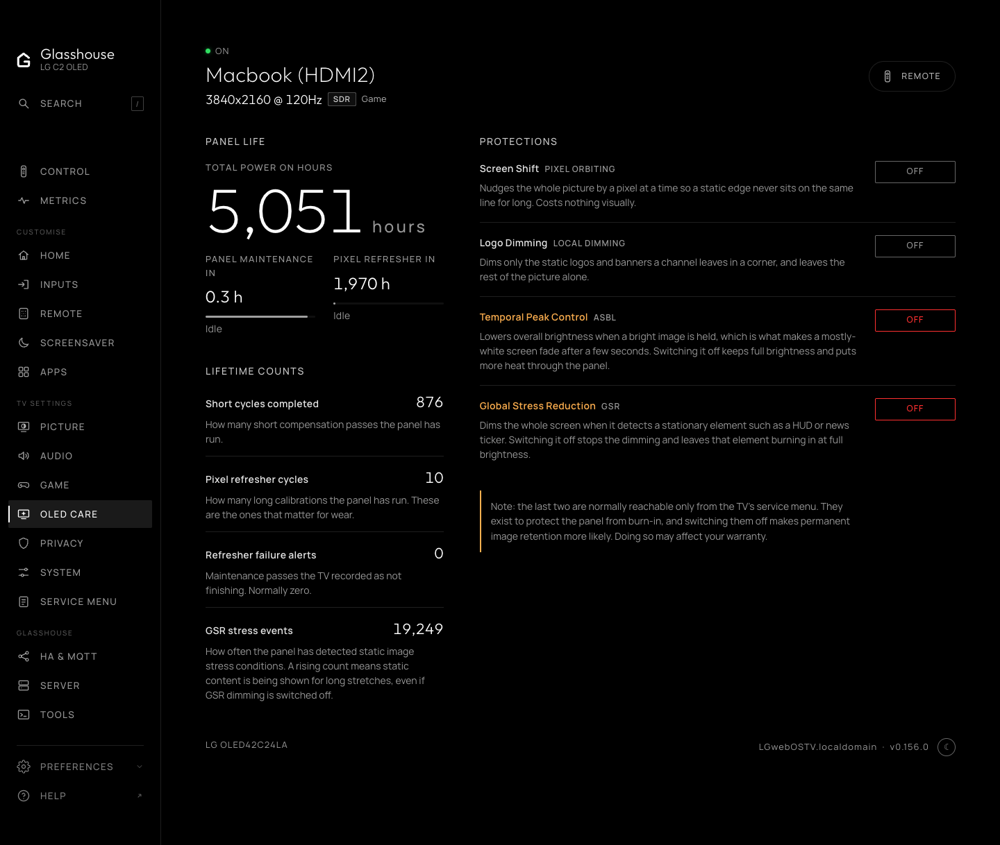

# OLED wear and burn-in protection

The **OLED Care** tab, `/?tab=oledcare`, brings together the panel's own wear figures with the protections that affect OLED wear.

The aim is not to encourage disabling OLED protections blindly. Instead, the dashboard shows what each control does and exposes the controls that the particular panel makes available.

* Cumulative panel hours, panel maintenance and Pixel Refresher countdowns with scheduling, completed cycle counters and refresher failure alerts.
* GSR stress events on supported panels — counts how many static image stress intervals (such as logos, HUDs, or news tickers) the panel has detected, even if active dimming is switched off.
* Stored calibration files, on a TV that keeps them: the size and a checksum of each picture calibration file (1D and 3D LUT, gamut matrix, enable flag), never the contents. This is the stored state, not what the panel is showing now; the section is hidden where the TV has no such folder.
* Screen shift and logo dimming on any OLED.
* Temporal peak control (ASBL) and global stress reduction on supported models (the two normally reachable only from the TV's service menu, with a service remote and a PIN).

*OLED panel wear information, maintenance cycle progress and burn-in protection controls.*

*Panel life, maintenance and Pixel Refresher status.*
