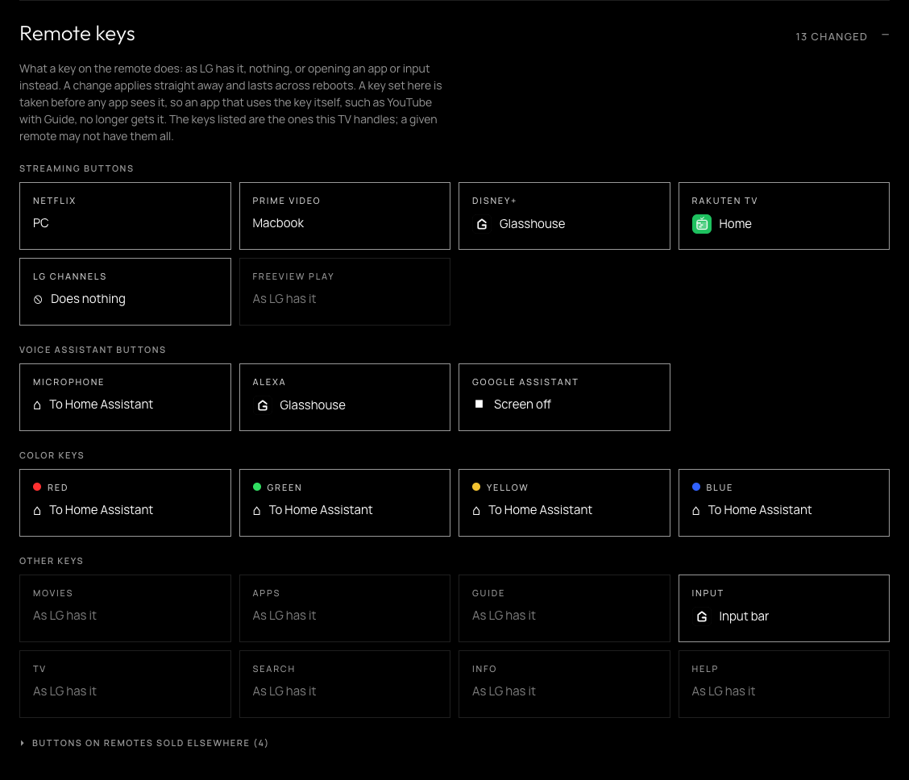

# Remote

The **Remote** tab, `/?tab=remote`, sets what the remote's keys do: the number keys held down, under **Quick Access**, and the other buttons, under **Remote keys**. It appears when the dashboard opens, and is left out on a TV with neither.

# Quick Access

Sets what each number key on the remote opens when it is held: an installed app, an HDMI input or Live TV, for keys 1 to 9. The keys are tiles laid out as the remote's number pad, each showing what it opens; choosing one opens the choices under its row, as for Remote keys. Holding 0 shows the list on the TV. A change applies straight away, the same as changing it in the TV's own Quick Access list, which shows it too.

**As LG has it** puts a key back as it was before Glasshouse first changed it, or, for a key changed by an earlier release, LG's own default for it, such as Quick Help on 9. **None** leaves a key opening nothing, including one LG set itself, such as its help on 9. Uninstalling, or `tvwebctl restore-keys`, puts every key Glasshouse changed back as it was. A streaming button set to None is still reported to Home Assistant as a [remote button event](../HOME-ASSISTANT-REMOTE-BUTTONS.md). A key LG set for an app that is not installed, as it does for some regions' channel apps, shows as **App not installed**, with the app's id beneath. A key set to a live TV channel on the TV shows the channel, and can be changed here but not set to another channel. The TV app lists the keys without changing them.

# Remote keys

Configures what individual remote buttons do when pressed. Each key appears as a tile showing its active assignment, grouped under **Streaming buttons**, **Voice assistant buttons**, **Color keys**, and **Other keys**. Selecting a tile opens its available choices beneath the row.

On webOS 11, **Ivi**, **Okko**, **Kinopoisk** and **LG Shop** are also offered under Streaming buttons when LG enables their assignments. They can open an app or input, do nothing, or return to **As LG has it**. A listed button may be absent from the physical remote.

Core keys (**Home**, **Back**, volume, mute, channel, and power) are reserved and cannot be reassigned, apart from the channel keys on some webOS 11 TVs (see below). The microphone button can be reassigned; setting it to another action overrides both press and hold, replacing LG's voice control until returned to **As LG has it**.

## Available actions

* **As LG has it:** Keeps the TV's default behavior for that key.
* **Open an app, an HDMI input, or Live TV:** Launches the selected target directly.
* **Input bar:** Opens Glasshouse's [input bar](inputs.md#glasshouse-input-bar) overlay instead of LG's inputs list.
* **Glasshouse Bar:** Opens [Glasshouse Bar](home.md#glasshouse-bar) over whatever is playing, while Glasshouse Home or LG's Home keeps the Home button. Offered on webOS 4 to 10, as the Bar is.
* **Input switcher:** Opens LG's quick input picker on TVs that support it (such as a C5 on webOS 11).
* **Screen off:** Blanks the display while audio continues playing; pressing any key turns the screen back on.
* **Brightness up** and **Brightness down:** Raises or lowers the panel brightness (OLED Light, or Backlight on an LCD) by the **Brightness step** per press, 10 points unless changed (5 to 25 on the Remote tab, out of 100), for the current picture mode and input, within 0 to 100. A held key repeats. Each press also shows the level in a bar laid out like the TV's own volume bar: vertical, at the right edge, with a sun above and below the track and the level beside it. It fades out about 1.6 s after the last change. **Level bar style**, in the same section, can change it to a horizontal bar low on the screen, to the same bar vertical at the right edge, or to **No bar**: the key then changes the brightness and shows nothing, and the input bar's app is taken off the TV unless an Input bar key needs it. It is Glasshouse's own bar, so it comes from the input bar's app (webOS 4 to 10), and the TV's own volume bar is not replaced. Set one key to each. The Brightness step is in the **Brightness key settings** section at the bottom of the Remote tab, which shows once a key is set to one of them.
* **Power off:** Puts the TV into standby on key release. When using TVs side by side, assigning this to a Magic Remote's RF button allows putting one TV into standby without an IR signal affecting the other. (The dedicated Power button is unchanged, and power actions are not offered in Quick Access).
* **Buttons:** Acts as **OK**, or sends **Play**, **Pause**, **Stop**, **Rewind**, **Fast forward**, **Volume up**, **Volume down**, or **Mute** to on-screen media. **OK** puts the Magic Remote's OK, the scroll wheel's press, on a flat button too. Volume commands repeat while held and control connected HDMI ARC soundbars.
* **Home & Guide:** Opens Glasshouse Home (or LG's Home if disabled), or opens Glasshouse Home's [IPTV guide](home.md#internet-tv).
* **Home Assistant:** Silences TV handling while keeping the key labelled for Home Assistant automations. When MQTT is enabled, Home Assistant receives [Remote Button](../HOME-ASSISTANT-REMOTE-BUTTONS.md) events for streaming buttons, color keys, Google Assistant, and the microphone regardless of what they are set to on the TV.
* **Nothing:** Disables the key completely on the TV.

## Remote models and regional buttons

The available keys reflect what the TV's software supports, not necessarily what is present on a specific physical remote. A Magic Remote lacks color, Guide, and Info keys, while a standard IR remote lacks dedicated streaming buttons, but the TV can receive both.

The list names buttons supported by the TV's model generation (e.g. a C5 lists its Disney+ button while a CX does not; 2020 remotes add a Movies button, and recent Magic Remotes add Alexa and Google Assistant buttons).

LG uses identical key definitions across countries. Once the TV reports its country, keys only sold on remotes elsewhere (such as Hulu and Sling TV in the US, BBC iPlayer and Freeview Play in the UK, Globoplay in Brazil, or Shahid in the United Arab Emirates) are grouped under **Buttons on remotes sold elsewhere**. Assigning a key not present on the physical remote does nothing and causes no harm.

## Interception and persistence

Changes take effect immediately across all screens and persist across reboots, working before the Glasshouse server starts. Setting every key back to **As LG has it** (or running `tvwebctl restore-keys` on the TV) removes Glasshouse's filter from the TV's key handling.

Glasshouse intercepts keys in the compositor filter chain before apps see them. An assigned key overrides an app's internal use of that key (such as **Guide** in YouTube, or color keys in Live TV teletext). See [Remote keys through the compositor's filter chain](../IMPLEMENTATION.md#remote-keys-through-the-compositors-filter-chain).

> [!WARNING]
> **Conflict with LG Input Hook:** If [LG Input Hook](https://repo.webosbrew.org/apps/org.webosbrew.inputhook/) is installed from the Homebrew Channel, it captures streaming buttons before the TV's key handling sees them, preventing Glasshouse from reassigning them. Uninstall LG Input Hook and restart the TV for Glasshouse remote keys to work.

## webOS 11 behaviour

On webOS 11 (LG's webOS 26), LG manages button assignments natively:

* **Supported keys:** Streaming buttons, Apps, Guide, Home Hub (on MR25 remotes), **AI**, **Alexa**, and the **?** button (configurable separately for press and hold). Color keys, Search, Info, Home, and **123** cannot be reassigned, and **Input** only as below.
* **Action limits:** LG only permits opening apps on webOS 11. **OK** and the media controls, **Power off**, **Home Assistant**, are unavailable. **Glasshouse Home's guide** is offered on the **Guide** key alone, on TVs whose key handler Glasshouse knows how to change (an OLED48C31LA on firmware 44.00.92 so far): setting it changes a few bytes of LG's `libappLaunch.so.1` in a copy mounted over it and restarts the TV's screen once, which takes about 35 s, and again each time the TV starts. The **Input** key is offered on the same TVs and can open an app, an HDMI input, **Live TV** or the **Glasshouse Input bar**, or stay as LG has it, with the same change to LG's library and the same restart of the screen. It cannot do nothing, and no media key or action can be set on it, and an app whose id is longer than 30 characters is not offered. Where the TV's build is not known, neither choice is offered. A streaming button set to **Nothing** displays LG's "This function is not supported" notice, and the **?** button cannot be set to **Nothing**.
* **Guide on Live TV and the HDMI inputs:** There, LG hands the **Guide** key to the input before Glasshouse's setting is read, so it opens the input's own guide whatever the key is set to, as on a C3 with webOS 11.2. The setting applies on Home and in apps ([#1615](https://github.com/rorygallagher2024/glasshouse/issues/1615)).
* **Screen off:** Available on Netflix, Prime Video, and Home Hub buttons. A streaming button displays LG's "This function is not supported" notice, and Glasshouse turns the screen off ~0.5 s after press. LG restores its streaming button assignments when the screen goes off, and Glasshouse reapplies them moments later.
* **Brightness up and Brightness down:** Offered on the same buttons as Screen off, and answered from the system log in the same way, so a press changes the brightness by one step. Holding the button does not repeat, and two presses less than half a second apart count as one.
* **Channel up and Channel down:** Offered on TVs whose key handler Glasshouse knows how to change (an OLED48C54LA on firmware 43.21.77 so far), and each can do **Nothing**, **Screen off**, **Brightness up** or **Brightness down**, or open an app or an input, and while it is set it no longer changes the channel anywhere, Live TV included. Setting one, or setting one back to **As LG has it**, restarts the TV's screen once, which takes about 35 s, and the change is made again each time the TV starts. A press changes the brightness by one step, and holding the key keeps stepping, about five steps a second after the first half second, until it is let go.
* **AI button:** Reassigning the AI button disables LG's voice assistant entirely (voice search, the AI assistant, and the microphone stop working until restored to **As LG has it**). Glasshouse opens the chosen target ~1 s after press.
* **Alexa button:** Reassigning the Alexa button prevents Alexa from launching and suppresses all on-screen notices for 4 seconds to hide Amazon's "Alexa is loading" prompt. Some TVs will not let Alexa be stopped from launching (seen on a C3 with webOS 11.2); there, once the TV has refused, the Alexa button is no longer offered and stays as LG has it. See [webOS 11: LG's own values](../IMPLEMENTATION.md#webos-11-lgs-own-values).
