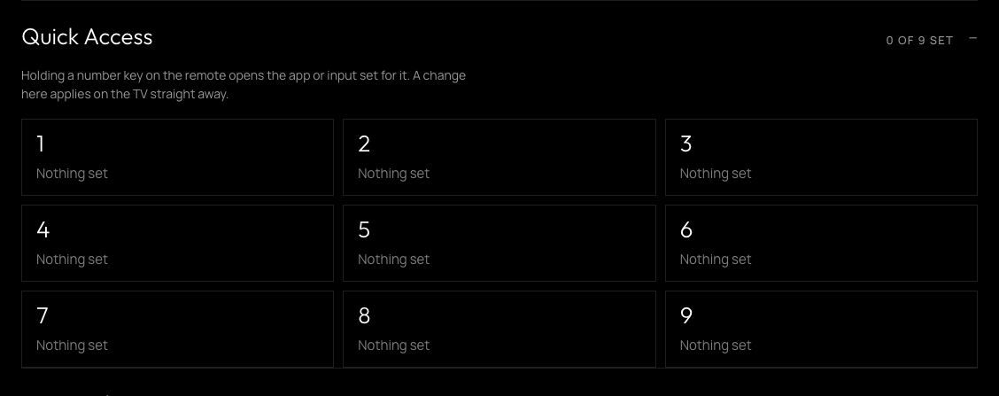

# Remote

The **Remote** tab, `/?tab=remote`, sets what the remote's buttons do. It has two parts:

* **Quick Access:** what holding a number key opens.
* **Remote keys:** what the other buttons do, such as the streaming buttons, the color keys and the channel keys.

The tab is left out on a TV that has neither.

## Quick Access

Holding a number key from 1 to 9 opens what it is set to: an app, an HDMI input or Live TV. Holding 0 shows the list on the TV. The keys are laid out like the remote's number pad; choose one to see its choices. A change applies straight away, and the TV's own Quick Access list shows it too.

* **As LG has it** puts the key back as it was before Glasshouse changed it.
* **None** makes the key open nothing, including one LG set itself, such as its help on 9.
* **App not installed** shows for a key LG set for an app that is not on the TV, as it does for some regions' channel apps.
* A key set to a live TV channel on the TV shows the channel. It can be changed here, but not set to another channel.

## Remote keys

Each button is a tile showing what it does now, grouped as **Streaming buttons**, **Voice assistant buttons**, **Channel keys**, **Color keys** and **Other keys**. Choose a tile to see its choices beneath the row. A change applies straight away, on every screen, and lasts across restarts.

Home, Back, volume, mute and power cannot be changed.

### What a key can do {#available-actions}

| Choice | What it does |
| :----- | :----------- |
| **As LG has it** | What the button does on a TV without Glasshouse. |
| **Nothing** | The button does nothing. |
| **An app, an HDMI input or Live TV** | Opens it. |
| **Glasshouse** | Opens one of Glasshouse's own: Glasshouse Home or its [Internet TV guide](internet-tv.md#electronic-programme-guide-epg), [Glasshouse Bar](launchers.md#glasshouse-bar), the [Home Assistant control bar](../HOME-ASSISTANT.md#home-assistant-control-bar), the [input bar](inputs.md#glasshouse-input-bar) or the dashboard. |
| **Home** | Opens Glasshouse Home where it has taken LG's Home's place, and LG's Home otherwise. |
| **Screen off** | Turns the picture off while the sound plays on. Any button turns it back on. |
| **Brightness up** / **Brightness down** | Steps the panel brightness, and shows a level bar. See [Brightness keys](#brightness-keys). |
| **Power off** | Puts the TV in standby when the button is let go. On a Magic Remote's radio buttons, this turns one TV off without the infrared reaching another beside it. |
| **Ambient light** | Turns [PicCap](../piccap.md)'s capture on or off. Offered where PicCap is installed. |
| **Buttons** | Acts as **OK**, or sends **Play**, **Pause**, **Stop**, **Rewind**, **Fast forward**, **Volume up**, **Volume down** or **Mute**. Volume repeats while held, and works a soundbar on HDMI ARC. |
| **Home Assistant** | Does nothing on the TV, and leaves the button to your [Home Assistant automations](../HOME-ASSISTANT-REMOTE-BUTTONS.md). |
| **Input switcher** | Opens LG's quick input picker, where the TV has one (such as a C5 on webOS 11). |

Home Assistant hears the streaming buttons, the color keys, the microphone and Google Assistant as [remote button events](../HOME-ASSISTANT-REMOTE-BUTTONS.md) whatever they are set to, while MQTT is on.

On webOS 11 fewer choices are offered: see [webOS 11](#webos-11).

### Which buttons are listed

The tab lists the buttons the TV's software knows, which can be more than your remote has: a Magic Remote has no color or Guide keys, and a standard remote has no streaming buttons. Setting a button your remote lacks does nothing and does no harm.

* **Display only buttons for your remote** (on by default) hides the buttons none of your remotes have. It shows where every remote paired with the TV, or used in the last 30 days, is one Glasshouse knows fully ([Remotes](../development/remotes.md)). Off, those buttons come back under **Buttons on other remotes**. A button you have changed always shows.
* **Buttons on remotes sold elsewhere** holds buttons only sold on remotes in other countries, such as Hulu in the US or BBC iPlayer in the UK.
* A button goes by the name printed on your remote: with an MR25GA, the microphone key is listed as **AI**.
* Where none of your remotes has number keys, **Quick Access** starts closed.

### Brightness keys

**Brightness up** and **Brightness down** change the OLED Light (or Backlight on an LCD) for the current picture mode and input, by the **Brightness step**: 10 out of 100 unless changed, from 5 to 25. Holding the button repeats. Set one button to each.

Each press shows the level in Glasshouse's own bar. **Level bar style** chooses its look: vertical at the right edge like the TV's volume bar, horizontal low on the screen, or **No bar**. Both settings are under **Brightness key settings**, at the bottom of the tab, once a button is set to Brightness.

On Glasshouse Home, a channel key set to Brightness steps the [Home Assistant tile](home.md) in focus instead, where that tile can step.

### Channel keys

**Channel up** and **Channel down** can be changed on webOS 4 to 10, and on some webOS 11 TVs. While set, the key no longer changes the channel anywhere, Live TV included; **As LG has it** brings that back.

### Microphone and other buttons

* **Microphone:** set to anything else, it no longer starts voice control, for a press or a hold.
* **?**, **123** and **Home Hub** on MR25 remotes can be changed where the TV's software names them, as on webOS 10. Set, a button takes both its press and its hold.
* **Text**, **T.Opt**, **Live Zoom** and **AD**, on remotes sold with a TV tuner such as the MR18, can be changed on webOS 4 to 10. Text and T.Opt are teletext's: outside Live TV, LG only says "This function is not available" for them, so they are good buttons to give a job. The **123** button can be changed on webOS 4 too.

### Number keys

**1** to **9** and **0** can each be set like any other button, under **Number keys**. A number key set here no longer types its number, in Live TV or when entering a PIN, and holding it no longer opens what [Quick Access](#quick-access) sets for it. **As LG has it** brings both back. The group shows only where your remote has number keys.

### How it works

Glasshouse puts its own filter first in the TV's key handling, so a button it has changed never reaches the app on screen: a color key set here no longer works teletext on Live TV, for example. The filter works from the moment the TV starts, before Glasshouse itself. Setting every button back to **As LG has it**, or running `tvwebctl restore-keys` on the TV, takes the filter out. See [Remote keys through the compositor's filter chain](../IMPLEMENTATION.md#remote-keys-through-the-compositors-filter-chain).

> [!WARNING]
> **LG Input Hook:** if [LG Input Hook](https://repo.webosbrew.org/apps/org.webosbrew.inputhook/) is installed from the Homebrew Channel, it takes the streaming buttons first, and Glasshouse cannot change them. Uninstall it and restart the TV.

## webOS 11

On webOS 11 (LG's webOS 26), LG keeps the button settings itself, and allows less:

* **Can be changed:** the streaming buttons, Apps, Guide, Home Hub (MR25 remotes), AI, Alexa and **?** (press and hold separately). On some TVs also **Input**, **Channel up** and **Channel down**. Search, Info, Home and 123 cannot.
* **Choices:** mostly opening an app or an input. **Screen off**, **Brightness** and **Ambient light** are offered on Netflix, Prime Video, Home Hub and, where they can be changed, the channel keys. **Nothing** shows LG's "This function is not supported" notice. **OK**, the media buttons, **Power off** and **Home Assistant** are not offered.
* **Color keys** can open an app, an input or the input switcher while Glasshouse runs. The key still reaches the app on screen too, so **Nothing** is not offered.
* **Guide**, **Input** and the **channel keys** need a small change to LG's key handling on the TVs Glasshouse knows. Setting one restarts the TV's screen once, about 35 seconds, and again each time the TV starts.
* **AI:** changing it turns off LG's voice assistant until it is **As LG has it** again.
* **Alexa:** changing it stops Alexa opening. Some TVs refuse; the button is then no longer offered.

The details for each button and TV are in [webOS 11 remote keys in detail](../IMPLEMENTATION.md#webos-11-remote-keys-in-detail).
