# Screen savers

The **Screensaver** tab, `/?tab=screensaver`, provides fifteen alternatives to LG's default screen saver, alongside support for screen savers added on the TV or bundled with homebrew applications.

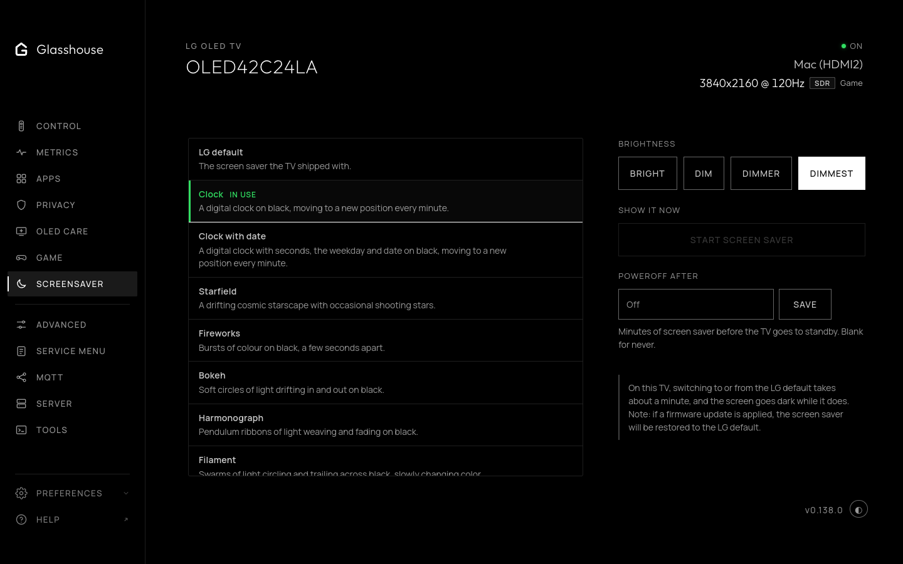

*The Screensaver tab in the web dashboard.*

Each mode offers dim and bright variants, designed with deep black backgrounds and continuously drifting or undulating elements to prevent OLED burn-in and image retention. Clocks and the time on Panel vitals automatically format in 12-hour or 24-hour time to match the TV's system settings.

A firmware update restores the LG default.

## Controls and settings

* **Brightness level:** Toggle between **Dim** and **Bright** for any screen saver mode.
* **Start screen saver:** Immediately requests the screen saver on the TV. On certain OLED TVs, including a G3 on webOS 9.2.2, LG's panel care holds the idle screen saver back for 30 minutes after key presses or app changes while dimming static areas itself. Glasshouse lifts that hold when an idle screen saver is requested or the button is pressed, and restores it once dismissed. An app that still refuses it, such as RetroArch played with a gamepad, is keeping the screen saver away itself, and is left alone until another app is in front or the TV turns off. Where the TV still refuses, as it does with LG's own Screen Saver setting off, which some LCD TVs have by default, the dashboard opens the screen saver itself, unless something is playing full screen or playback cannot be checked. Pressing any remote key, including Home or the coloured buttons, dismisses the screen saver.
* **Poweroff after:** Automatically switches the TV into standby once the screen saver has been active for a configured duration, from 1 to 1440 minutes (blank or 0 disables it). The timer resets if the screen saver is dismissed. This requires power actions to be enabled (`allowPower`) and is stored in `config.json` as `screensaverPowerOffMinutes`.

## Built-in screen savers

### Clock

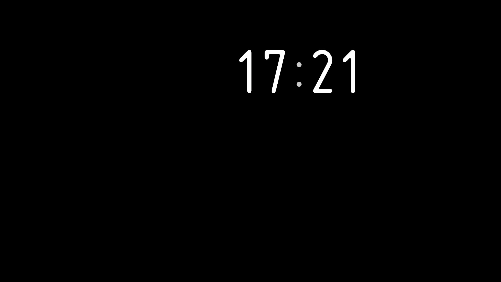

A digital clock showing hours and minutes against pure black. The readout moves to a new position across the screen every minute to prevent image retention, using the TV's 12-hour or 24-hour setting.

### Clock with date

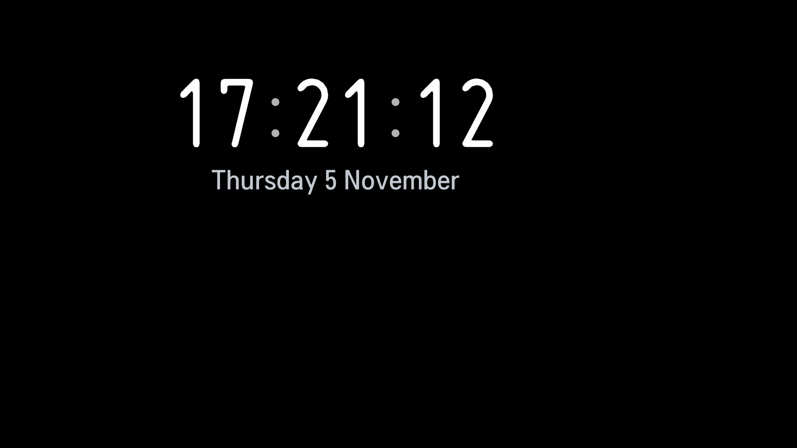

A digital clock displaying seconds alongside the current weekday and date beneath it. Like Clock, it shifts position every minute to protect the panel.

### Starfield

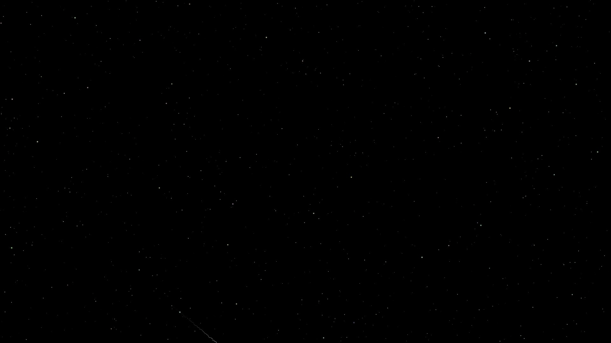

A cosmic starscape of drifting multi-depth stars with occasional meteors leaving fading ion trails across deep space.

### Fireworks


Bursts of colour erupting on black every few seconds, launching with bright trails before crackling and showering expanding particle bursts.

### Bokeh

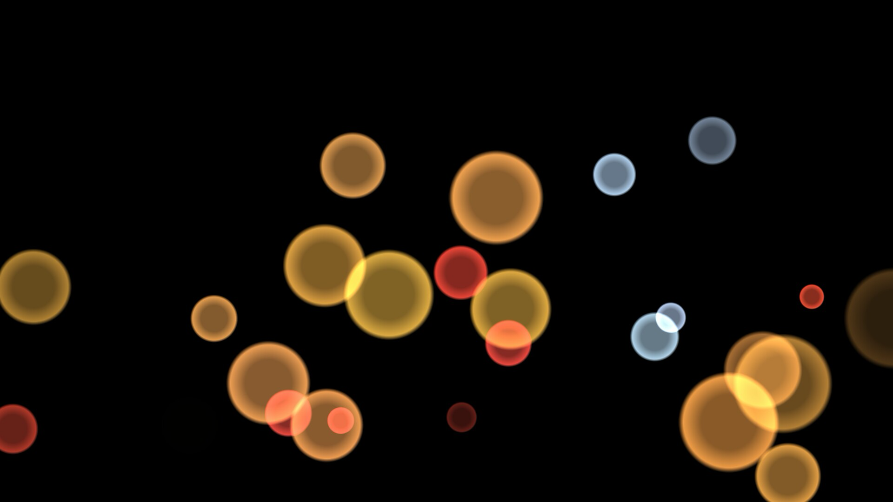

Soft, out-of-focus orbs of light drifting in and out of view across pure black.

### Filament

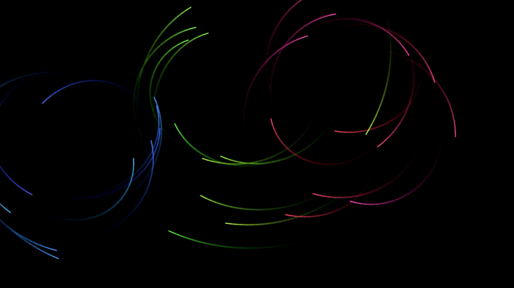

Swarms of luminescent filaments circling and weaving across black, leaving glowing curvilinear trails that slowly cycle in colour.

### Currents

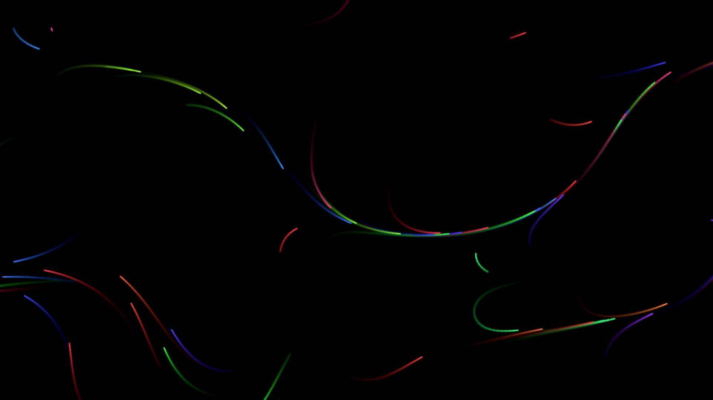

Streams of light flowing dynamically along an organic, slowly shifting wind field across the dark screen.

### Veils

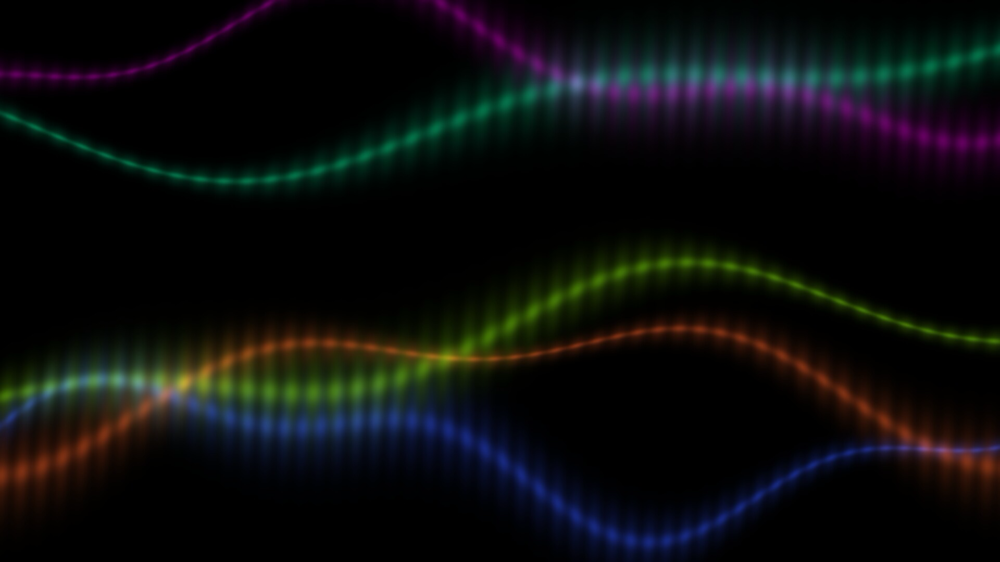

Translucent ribbons of undulating light rippling smoothly across black like curtains of aurora.

### Incense

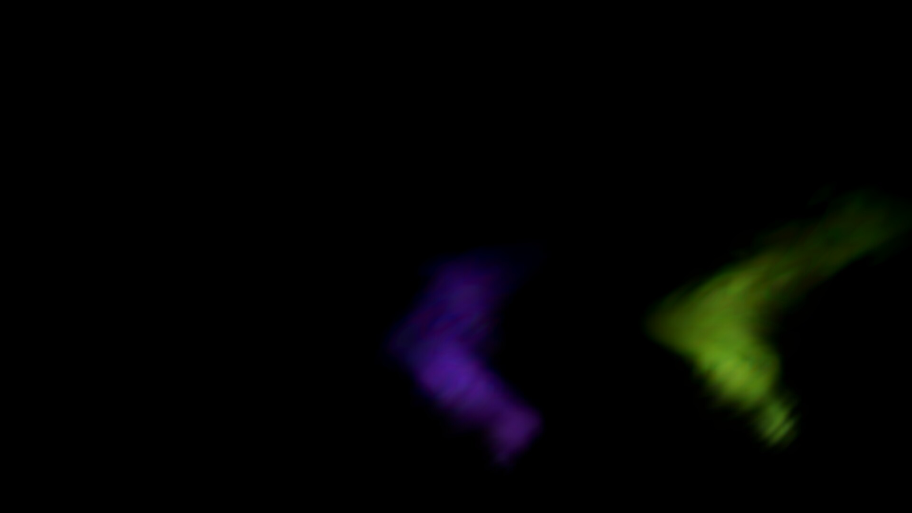

Thin, delicate plumes of tinted smoke rising and curling upward in drifting eddies.

### Murmuration

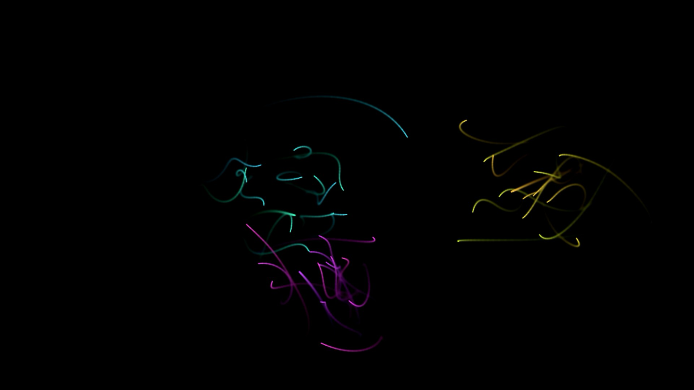

Flocks of light points sweeping, banking, and swooping across the display in coordinated flocking dynamics behind leader paths.

### Vortex

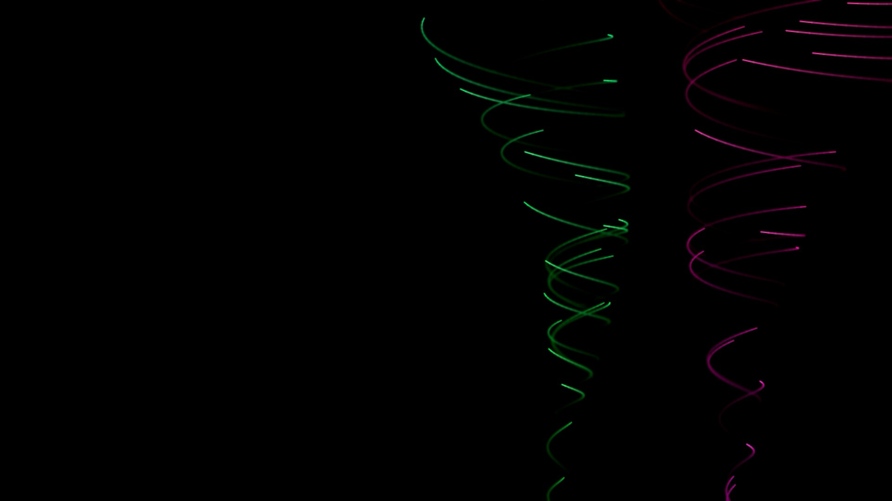

Whirlwinds of light spiraling up swaying funnels on black.

### Neo

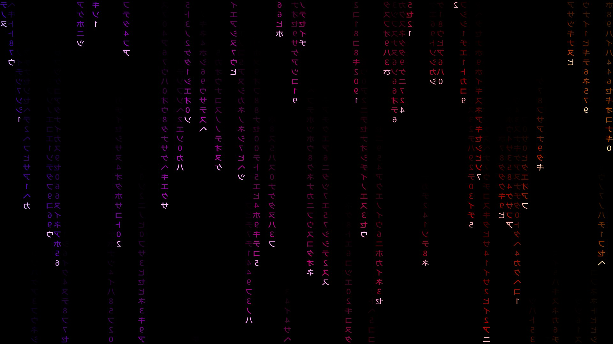

Cascading columns of falling cryptographic glyphs, their palette turning through the colour spectrum every minute.

### Harmonograph

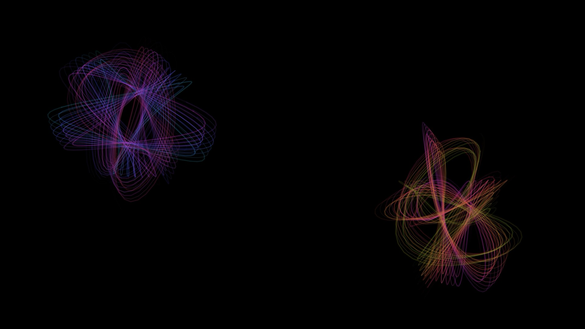

Geometric pendulum ribbons of light weaving intricate Lissajous curves and fading across black as new harmonic paths are drawn.

### Tesseract

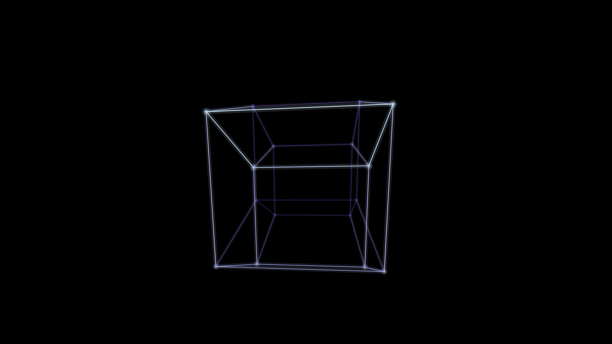

A four-dimensional hypercube turning through the fourth dimension, rendered in fine lines of light that shift intensity and violet hue with depth.

### Panel vitals

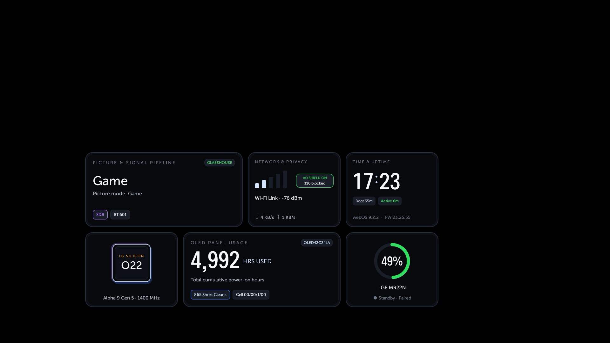

A live panel diagnostics dashboard on black, showing the TV's cumulative panel hours, short clean and refresher countdowns, processor silicon, Wi-Fi link quality, and remote battery. The card cluster periodically moves to protect the panel.

## Adding your own

A screen saver added on the TV is a folder in `/var/lib/tvweb/screensavers/`, named as you like within a few rules (lowercase letters, digits and `-`, up to 32 characters; see the format below), holding a `saver.json` that names and describes it, its QML, and anything else it uses. The tab lists it after Glasshouse's own, marked *Added on this TV* with its author and license, and a Glasshouse update leaves the folder alone. To add one, copy its folder there and open the tab:

```
scp -r my-saver root@<tv-ip>:/var/lib/tvweb/screensavers/
```

One with something wrong in its folder, or whose QML would only show black, is listed with the reason and cannot be picked. One that reaches the network, can play sound, or can open apps says so under its name, and can still be picked. [Writing a screen saver](../development/WRITING-SCREENSAVERS.md) covers making one, and the format is in [Screen saver design principles](../development/SCREENSAVER-DESIGN.md#screen-saver-folders).

Glasshouse installs one there itself, as an example: **Pigs - Three Different Ones**, a pink pig, a saddleback and a razorback, big and small, flapping across a pixel-art night over Chicago. An update puts it back if it has been removed.

### Pigs - Three Different Ones

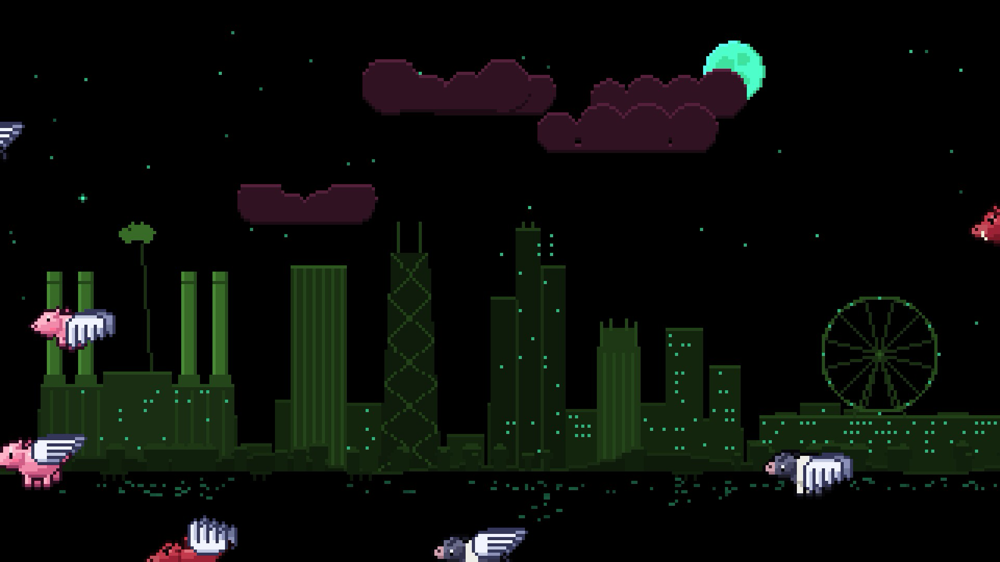

*Bundled example screen saver installed into `/var/lib/tvweb/screensavers/pigs`.*

## Screen savers from homebrew apps

Homebrew Channel apps that come with a screen saver are listed too, after the others, named after the app and marked *Installed app*: Custom Screensaver, the two Aerial screen savers and Idlegif. Choose one here like any other, on any webOS Glasshouse's screen savers work on, and it stays chosen after the TV restarts. Its settings, such as which Aerial videos play, stay in its own app. With several installed, each is listed and one is in use at a time; two apps of the same name, as both Aerial ones are, show who made each.

These apps can also put their screen saver in place themselves, with their own Apply and Autostart. That only works on webOS 9 and earlier, where LG's screen saver is the kind they change, and anything chosen here takes it off again, so choosing it here is the dependable way. If the app is uninstalled while its screen saver is in use, LG's comes back.

On webOS 10 and later they are experimental: the tab shows a switch above the list that turns them on, after a warning, and until then only LG's default can be chosen. See [Experimental features](../experimental.md) for why.
