# Screen savers

The **Screensaver** tab, `/?tab=screensaver`, provides seventeen alternatives to LG's default screen saver, alongside a **Random** rotation mode, support for screen savers added on the TV or bundled with homebrew applications.

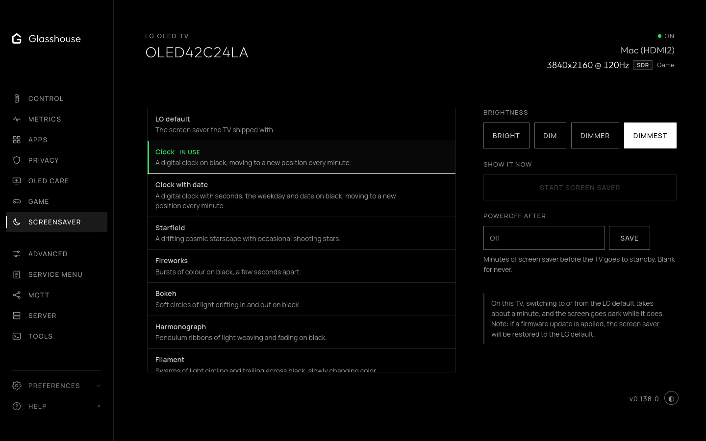

*The Screensaver tab in the web dashboard.*

Each mode can be shown from 5% to 100% brightness, designed with deep black backgrounds and continuously drifting or undulating elements to prevent OLED burn-in and image retention. Clocks and the time on Panel vitals automatically format in 12-hour or 24-hour time to match the TV's system settings. On a wide screen, the screen saver list sits beside the controls and scrolls within its own box so the controls stay in view; on narrower screens and phones, it flows down the page.

A firmware update restores the LG default.

## Controls and settings

* **Switching while one is showing:** picking another while a screen saver is on the TV closes it first, as Back on the remote would, and starts the new one a few seconds after the switch. Changing a screen saver under one that is showing left some TVs refusing every screen saver until restarted, or restarted them. Where a TV is stuck that way anyway, **Start screen saver** says so.
* **Brightness:** A slider from 5% to 100% in 5% steps, set when it is let go. 100% and 65% are what were **Bright** and **Dim**, each screen saver drawn as designed for them; every other step lays black over the nearer one above. An installed app's screen saver has its own settings instead. On the TV app, OK on **Brightness** gives a bar that Left and Right move, sent with OK.
* **Options:** For a screen saver with options to pick from (its `saver.json` lists them as `choices`), a list under Brightness picks the one it shows: Clock's **Show**, or **Animation** for one with several animations. It stays picked when the brightness changes.
* **Value colour:** For Home Assistant screen savers (**Home Assistant: Ambient** and **Home Assistant: Data Display**), picks the value colour (defaulting to **White**, with Blue, Green, Amber, Red, and Purple presets).
* **News feeds:** For the **News** screen saver, up to three feeds, added one at a time as on the Home tab, whose news strip uses the same ones.
* **Home Assistant Entities:** Screen savers that pull live readings from Home Assistant (**Home Assistant: Ambient** and **Home Assistant: Data Display**) appear on the tab once **Home Assistant API** is enabled and configured under the **HA & MQTT** tab (otherwise they stay hidden). Once ready, **Home Assistant Entities** opens an entity picker with search by name, entity ID or unit, type filter chips (`Sensors`, `Weather`, `Climate`, and more) with live counts, and progressive loading for large Home Assistant setups, alongside optional custom display labels without editing files on the TV.
* **Random rotation:** Picking **Random** selects a different custom screen saver each time the screen saver appears on the TV. When active, the card shows which screen saver is up next, and an **Included in rotation** section lets individual screen savers be checked or unchecked from the rotation pool (with quick **Select all** and **Deselect all** buttons). Dismissing the active screen saver automatically rotates and stages the next selection in the background so it launches immediately when the TV next idles.
* **Start screen saver:** Immediately requests the screen saver on the TV. On certain OLED TVs, including a G3 on webOS 9.2.2, LG's panel care holds the idle screen saver back for 30 minutes after key presses or app changes while dimming static areas itself. Glasshouse lifts that hold when an idle screen saver is requested or the button is pressed, and restores it once dismissed. It leaves the idle screen saver held while something plays, including an app whose player the TV does not report: non-preview video from the decoder on the TV's main screen counts as playing unless a reported player reads paused (preview tiles on Home or browse menus still lift the hold). An app that still refuses it, such as RetroArch played with a gamepad, is keeping the screen saver away itself, and is left alone until another app is in front or the TV turns off. Where the TV still refuses, as it does with LG's own Screen Saver setting off, which some LCD TVs have by default, the dashboard opens the screen saver itself, unless something is playing full screen or playback cannot be checked. Pressing any remote key, including Home or the coloured buttons, dismisses the screen saver, and so does moving the Magic Remote's pointer or clicking, as with LG's own. So does another app or input coming to the front, such as a games console switched on with its controller taking the TV to its HDMI input.
* **Power off after:** Automatically switches the TV into standby once the screen saver has been active for a chosen time: off, 15 or 30 minutes, or 1, 2 or 4 hours. Any other number from 1 to 1440 minutes set in `config.json` is kept and shown in the list. The timer resets if the screen saver is dismissed. A video screen saver that Glasshouse opens again after the TV ends it counts too. This requires power actions to be enabled (`allowPower`) and is stored in `config.json` as `screensaverPowerOffMinutes`.

## Built-in screen savers

### Video

Plays the muted video playlist configured under **Home → Background → Video**. A [playlist](home.md#which-video-links-work) adds its scenes' names and timed captions. The same list is shared with Glasshouse Home; the screen saver appears on webOS 10 and later once at least one usable video is saved. The playlist repeats in order or random order as configured there, and its captions are placed and styled as set there. With Video chosen, this tab sets the rest of what shows over it: the clock, date, weather and captions can each be switched off, the clock and weather placed in any corner, made one of four sizes and set in Outfit or Manrope, the date, weather and captions set in either, and all of it given one text colour. **Use the default look** puts these back as Glasshouse Home has them. Weather from Open-Meteo is credited in the corner, as on Home. Each video fades out at its end and the next fades in; while the first is still loading, the screen saver says so.

### Picture frame

Shows your own pictures, photos from your network and paintings in the public domain, one at a time, each fading into the next. With Picture frame chosen, this tab shows what is on screen, a line saying where its pictures come from and how often they change, and **Picture frame settings**, which opens its settings in a dialog. The same dialog opens from the [Inputs](inputs.md#no-signal-screen) tab, and from search ("picture frame", "photos", "slideshow"); on a phone it fills the screen.

On this tab:

* **Now showing:** the picture on screen, with its title, and **Previous** and **Next**, which the screen saver takes up within a couple of seconds. Previous goes back through the last five pictures; Next after going back comes forward through them before a new one. They work while the picture frame is on screen, as the screen saver or on an input's [No Signal screen](inputs.md#no-signal-screen).

In **Picture frame settings**:

* **Your pictures:** up to 100 JPEG, PNG or WebP images, added from the browser or dropped on **Add pictures**. Each is made 1920 × 1080 or smaller before it is uploaded, and kept on the TV in `/var/lib/tvweb/art-pictures`, which an update leaves alone.
* **Collections:** fourteen, in three groups, each free to show with its credit.
  * **Space:** the [James Webb](https://esawebb.org/images/) Space Telescope's Picture of the Month, nebulae and galaxies, and the [Hubble](https://esahubble.org/images/potw/) Space Telescope's Picture of the Week, from ESA. Diagrams, annotated versions and artists' impressions are left out. They are CC BY 4.0, and ESA asks for each image's credit line to be shown in full and unaltered.
  * **Photography:** Wikimedia Commons' [featured pictures](https://commons.wikimedia.org/wiki/Commons:Featured_pictures), the community's pick of its best photographs, by topic: landscapes, skies and weather, the night sky, animals, plants and flowers, and architecture. Only those in the public domain or under CC0, CC BY or CC BY-SA are shown, each credited to its photographer with its licence.
  * **Paintings:** two from the [Rijksmuseum](https://data.rijksmuseum.nl/): Dutch Golden Age paintings, and Dutch paintings of the 1700s and 1800s. and four from [the Cleveland Museum of Art's open access collection](https://www.clevelandart.org/open-access): European paintings to the 1700s, European paintings of the 1800s, American paintings, and Japanese and Chinese paintings. All are in the public domain.

  Very long scrolls, folios and panoramas, which would be tiny on a TV, are left out, and so are pictures too small to fill it.

  A picture whose licence asks for its credit (ESA's, and a photographer's under CC BY or CC BY-SA) keeps it on screen, small, in a bottom corner, whenever its label is not up, whichever label setting is picked.
* **Network folders:** up to 10 folders on media servers on your network, such as Plex, Jellyfin, Emby, MiniDLNA or a NAS, shared over DLNA. **Add a network folder** looks for servers, then lets you open folders one level at a time and pick one; the JPEG pictures directly in it are shown, not those in its subfolders. Each picture's label gives its title and year, and the folder and server it is from. Where the server offers several sizes of a picture, the smallest that still fills the screen is fetched. A server that moves to another address on the network is found again. Speakers such as Sonos, which answer as media servers with music only, are left out.

Your pictures, collections and folders take turns: your own every other picture, the collections and folders between them. Under **Showing them**, a new picture comes every 30 seconds, every 1, 2, 5, 10, 15 or 30 minutes, or every hour, either whole on black or filling the screen, and its label (title, artist or photographer, date, and where it is from) shows for 20 seconds after each change, all the time, or not at all. A change applies from the next picture.

Nothing is fetched until a collection or folder is picked. Then the TV fetches one painting at a time from the museum, keeping the next one or two ready, so the screen saver never waits on the network; older ones are deleted. A museum that cannot be reached is said under the settings.

The same pictures can be the [No Signal screen](inputs.md#no-signal-screen) of an input with nothing coming in.

The remote's arrows cannot step the screen saver: the TV ends a screen saver on any key, before Glasshouse can see it, and changing that means changing LG's key handling, which differs between webOS versions. On the No Signal screen they can: left goes back and right goes forward.

For an OLED, each picture drifts slowly across a few dozen pixels while it is up, too slowly to be seen, and the label moves to another corner with each picture. A painting is still a still picture, so keep **Power off after** set, and choose a shorter time between pictures on an OLED.

### Clock

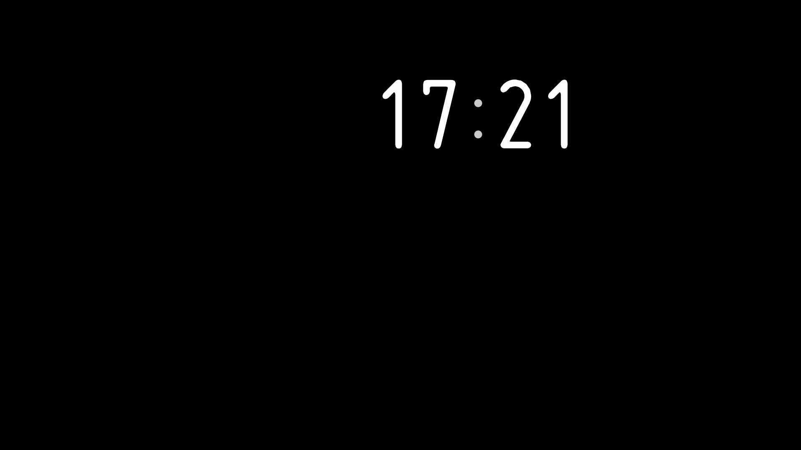

A digital clock showing hours and minutes against pure black. The readout moves to a new position across the screen every minute to prevent image retention, using the TV's 12-hour or 24-hour setting.

**Show** picks **Time** or **Time, seconds and date**, which adds the seconds and the weekday and date beneath:

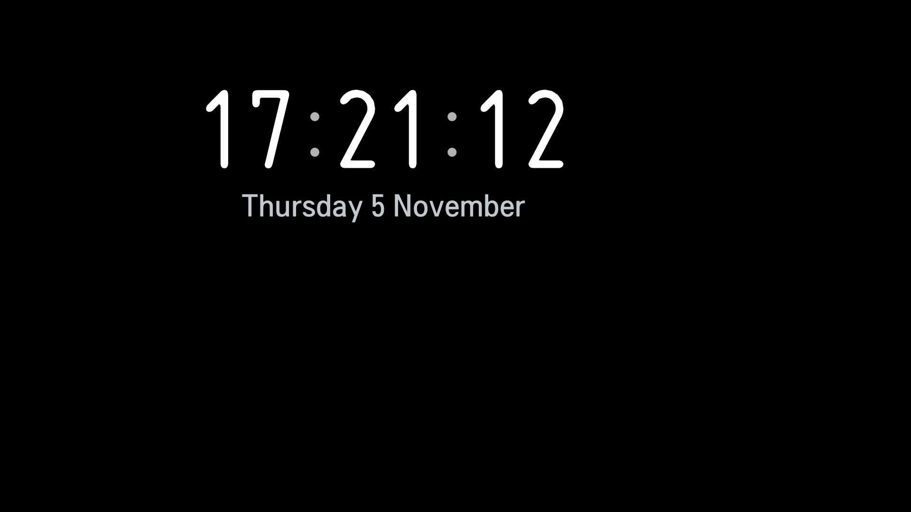

Clock with date used to be a screen saver of its own. A TV that had it in use keeps it, as Clock with that option, and Home Assistant and the API still take `clock-date`.

### News

The time and date, moving every minute, with the headlines of the news feeds given on the Home tab along the bottom, each after its source, one at a time or running as the Home tab's **Headlines** and **Speed** choose. The **News feeds** row on this tab sets the same feeds as the Home tab's [news strip](home.md#news-strip): up to three addresses, each with an optional name. The headlines come from the server, which reads each feed every 10 minutes at most while the screen saver shows; until the first read, it says there are no headlines yet.

Its **Headlines** choice puts them at the bottom left (the default), centre or right, or under the clock, a little wider than it and moving with it. Running headlines use the whole width at the bottom, or the width under the clock.

### Home Assistant: Ambient

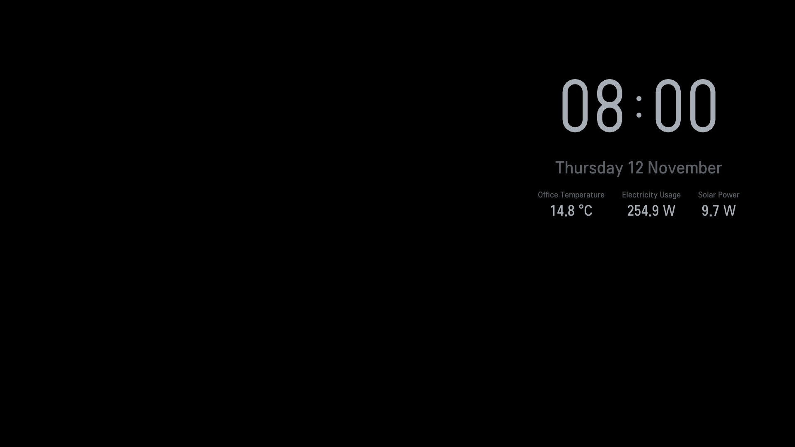

A digital clock, date, and up to three live Home Assistant readings on pure black, using the TV's 12-hour or 24-hour setting. **Readings** switches between **Names and values** and **Values only**, and **Sensor 1**, **Sensor 2**, and **Sensor 3** can be picked from your Home Assistant entities with an optional custom display **Label** (or cleared to hide) once **Home Assistant API** is saved on the **HA & MQTT** tab. The sensors start blank. Sensors left blank or unavailable stay omitted, leaving the clock and date.

With either Home Assistant screen saver chosen, the tab says what it reads, and **Screen saver settings** opens a dialog with its options and entities; on a phone it fills the screen.

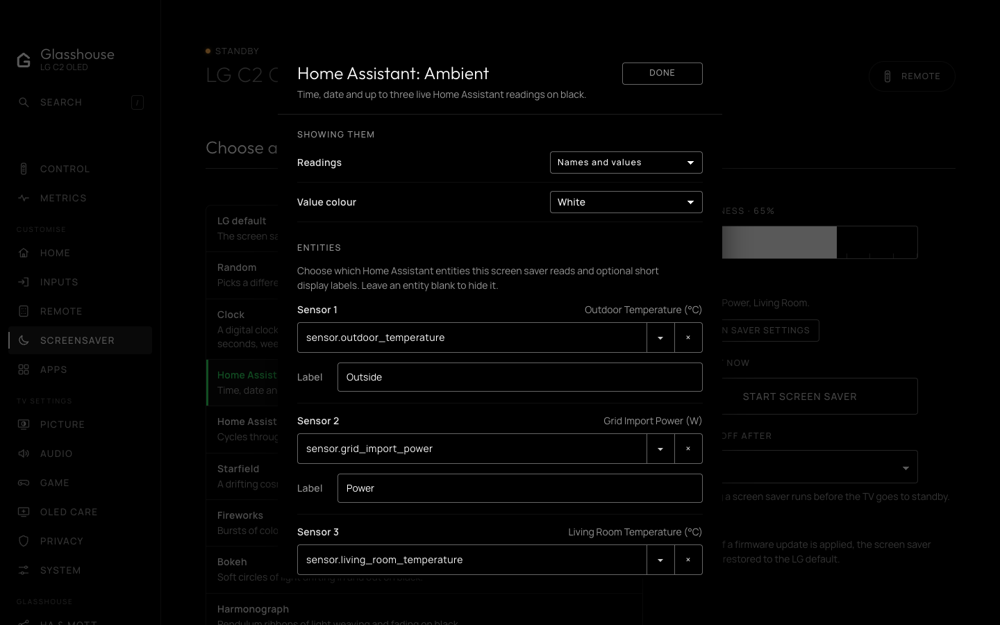

### Home Assistant: Data Display

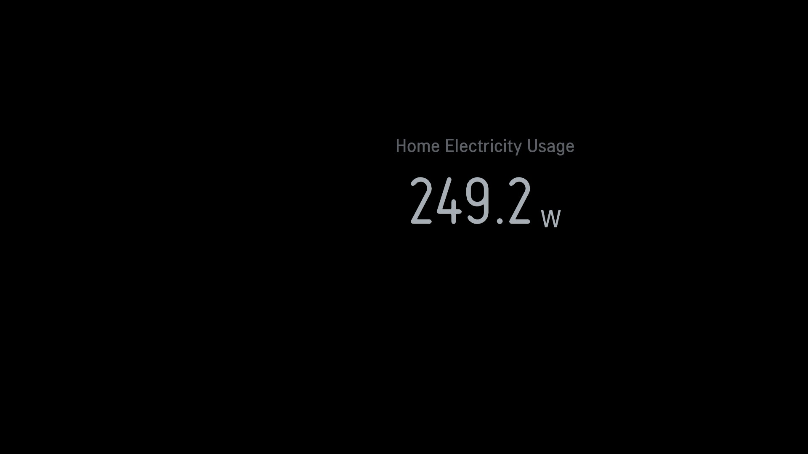

Cycles sequentially through **2 to 100** configured Home Assistant entities one at a time on pure black. At least two entities are required before the screen saver can start. Unavailable or deleted entities are skipped automatically when at least two healthy readings remain (and checked again in the background so restored entities return); if Home Assistant cannot be reached at all, a drifting unavailable notice stays on screen until connectivity returns.

Use **Add entity** to search or enter entity IDs, reorder items with the arrow buttons, set an optional custom display **Label** per entry (blank uses Home Assistant's friendly name), pick a **Value colour** (White by default), and choose how quickly entries advance under **Cycle speed** (every 5, 10, 15, 30, or 60 seconds). Requires **Home Assistant API** on the **HA & MQTT** tab.

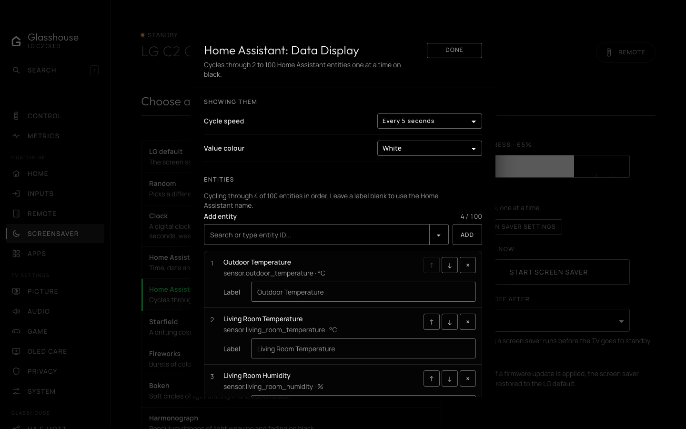

### Starfield

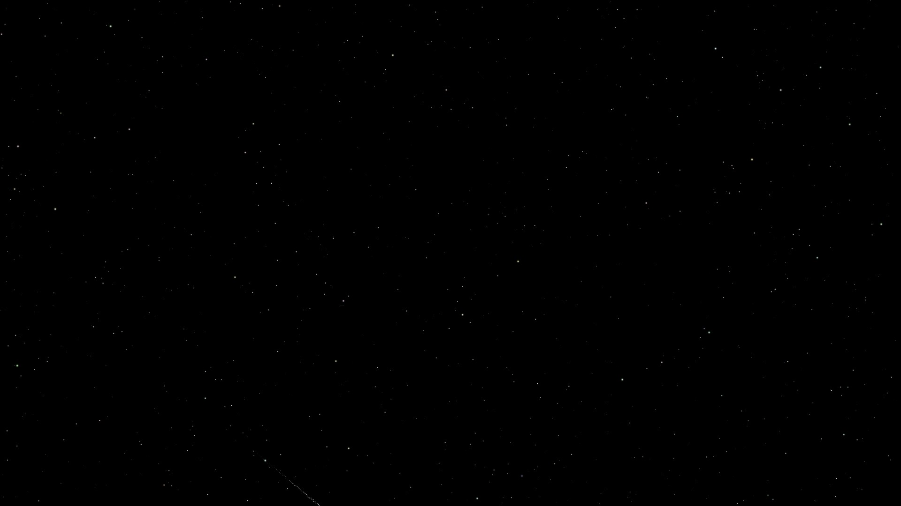

A cosmic starscape of drifting multi-depth stars with occasional meteors leaving fading ion trails across deep space.

### Fireworks


Bursts of colour erupting on black every few seconds, launching with bright trails before crackling and showering expanding particle bursts.

### Bokeh

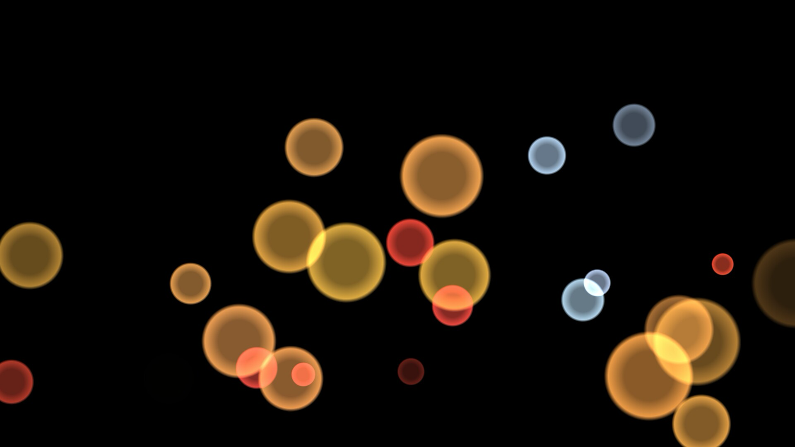

Soft, out-of-focus orbs of light drifting in and out of view across pure black.

### Filament

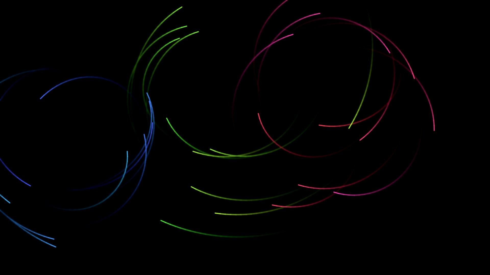

Swarms of luminescent filaments circling and weaving across black, leaving glowing curvilinear trails that slowly cycle in colour.

### Currents

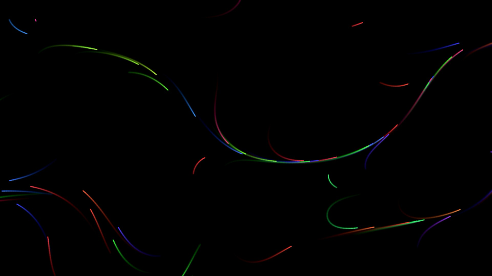

Streams of light flowing dynamically along an organic, slowly shifting wind field across the dark screen.

### Veils

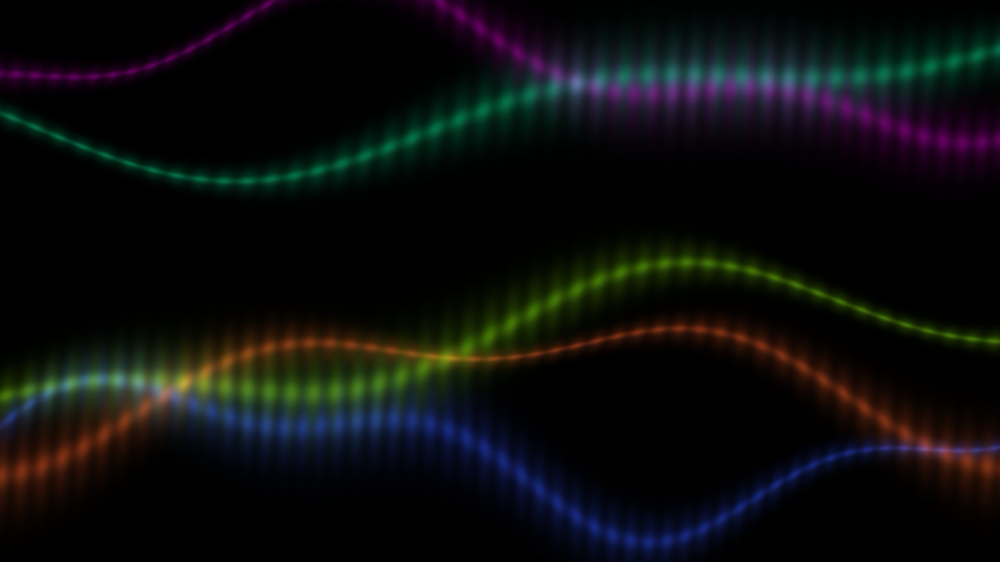

Translucent ribbons of undulating light rippling smoothly across black like curtains of aurora.

### Incense

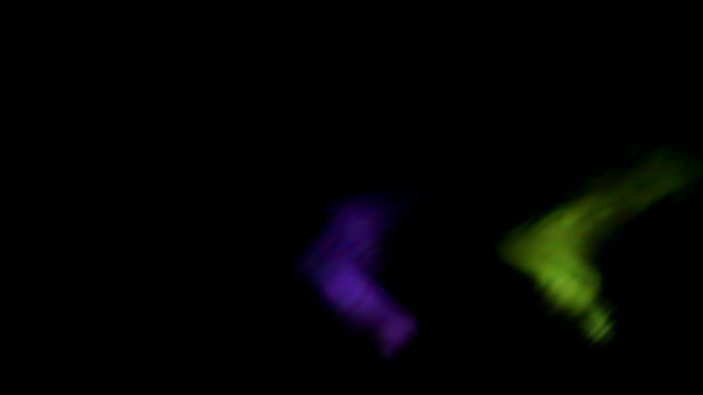

Thin, delicate plumes of tinted smoke rising and curling upward in drifting eddies.

### Murmuration

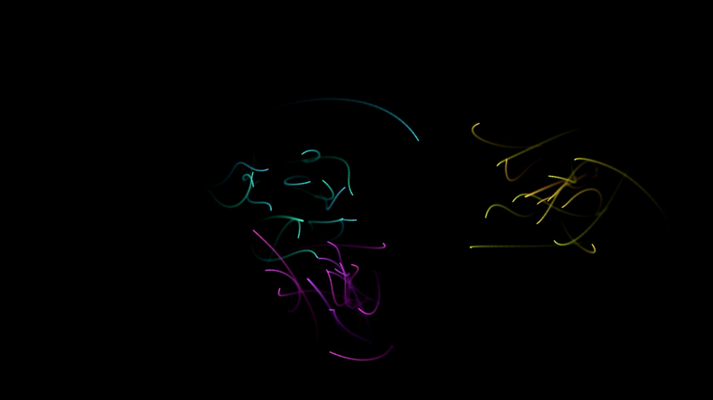

Flocks of light points sweeping, banking, and swooping across the display in coordinated flocking dynamics behind leader paths.

### Vortex

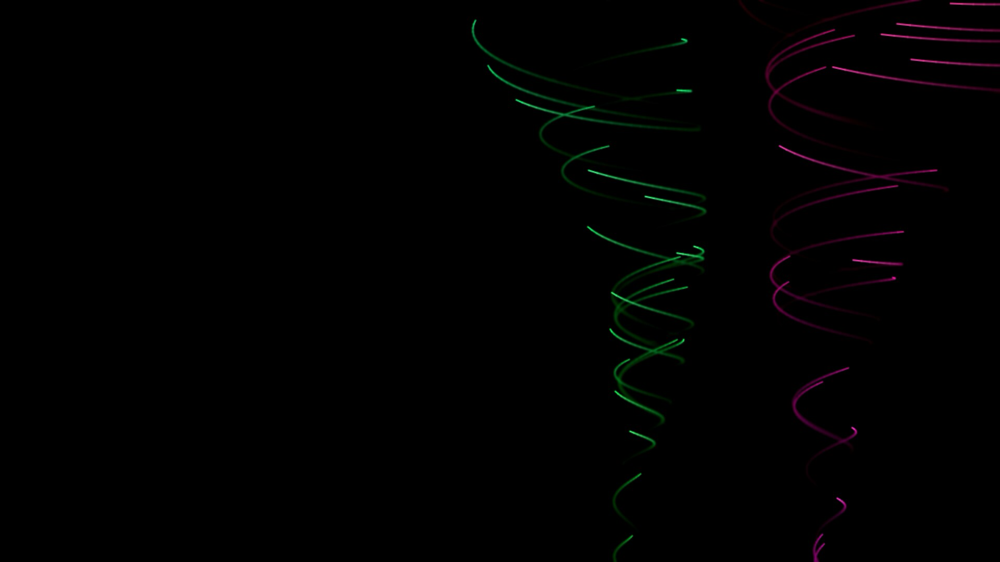

Whirlwinds of light spiraling up swaying funnels on black.

### Neo

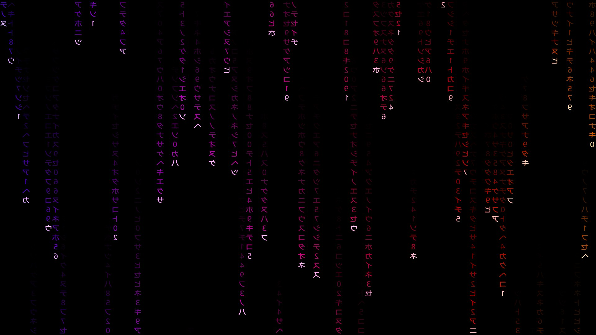

Cascading columns of falling cryptographic glyphs, their palette turning through the colour spectrum every minute.

### Harmonograph

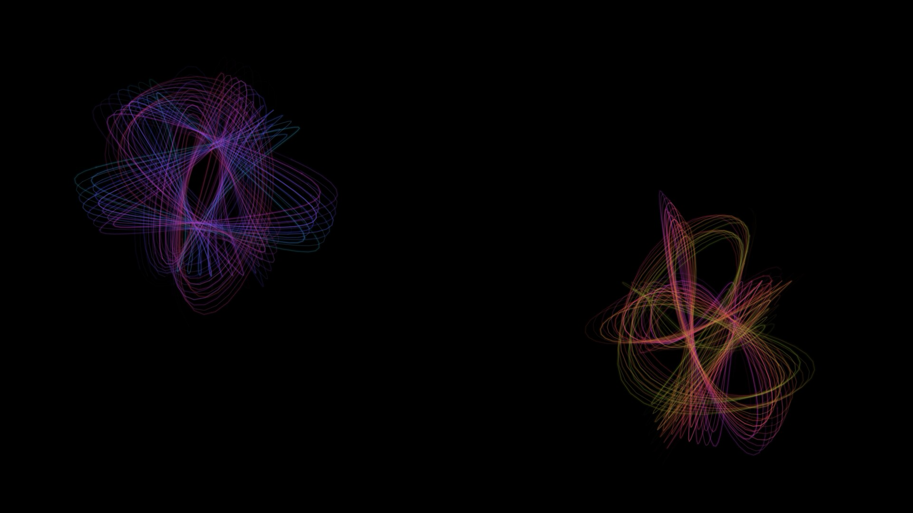

Geometric pendulum ribbons of light weaving intricate Lissajous curves and fading across black as new harmonic paths are drawn.

### Tesseract

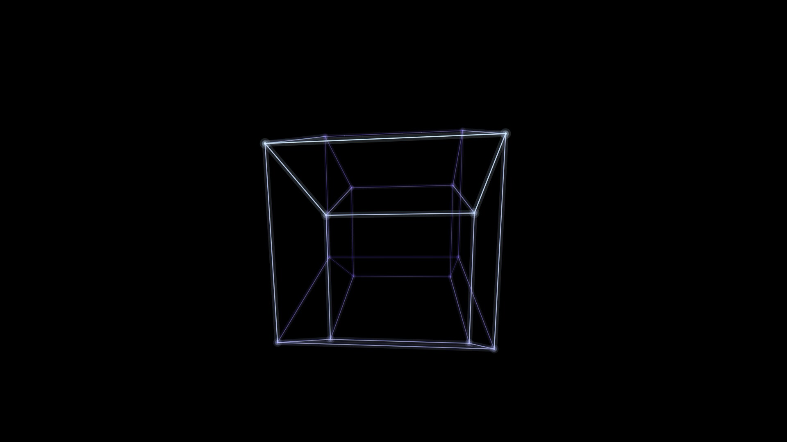

A four-dimensional hypercube turning through the fourth dimension, rendered in fine lines of light that shift intensity and violet hue with depth.

### Panel vitals

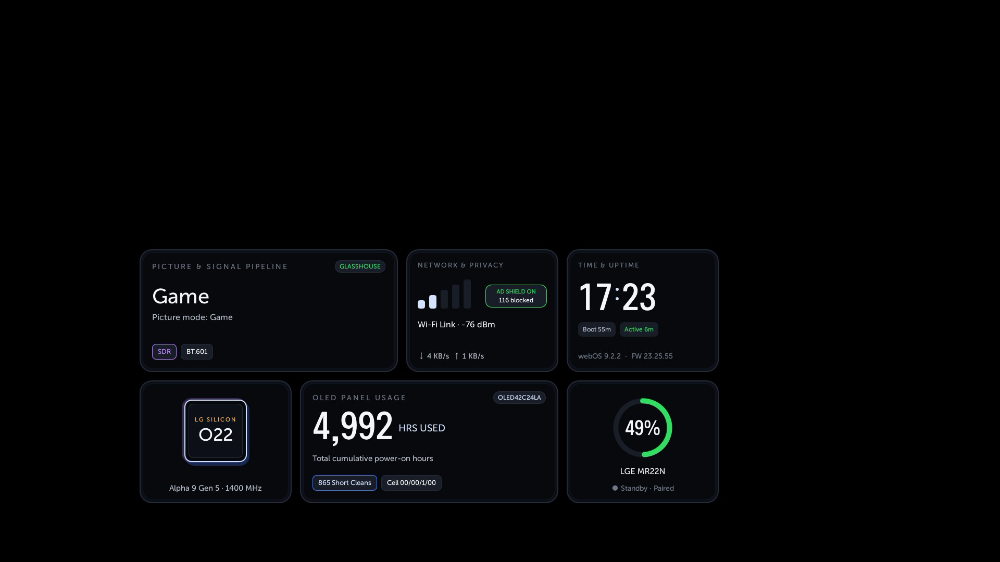

A live panel diagnostics dashboard on black, showing the TV's cumulative panel hours, short clean and refresher countdowns, processor silicon, Wi-Fi link quality, and remote battery. The card cluster periodically moves to protect the panel.

## Community screen savers

Below **Choose a screen saver**, **Community screen savers** lists third-party screen savers from [rorygallagher2024/glasshouse-catalog](https://github.com/rorygallagher2024/glasshouse-catalog) (including **Pigs - Three Different Ones** by Michael Nestrud and **Music highway** by vecluu, which were previously bundled in core Glasshouse). Community add-ons are created and maintained by their authors, not by Glasshouse; each entry displays its author, licence, version, and source repository, and downloads are verified by SHA-256 before unpacking into `/var/lib/tvweb/screensavers/`. You can also test an unlisted screen saver from an `https://` GitHub repository or `.zip` link (requires **Install app from a URL or file** on the [Apps tab](apps.md#install-app-from-a-url-or-file), a token, or the TV's browser). To write your own and submit it to the catalog, see [Writing a screen saver](../development/WRITING-SCREENSAVERS.md). [Community add-ons](community.md) covers the catalog as a whole.

## Adding your own

A screen saver added on the TV is a folder in `/var/lib/tvweb/screensavers/`, named as you like within a few rules (lowercase letters, digits and `-`, up to 32 characters; see the format below), holding a `saver.json` that names and describes it, its QML, and anything else it uses. The tab lists it after Glasshouse's own, marked *Added on this TV* with its author and license, and a Glasshouse update leaves the folder alone. To add one, install it from **Community screen savers** above or copy its folder to the TV and open the tab:

```
scp -r my-saver root@<tv-ip>:/var/lib/tvweb/screensavers/
```

One with something wrong in its folder, or whose QML would only show black, is listed with the reason and cannot be picked. One that reaches the network, can play sound, or can open apps says so under its name, and can still be picked. A screen saver can also draw Home Assistant values: it names the entities it wants in its `saver.json` and reads each from the address Glasshouse gives it, with the token kept on the server. [Writing a screen saver](../development/WRITING-SCREENSAVERS.md) covers making one, and the format is in [Screen saver design principles](../development/SCREENSAVER-DESIGN.md#screen-saver-folders).

## Screen savers from homebrew apps

Homebrew Channel apps that come with a screen saver are listed too, after the others, named after the app and marked *Installed app*: Custom Screensaver, the two Aerial screen savers and Idlegif. Choose one here like any other, on any webOS Glasshouse's screen savers work on, and it stays chosen after the TV restarts. Its settings, such as which Aerial videos play, stay in its own app. With several installed, each is listed and one is in use at a time; two apps of the same name, as both Aerial ones are, show who made each.

These apps can also put their screen saver in place themselves, with their own Apply and Autostart. That only works on webOS 9 and earlier, where LG's screen saver is the kind they change, and anything chosen here takes it off again, so choosing it here is the dependable way. If the app is uninstalled while its screen saver is in use, LG's comes back.

On webOS 10 and later they are experimental: the tab shows a switch above the list that turns them on, after a warning, and until then only LG's default can be chosen. See [Experimental features](../experimental.md) for why.
