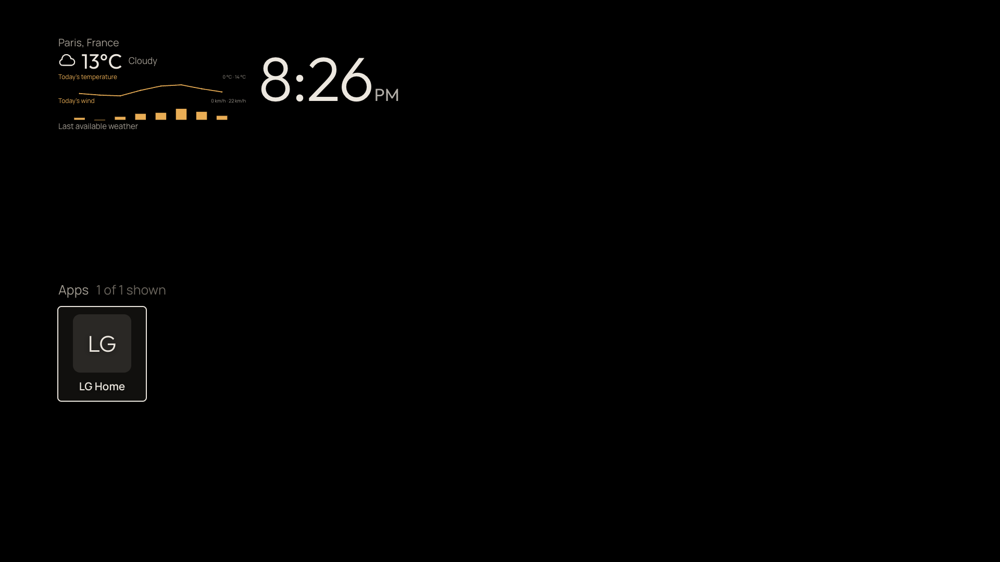
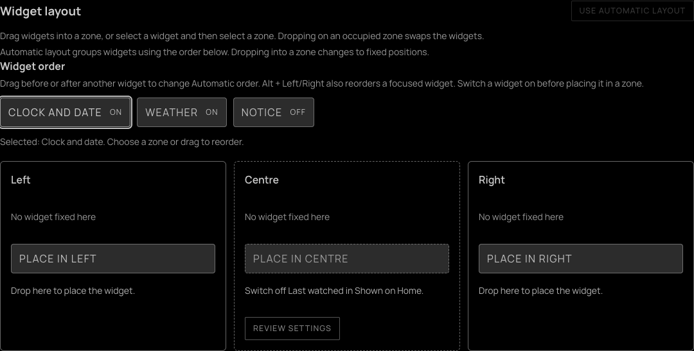
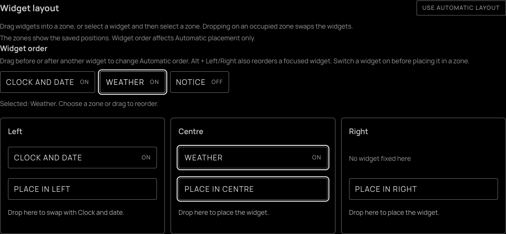
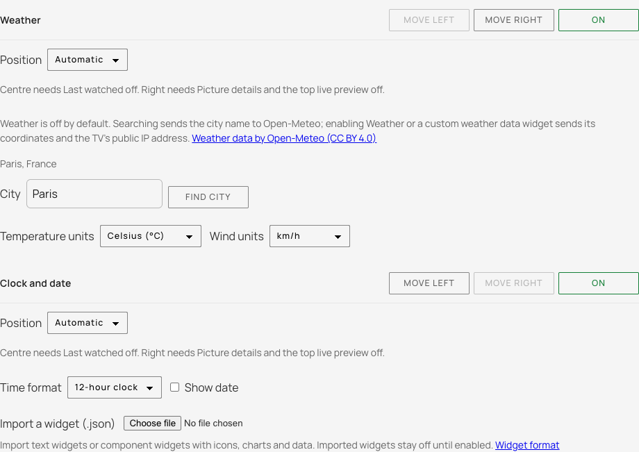
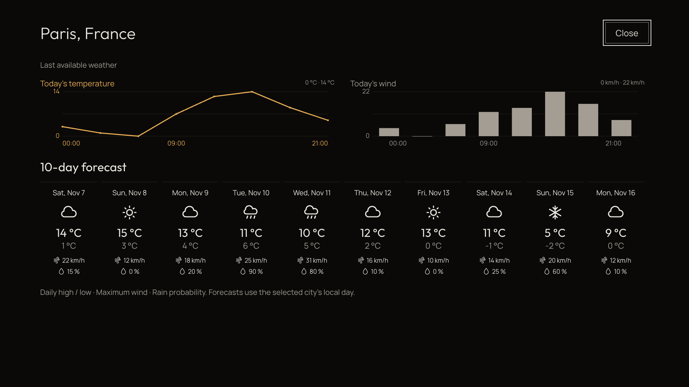
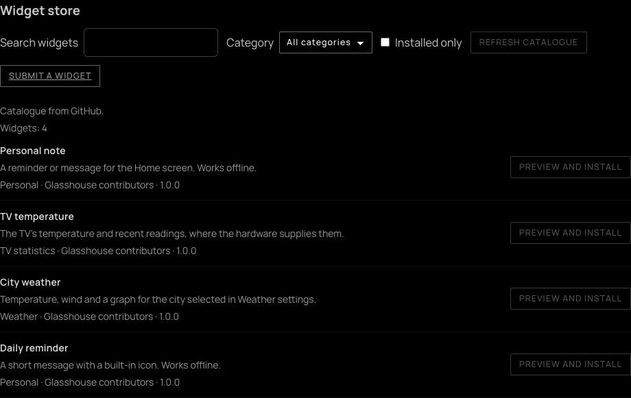
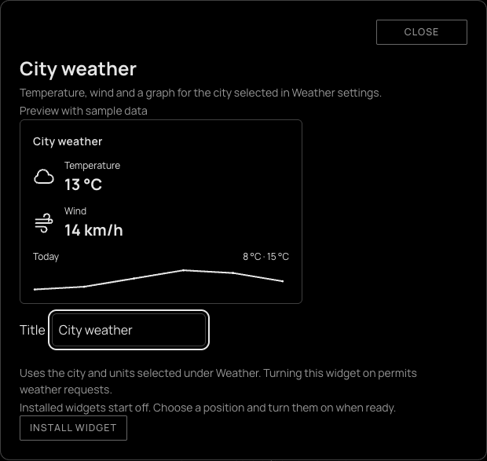

# Home widgets

Widgets occupy fixed 360 × 200 spaces above Glasshouse Home's app and input
rows. Clock and date starts on; Weather and imported widgets start off.
Open the web dashboard, choose **Home > Home customisation > Top widgets**.
LG Home, Glasshouse Minimal and custom launchers have their own layouts.

> [!NOTE]
> The previews below use an emulated TV and sample weather in a browser.
> Physical-TV rendering and remote behaviour still need testing.



## Position and visibility

Use **On** or **Off** to show or hide a widget without losing its settings.
Up to eight imported widgets can be saved. Two widgets can normally be shown;
three fit when **Last watched**, **Picture details** and the **top live
preview** are off.

The **Widget layout** board shows **Left**, **Centre** and **Right** drop zones.
Drag an enabled widget from **Widget order** into a zone. Once positions are
fixed, widgets can also be dragged from their current zones. Dropping on an
occupied zone swaps the two widgets. On a phone, tap a widget and then
**Place in…**; the same controls work with Tab and Enter.



Every zone explains its requirements before accepting a drop. The board checks
visibility, a saved city for weather widgets, reserved Home features, and
whether every other enabled widget still has a free position. An off widget
must be turned on before placing it; dropping never enables it. **Review
settings** moves focus to the relevant existing control. Change the setting
there, then return to the board. Features are not switched off automatically.



**Use Automatic layout** returns the widgets to an ordered group; Alternative
View puts that group on the right. Drag a widget before or after another in
**Widget order** to reorder it, including off widgets. With a widget focused,
**Alt + Left/Right** changes that order too. Order affects Automatic placement;
fixed positions take priority. The board keeps keyboard focus after saves.

Dropping into a zone changes to fixed placement in either view. Remaining
Automatic widgets take free positions. If they cannot all fit, the drop is
blocked and explains what must be freed. Each widget's existing **Position**
dropdown and **Move left/right** controls remain available below the board.

The dashboard displays these requirements in the zones and beside the
position controls, and prevents drops into reserved positions:

- **Centre needs Last watched off.** Open **Home > Shown on Home > Last
  watched** to hide the last used app or input and free that space. This is
  separate from the **Recent apps** list opened with Back.
- **Right needs Picture details and the top live preview off.** A live
  preview inside the focused tile does not reserve the right position.
- When Picture details are shown beside a top live preview, they also use
  the centre; turn either one off to free it.

Switch conflicting features off before changing a position. A save that would
overlap another widget or top feature is refused. The server checks the current
settings again, so a setting changed from another dashboard during a drag
cannot create an overlap. A failed save keeps the previous layout and refreshes
the board's requirements.

Switches, order, positions, clock settings, city and units save immediately.
Text and component edits use **Save widget**. Home picks up dashboard changes
on its next heartbeat, normally within five seconds. Finish any Home arrange
mode first. With every widget off, one empty space remains so rows stay put.

Unsaved widget edits stay in the open dashboard during catalogue refreshes,
other setting changes and failed saves. A successful save or removal clears
that draft. Updating a store template starts its editor from the saved settings;
drafts from the previous template are discarded. Reloading the page discards
unsaved edits.



## Use widgets with the remote

From the first visible Home row, press **Up** to focus a widget. **Left** and
**Right** choose a widget; **Down** returns to the rows. **OK** expands Weather
or a component widget. **Back**, **Escape** or **OK** closes the expanded
view. Use **Up** and **Down** to scroll an expanded view. The pointer can
select a widget too.

Hold **OK** on a widget to arrange it. Clock and text widgets enter this mode
with a short OK press too. **Left** and **Right** move it between top positions
and swap with an occupying widget; **OK** finishes. The on-screen help states
the centre and right requirements. If a position is reserved, the existing
layout is kept and a message explains why.

## Clock and date

Choose **Follow the TV**, **12-hour clock** or **24-hour clock**. **Show date**
is on by default. These choices affect this widget only. The TV app retains
the clock visibility switch; the other controls are on the web dashboard.

The clock uses the TV's time and Home's display language. It has no separate
city or time zone. Correct a wrong time on the TV; see [network time](../ntp.md).

## Weather

The compact widget shows a condition icon, current temperature and condition,
and today's temperature and wind graphs. Select it with **OK** to open larger
graphs and a **10-day forecast**, including today. Each day shows its condition,
high and low temperatures, maximum wind speed and rain probability. Forecast
days follow the selected city's local date. A provider response with fewer
days shows the available days.



### Set it up

1. Enter at least two characters under **City**, then press **Find city**.
2. Select a result, checking its region and country. Searching alone does
   not enable weather.
3. Choose Celsius or Fahrenheit, and wind units: km/h, mph, m/s or knots.
4. Free a slot if necessary and turn **Weather** on.

The saved city and units also feed custom widgets whose data source is
`weather`. Such a widget can be on while the built-in Weather widget is off.
To stop all weather polling from Home, switch off Weather **and** every
custom weather data widget. There is no automatic location detection or API
key setting.

### Refresh, missing data and privacy

While Home is visible, successful reads refresh after 15 minutes. Failed
reads retry after five minutes. The last successful result for the same city
and units remains usable for six hours, labelled **Last available weather**.
After that, Home shows **Weather unavailable**. Missing chart or forecast data
gets an empty-state message; missing numbers use a dash. Zero is a valid
reading. At city midnight, yesterday's hourly data is cleared until a new
reading arrives; past forecast days are removed.

All views share the server's in-memory cache, which clears on restart.
Home pauses weather and TV-statistics polling while hidden or covered by an
app or screen saver. A request already running on the server may still finish.
Clock, text and static component widgets work offline.

Weather is off by default. City searches send the entered name to Open-Meteo.
Enabling Weather or a custom weather data widget permits requests using the
saved coordinates, temperature and wind units. Requests originate on the TV,
so the provider receives its public IP address. The dashboard explains this
before enabling weather data.

The city, units and widget definitions are saved on the TV and included in
settings backups. Weather readings stay in memory. Static widget values and
TV statistics are not sent to the weather provider. Disabling weather keeps
the saved city and does not erase existing backups or provider records.
The dashboard credits [Open-Meteo](https://open-meteo.com/).

## Browse the widget store

Choose **Browse widget store** under Top widgets. Search by name, description
or author, choose a category, or select **Installed only**. Search and filters
run locally. The starter catalogue contains Personal note, Daily reminder,
TV temperature and City weather.



**Preview and install** opens a preview labelled **sample data**, with the
widget's settings below it. Editing those fields updates the preview. The
sample is not a reading from the TV. Choose **Install widget** to save a copy;
it starts off. Set its position and turn it on under Top widgets. The existing
eight-saved-widget and three-visible-widget limits still apply.



Install a widget again for a separate copy with independent settings. Installed
store widgets have normal settings fields instead of a JSON editor. **Save
widget** saves their configuration. Their template and settings are kept
separately, so an **Update to…** action preserves settings, position and
visibility. Updates apply only to the chosen copy. An incompatible update
leaves it unchanged. If an update changes its data source, switch the widget
off before updating, then review its requirements before enabling it again.

Opening or refreshing the store requests a catalogue from GitHub, with jsDelivr
as an alternate delivery source. Both serve the same Glasshouse repository;
there is no separate widget repository, account, payment or hosting backend.
The hosts receive the TV's public IP address, but search text and widget
settings are not sent. A successful catalogue stays cached in memory for an
hour. Refresh requests are limited to once a minute. If neither host responds,
the last validated catalogue remains available, or the included starter
catalogue is used. Installed widgets keep working without the catalogue.

The online sources use the repository's `main` branch. While this feature is
only in its draft PR, they may be unavailable and the included catalogue is
used. The PR branch has a public catalogue preview; merging the PR enables
the normal online addresses. No change to the TV is needed to browse the
included widgets offline.

### Share a widget

Use **Export widget** beside an installed custom widget, then **Submit a
widget** in the store. That link opens a prefilled GitHub issue in the
Glasshouse repository; review and paste the JSON there. A GitHub account is
required, and nothing is submitted until the issue is sent. Maintainers review
submissions before adding them to the catalogue.

A store export contains the template's example values, not that copy's private
settings. A manually imported text or component widget exports its current
contents. Review every export and remove personal messages, locations and
credentials before sharing it.

The repository also includes a **Submit a widget** issue form with fields for
the JSON, description, category, author, licence and testing. GitHub exposes
that named form after it reaches the default branch; the dashboard's prefilled
issue link works before then. See [Writing a widget](../development/WRITING-WIDGETS.md#contribute-to-the-catalogue).

## Create and import widgets

**Import a widget (.json)** accepts version 1 text files up to 4 KB and version
2 component files up to 16 KB. Imports start disabled, including replacements
with an existing id. Check the contents, free a position, then enable the
widget. A distinct `id` creates a separate widget; filenames do not identify it.

Text widgets have a title, value and detail line, editable with the dashboard's
text fields. Download [Movie night](../development/widget-examples/movie-night.json)
or save this as UTF-8 JSON:

```json
{
  "version": 1,
  "type": "text",
  "id": "movie-night",
  "name": "Movie night",
  "value": "Friday at 20:00",
  "detail": "Bring popcorn"
}
```

Version 2 widgets combine **text**, **icons**, **data values** and **line or bar
charts**. They use saved static values, local TV statistics or the same
weather data as the built-in widget. The dashboard provides a **Widget JSON**
editor and **Save widget**. Keep the id unchanged when editing. Definitions
can include larger components for the expanded view.

Try [Energy example](../development/widget-examples/energy.json),
[City weather](../development/widget-examples/city-weather.json) or
[TV temperature](../development/widget-examples/tv-temperature.json).
Energy uses sample static data; it does not connect to a meter. If an example
opens as JSON in the browser, save it as a `.json` file before importing.

Widget text is literal, including anything that resembles HTML. Icons come
from a built-in set. Uploaded JavaScript, HTML, raw SVG, CSS, arbitrary URLs
and Home Assistant subscriptions are not supported. See
[Writing a widget](../development/WRITING-WIDGETS.md) for the complete schema,
bindings, limits and API.

**Remove** deletes an imported definition and its saved values, leaving the
original file and previous backups alone. Built-in widgets cannot be removed.

## Save and restore

Widget positions, order, visibility, contents and weather settings share
Home's layout and its [settings backup](server.md#glasshouse). Restoring a
backup can restore weather opt-in too; review it if the TV has moved.

**Reset the layout** in the rows-and-tiles editor resets rows and tiles only.
For the initial widget display, turn on Clock and date, choose **Follow the
TV**, enable **Show date**, set widget positions to **Automatic**, and turn
Weather and imported widgets off.

## Troubleshooting

| What happens | What to check |
| :--- | :--- |
| Top widgets is missing | Choose Glasshouse Home as the launcher. |
| Controls are unavailable | Check whether controls are disabled or a save is in progress. |
| A position is disabled or a move fails | Read the placement requirements beside Position; hide Last watched for centre, and Picture details and the top live preview for right. Explicit widget positions must also be unique. |
| A third widget will not turn on | Turn off Last watched, Picture details and the top live preview. |
| Weather will not turn on | Select a city result first. Typing a name alone is insufficient. |
| Weather still updates with Weather off | Disable custom widgets using the weather source too. |
| City search or weather is unavailable | Check the TV's internet connection and access to Open-Meteo; Home retries weather automatically. |
| Data shows a dash or a chart is empty | Check the binding and data source. Missing readings are distinct from zero. |
| Import is rejected | Check JSON syntax, schema, file size and the eight-import limit. |
| Text is cut short | Shorten labels and values to fit the fixed space. |
| A save has not reached Home | Allow the next heartbeat or finish arranging and reopen Home. |
