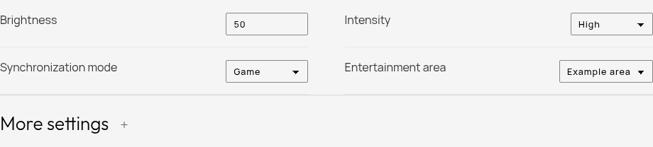

# Hue Sync

Philips' Hue Sync TV app syncs Philips Hue and Ambience lights to what is on the TV's screen. Where the app is installed on the TV, it registers a background service (`com.lighting.huesync.service`); Glasshouse toggles its streaming through that service, so the light can be switched on and off from the web dashboard or Home Assistant without opening the app on the TV or reaching for the Magic Remote.

---

## How Glasshouse supports Hue Sync

### Zero-overhead detection

Hue Sync is optional. Glasshouse inspects the TV filesystem for the app's service bundle (`/media/cryptofs/apps/usr/palm/services/com.lighting.huesync.service`, the retail install from LG's store):

* **If Hue Sync is not installed:** Glasshouse never queries its Luna service, opens no Luna subscription and sends no network requests. Nothing about it appears anywhere.
* **If Hue Sync is installed:** Glasshouse queries its service (`com.lighting.huesync.service/get`) to check whether streaming is active.

### The toggle on the System tab

When Hue Sync is installed, the **System** tab (`/?tab=advanced`) displays an **Ambient light** section with a **Hue Sync streaming** toggle, alongside the PicCap capture row:

* **On:** Instructs Hue Sync's service to start streaming (`com.lighting.huesync.service/set` with `{"key":"streaming","data":true}`). The Ambience light starts following the screen. The app often does not start on an enable without saying so, so Glasshouse sends the enable, waits 3 seconds and asks the app's own state; if it still is not streaming, it sends the enable again, up to three tries in all: one click is enough.
* **Off:** Instructs the service to stop (`data: false`). The Ambience light stops, and the app stops streaming colour with it.

### Home Assistant integration

When Hue Sync is answering on the TV, Glasshouse discovers a **Hue Sync** switch in Home Assistant (`switch.<tv_name>_huesync`) under the **Controls & Media** category:

* **State topic:** `<topicPrefix>/state/huesync/power` publishes `ON` or `OFF` (retained).
* **Command topic:** `<topicPrefix>/command/huesync/power` accepts `ON` or `OFF` (requires `allowControl: true`).
* **Telemetry:** `/api/stats` and telemetry payloads include `huesync.streaming` (`true` or `false`).
* **Dynamic discovery:** If Hue Sync is uninstalled or stops answering, Home Assistant discovery is automatically updated to withdraw the entity.

```yaml
# Start the Ambience light when film night begins
alias: "Living Room: Hue Sync on at film night"
trigger:
  - platform: time
    at: "20:00:00"
action:
  - service: switch.turn_on
    target:
      entity_id: switch.lg_tv_huesync
```

```yaml
# And put the light back to sleep afterwards
alias: "Living Room: Hue Sync off late night"
trigger:
  - platform: time
    at: "23:30:00"
action:
  - service: switch.turn_off
    target:
      entity_id: switch.lg_tv_huesync
```

---

## Setting up Hue Sync

1. Get the Hue Sync app onto the TV and pair it with your Philips Hue or Ambience lights, following the app's own setup.
2. Once the app has registered its service on the TV, Glasshouse notices it on the next check and offers the toggle; nothing is asked of TVs that do not have it.

---

## Using Hue Sync with Glasshouse

### In the Web Dashboard

1. Open the Glasshouse dashboard in any browser.
2. Go to the **System** tab (`/?tab=advanced`).
3. Scroll down to **Ambient light** and click the **Hue Sync streaming** button to start or stop streaming.

### In Home Assistant

The **Hue Sync** switch appears under your TV device and can be used in automations and dashboard cards, as above.

### Via REST API and MQTT

```bash
# Start streaming
curl -X POST http://<tv-ip>:8080/api/control \
  -H "Content-Type: application/json" \
  -d '{"action": "huesync", "value": "on"}'

# Stop streaming
curl -X POST http://<tv-ip>:8080/api/control \
  -H "Content-Type: application/json" \
  -d '{"action": "huesync", "value": "off"}'
```

```bash
# Publish ON or OFF to the command topic
mosquitto_pub -h <broker-ip> -t "tv/command/huesync/power" -m "ON"
```

---

## Configuration options

In `config.json`, the following settings govern Hue Sync:

| Key | Default | Description |
| :--- | :--- | :--- |
| `huesync.pollIntervalMs` | `30000` | How often (in milliseconds) Glasshouse queries the Hue Sync service for Home Assistant state updates while MQTT is connected (minimum `1000`, maximum `600000`). |
| `mqtt.entities.disabled` | `[]` | Add `"huesync"` to this list to permanently disable the Home Assistant entity and stop all background polling for Hue Sync. |

## Sync settings

The web dashboard and TV app's System sections offer brightness (0–100%), intensity
(Subtle, Moderate, High, Extreme), synchronization mode (Video or Game),
entertainment area, background light separately for video and games, and
automatic start, and automatic-start notifications. Streaming, brightness,
intensity, mode and entertainment area are shown directly. Background-light and
startup options are under **More settings**. A setting appears only when the
service returns a valid value.
Area names are displayed as text, with their IDs used for commands; areas sharing
a name remain distinct. The area list is read from the app, not the Hue bridge.

Each change is read back before success is reported. A service refusing or
ignoring a change leaves its actual value visible. Controls require
`allowControl`, like the streaming switch. No extra credentials are needed.

Home Assistant receives a brightness number, intensity/mode/area selects and
four switches. Their command topics are `<topicPrefix>/command/huesync/<key>`;
retained JSON state is `<topicPrefix>/state/huesync/settings`. Keys are
`brightness`, `intensity`, `sync_mode`, `current_ec`,
`background_lightning_video`, `background_lightning_games`, `auto_start` and
`auto_start_notification`.
Direct MQTT accepts numeric brightness/intensity, mode `0` (video) or `1` (game),
area IDs from `ec_list`, and `ON`/`OFF` for switches. Discovery supplies the
friendly intensity and mode labels, and area names with IDs. Unsupported settings
are omitted from discovery instead of becoming zero or off. Temporary failures
keep previously supported controls visible but mark them unavailable using the
`_stale` list in settings state. Writes require a fresh value; they cannot be
confirmed by a retained last-known reading.

A fuller retail-app capture confirms boolean setters for both background-light
settings, automatic start, and automatic-start notifications. The capture
establishes their protocol; Glasshouse still needs testing on a real TV.
Nothing is deployed by the automated tests.

Glasshouse uses the app's `/sub` event stream while MQTT needs Hue Sync or a
dashboard is active. It hydrates state on reconnect and retains the configured
poll interval as reconciliation/fallback. A dashboard consumer expires after
one minute without requests, and no subscription is opened where the app is
absent. Unknown subscription methods fall back to polling.

Settings and streaming writes share one operation slot and refuse writes while
the service reports busy or explicitly not ready. Setting confirmation retries
fresh reads for a bounded period without resending the write. Stopping also
requires a fresh OFF readback; the existing three-attempt enable behavior stays.
Discovery changes only when supported fields or entertainment-area choices do.

Both dashboards show controls without a readiness paragraph. Failed actions
show a brief error. Busy and readiness checks stay internal and disable controls
when needed; Home Assistant exposes only the controls.

Pairing, resets, claim certificates, analytics and logging uploads remain owned
by the retail app. Glasshouse does not invoke those setup or telemetry actions.



The screenshot uses simulated service responses; it is not a hardware test.

On the TV app, use **System → Hue Sync**. Press OK to toggle streaming or cycle
intensity, mode and entertainment area. For brightness, press OK, adjust with
the arrow keys, then press OK or Back to finish. **More settings** opens the
secondary switches; Left or Back returns.
