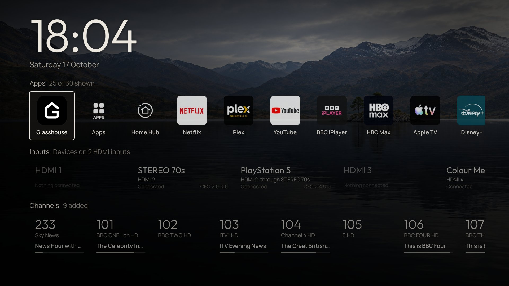
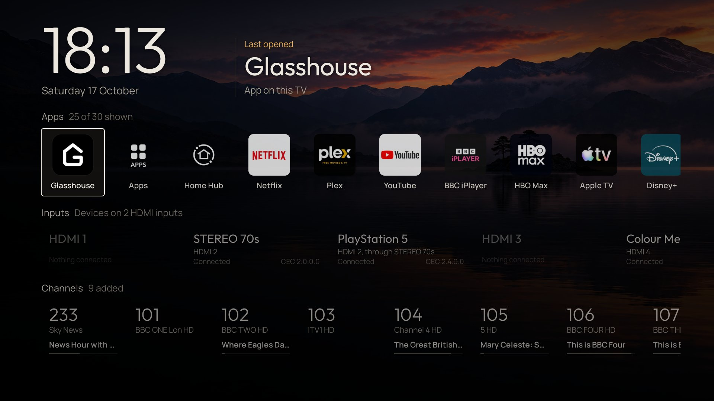

# Glasshouse

**Own the glass.** A dashboard, privacy controls and Home Assistant bridge for rooted LG webOS TVs.

> [!NOTE]
>
> ## You bought the TV.
>
> **It's your TV and you should control it. You own the glass.**
>
> Designed for those who reject their network-connected home appliances being
> used as a platform for advertising, telemetry and vendor-controlled
> experiences, this project brings control, visibility and automation back to
> the device.
>
> It offers multiple ways to remove ads, withdraw from agreements and services
> designed to monetize your data, and make the TV a simpler, more streamlined
> experience — alongside a wide range of useful features, customisation and
> local smart-home integration.
>
> Glasshouse itself is local, transparent, and requires no cloud service.
> No nonsense, no data collection, no ads, no dark patterns. I don't want your data.

**Glasshouse** is a server that runs directly on a rooted LG webOS TV, providing both a live browser dashboard and a dashboard app.

Use it for remote control, app installation and removal, OLED panel care, privacy controls, service menu access, and hardware telemetry. It also includes an MQTT bridge for integrating the TV with Home Assistant and other smart-home software.

### Compatibility at a glance

* **webOS**: 2.2 through 11 (LG's webOS 26) confirmed; tested across 2015–2026 models. Other versions likely work as well. LG names its versions two ways: [webOS version numbers](tested-tvs.md#webos-version-numbers) gives both
* **Panels**: OLED (full panel wear telemetry and burn-in controls) and LCD (core dashboard, controls, and telemetry; OLED Care tab hides automatically)
* **Access**: Rooted via [Homebrew Channel](https://github.com/webosbrew/webos-homebrew-channel). Telnet or SSH. No external dependencies or internet access needed on the TV
* **Tested hardware**: 55 TVs across 38 series verified so far (LF632V, UH600V, UH6030, UH610V, UH635V, B6, B7, B8, C8, LK61, LM57, UM71, UM73, C9, CX, GX, C1, UP80, UP81, QNED82, UQ80, C2, G2, C3, B4, G3, C4, G4, UT73, UT81, C5, G5, CS, LX3, UA73, C6, NU80, QNED84). Other rooted models should work; [see full table](tested-tvs.md)

[Install](install.md){ .md-button .md-button--primary } [See the dashboard](dashboard/index.md){ .md-button }

=== "Web dashboard"

    

      
      &nbsp;
      
       
      Metrics and Control tabs in dark and light themes — served directly from the TV with no cloud or external dependencies.
    

=== "Glasshouse Home"

    

      
      &nbsp;
      
       
      <a href="dashboard/home/">Glasshouse Home</a> replaces LG's ad-heavy launcher with a clean, instant app and input row on the TV.
    

=== "TV app"

    

      
       
      <a href="apps/tv-app/">The TV app</a> puts the same readings and controls on the TV screen itself, driven by the remote.
    

=== "Home Assistant"

    

      
      &nbsp;
      
       
      The TV arrives over <a href="HOME-ASSISTANT/">MQTT Discovery</a> as a single unified device with its controls, sensors, and remote button events.
    

=== "Android app"

    

      
      &nbsp;&nbsp;
      
       
      <a href="apps/android/">Glasshouse for Android</a> keeps a list of TVs, shows which are online, wakes them with Wake-on-LAN, and opens each dashboard full screen.
    

## What it's for

This project is intended to give a rooted webOS TV a useful local control surface instead of requiring the owner to work around the TV's built-in menus, vendor services and cloud dependencies.

-   **[A cleaner Home screen](dashboard/home.md)**

    ---

    A replacement Home app with full control over what displays, and no ads. This feature is currently only available on webOS 7, 9 and 10 TVs.

-   **[Controlling the TV without the cloud](dashboard/control.md)**

    ---

    Remote's keys, volume, inputs, power, sleep timer, comprehensive picture and sound settings, Game Optimizer, and much more.

-   **[Seeing what the TV is configured to collect, and switching it off](dashboard/privacy.md)**

    ---

    One button to turn ads and telemetry off, including LG's content-recognition engine. Every data agreement is recorded in the app, with most of them switchable from the dashboard.

-   **[App management and debloating](dashboard/apps.md)**

    ---

    Install apps from the Homebrew Channel catalog, uninstall apps, disable unnecessary background system services to free up RAM and CPU cycles, stop LG keeping apps loaded in the background that are never used, and hide non-removable built-in LG system apps from LG's Home.

-   **[Remapping the remote's buttons](dashboard/apps.md#remote-keys)**

    ---

    Point Netflix, Prime Video, Guide, the color keys and the TV's other shortcut buttons at any installed app, an HDMI input or Live TV, or turn them off.

-   **[Replacing the screen saver](dashboard/screen-savers.md)**

    ---

    Over a dozen screensavers to choose from, and customisable brightness settings.

-   **[Integrating the TV with a smart home](HOME-ASSISTANT.md)**

    ---

    The MQTT bridge exposes the TV as a single device with its controls and telemetry, with Home Assistant support through MQTT Discovery and the same underlying interface available to other MQTT clients. You can also send button press events to Home Assistant to control your smart home from your TV remote.

-   **[Seeing what the TV is actually doing](dashboard/metrics.md)**

    ---

    SoC temperature, CPU load, memory, Wi-Fi signal and throughput, storage health, watch time and much more.

-   **[Observing OLED panel wear](dashboard/oled-care.md)**

    ---

    Track the lifetime use of your TV with cumulative panel hours, compensation cycle progress, Pixel Refresher countdown with scheduling, completed cycle counters and refresher failure alerts.

-   **[Controlling the OLED burn-in protections](dashboard/oled-care.md)**

    ---

    Surfaces all the burn-in protections, explains what each one does and allows you to switch them off. This includes ASBL and Global Stress Reduction which is normally reachable only from a TV's service menu with a service remote and a PIN.

-   **[Opening the service menu, and unlocking it where it is locked](dashboard/service-menu.md)**

    ---

    LG's own engineering menu, put on the TV screen from a browser which means no service remote is needed. Newer firmware shows a cut-down version of it until it is unlocked, which the dashboard can do as well.

-   **[Reading all of it on the TV itself](apps/tv-app.md)**

    ---

    An optional app on the home screen puts the same readings and controls on the TV, driven by the remote, for when there is no phone or laptop to hand.

-   **[Managing TVs from Android](apps/android.md)**

    ---

    A phone app that keeps a list of TVs, shows which are online, wakes them over Wake-on-LAN, and opens each one's dashboard full screen.

---

## Disclaimer

**Use this software at your own risk.**

* **Root access and hardware.** This runs custom software with `root` privileges on an embedded TV OS. It is designed to be lightweight and to leave the read-only rootfs untouched, but the author accepts **no responsibility** for damage, bootloops, bricked devices, voided warranties, data loss or panel issues.
* **Power and control commands.** Reboot, power off, screen blanking and Pixel Refresher scheduling issue low-level `luna-send` calls. Understand what each does before using it.
* **Trademarks.** An independent, unofficial community project, not affiliated with or endorsed by LG Electronics. webOS is a trademark of LG Electronics.
* **Fonts.** Bundles [Outfit](https://github.com/Outfitio/Outfit-Fonts) and [Manrope](https://github.com/sharanda/manrope) under the [SIL Open Font License 1.1](https://openfontlicense.org/); licence texts ship in `server/assets/fonts/`.

## License

MIT. See [LICENSE](https://github.com/rorygallagher2024/glasshouse/blob/main/LICENSE).
